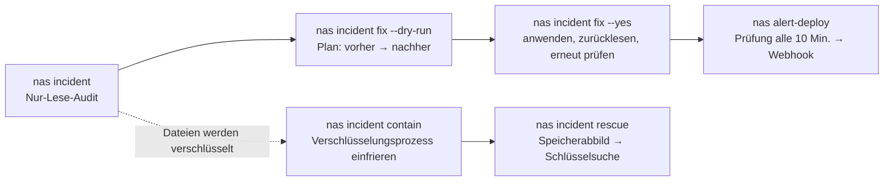

# synology-nas-cli

**Prüfe ein Synology NAS mit einem Befehl auf Schwachstellen und Kompromittierungsindikatoren der Ransomware-Kampagne C3RB3R / `.L0CK3D`, behebe die Befunde mit einem zweiten Befehl und verwalte DSM danach weiter direkt über das Terminal.**

[English](README.md) · [繁體中文](README.zh-TW.md) · [简体中文](README.zh-CN.md) · [日本語](README.ja.md) · [한국어](README.ko.md) · [Deutsch](README.de.md) · [Español](README.es.md) · [Français](README.fr.md)

[](https://gitlab.com/aa22396584/synology-nas-cli/-/releases) [](LICENSE)

Kanonisches Repository, Releases und Issues: https://gitlab.com/aa22396584/synology-nas-cli


`nas` ist ein Python-CLI ohne externe Abhängigkeiten (nur Standardbibliothek, Python 3.8+, läuft daher auch direkt auf DSM selbst) sowie ein stdio-MCP-Server für die Synology DSM 7 Web-API: Systemstatus, Zustand von Laufwerken und Speicherpools, Protokolle, Pakete, Volumes, Tailscale, DSM-Upgrades, zeitgesteuerte Zustands- und Sicherheitswarnungen per Webhook sowie ein Audit- und Reparaturwerkzeug für Sicherheitsvorfälle, entwickelt während der C3RB3R- / `.L0CK3D`-Kampagne im Oktober 2026 gegen über das Internet erreichbare Synology-NAS-Geräte (Synology-SA-24:20, SA-26:13, SA-26:14).

Steht in keiner Verbindung zu Synology Inc. (Not affiliated with Synology Inc.) "Synology", "DSM" und "QuickConnect" sind Marken von Synology Inc.

## Übergabe an deinen KI-Agenten

Füge einen der folgenden Prompts in Claude Code, Codex, Cursor, Gemini CLI, OpenCode, Grok Bot oder einen beliebigen werkzeugfähigen KI-Agenten ein (Grok Bot-Einrichtung, Skills und Alert-Routine: [`docs/GROK-BOT.md`](docs/GROK-BOT.md)):

**Deutscher Prompt:**

```text
Verwende https://github.com/akari-sora/synology-nas-cli, um mein Synology NAS unter https://192.0.2.10:5001 zu prüfen und abzusichern. Folge docs/AGENT-RUNBOOK.md.
```

**Englischer Prompt:**

```text
Use https://github.com/akari-sora/synology-nas-cli to audit and fix my Synology NAS at https://192.0.2.10:5001. Follow docs/AGENT-RUNBOOK.md.
```

### Was der Agent Schritt für Schritt tut

1. **Installation**: Klont das Repository (oder installiert das Paket) und prüft `./bin/nas --version`.
2. **`nas setup`**: Führt `nas setup --json --no-input ...` aus, um `~/.config/synology-nas-cli/config.json` (Modus `0600`) zu schreiben, meldet sich einmalig zur Überprüfung der Zugangsdaten an und speichert beim ersten Verbindungsaufbau den SHA-256-Fingerabdruck des TLS-Zertifikats von DSM (Trust on First Use).
3. **`nas doctor`**: Führt `nas doctor --json` aus, um Konfiguration, Zugangsdaten, Erreichbarkeit des Origins, TLS-Pin, Anmeldung, DSM-Version im Abgleich mit SA-26:13, Status der 2-Stufen-Verifizierung, Administratorberechtigungen und Uhrenabweichung zu prüfen.
4. **`nas incident`**: Führt `nas incident --json` (und optional `--probe --scan`) für ein schreibgeschütztes Audit aus: DSM-Version, verwundbare Pakete, Firewall, QuickConnect, UPnP-Routerregeln, öffentliche Ports, externe und fehlgeschlagene Anmeldungen, AutoBlock, SMB1, das integrierte Konto `admin`, Schnappschuss-Zeitpläne, die WORM-Sperrfalle auf nicht unterstützten Modellen, Erpressernachrichten sowie Ausnutzungsversuche von CVE-2024-10441.
5. **Plan**: Führt `nas incident fix --dry-run --json --ransom-scan` aus und zeigt jede geplante Änderung (`before -> after`), die exakten Aufrufe der DSM Web-API sowie den zugehörigen Pfad in der DSM-Weboberfläche.
6. **`nas incident fix --yes`**: Wendet den bestätigten Plan in der vorgesehenen Reihenfolge an (`snapshot_worm` → `snapshots` → `packages` → `smb_min_protocol` → `quickconnect` → `router_port_forwarding` → `autoblock` → `admin_account` → `firewall`, zuzüglich optional `--rotate-password` und `--upgrade`), liest jede Einstellung zur Verifizierung zurück und führt das Audit erneut aus.
7. **Optional `--deep` und `alert-deploy`**: Führt `nas incident --deep --json` (ein schreibgeschützter Root-Collector über den Aufgabenplaner, der nur für `root` lesbare Protokolle, Crontabs, Binärdateien unter `/bin`, Konten, SSH-Schlüssel und `/proc` prüft) sowie `nas alert-deploy --json --test` (10-minütige Zustands- und Sicherheitsüberwachung mit Push an einen Webhook) aus.

### Was du unterwegs angibst

1. **NAS-Adresse und Konto (einmalig)**:
   - DSM-URL (zum Beispiel `https://192.0.2.10:5001` sowie ggf. eine VPN-/Tailscale-URL).
   - Einen Administrator-Benutzernamen und die Quelle seines Kennworts (`op://VAULT/ITEM/password`, ein Kennwort-Befehl oder der Schlüsselbund des Betriebssystems).
   - Deine LAN-/VPN-Subnetz-CIDR(s), die in der Firewall erlaubt bleiben sollen (zum Beispiel `192.0.2.0/24`).
   - Optional einen Pfad in einem freigegebenen Ordner für temporäre Bereitstellungsdateien (zum Beispiel `/docker/.nas-cli-deploy`, genutzt von `--deep` und `alert-deploy`).
2. **Einen 6-stelligen 2FA-Code (einmalig, falls die 2-Stufen-Verifizierung aktiv ist)**:
   - Wenn `nas setup` sich mit Exit-Code `3` und `"field": "otp"` beendet, gib den aktuellen 6-stelligen Code an; `--trust-device` speichert das Token für vertrauenswürdige Geräte von DSM (`0600`), sodass nachfolgende Befehle keinen Code mehr benötigen.
3. **Planbestätigung**:
   - Prüfe den Dry-Run-Plan, bevor `nas incident fix --yes` ausgeführt wird (und entscheide, ob `--rotate-password` oder `--upgrade` einbezogen werden sollen).

Vollständige Agenten-Spezifikation: [`docs/AGENT-RUNBOOK.md`](docs/AGENT-RUNBOOK.md).



## Was geprüft und behoben wird

`nas incident` arbeitet rein lesend. Jeder Prüfpunkt gibt `PASS`, `WARN`, `FAIL` oder `SKIP` samt einzeiligem Hinweis aus (`--json` liefert strukturiertes JSON; Schema in [`schemas/incident.schema.json`](schemas/incident.schema.json)). Der Exit-Status ist `1`, sobald mindestens ein Punkt `FAIL` meldet.

| Prüfpunkt | Was `nas incident` meldet | Was `nas incident fix` ändert |
|---|---|---|
| `dsm_version` | `FAIL`, wenn der DSM-Build älter als der behobene Build gemäß SA-26:13 für den jeweiligen Zweig ist oder auf einem Zweig ohne SA-26:13-Fix läuft (DSM 7.1 und älter); `PASS`, wenn gepatcht | Mit `--upgrade`: lädt die neueste offizielle `.pat`-Datei für das Modell herunter, führt den PreCheck aus, installiert das Update und startet neu |
| `sa_26_14_packages` | Prüft installierte Pakete gegen Synology-SA-26:14 (Calendar, MailStation, PHP 7.3–8.4): `FAIL`, wenn eine verwundbare Version läuft; `WARN`, wenn sie installiert, aber gestoppt ist | Stoppt laufende verwundbare Pakete (`--only packages`) |
| `firewall` | `FAIL`, wenn die Firewall deaktiviert ist und das NAS selbst eine öffentliche IP hält (z. B. eigene PPPoE-Einwahl), `WARN`, wenn sie hinter NAT deaktiviert ist, oder `FAIL`/`WARN`, wenn Schnittstellen nicht zuordenbaren Datenverkehr zulassen oder Regeln beliebige Quellen erlauben (`source_ip: all`) | Aktiviert die Firewall, fügt Erlaubnisregeln für die `/32`-Adresse dieses Computers (wie von DSM protokolliert) sowie IPv4-`allowed_networks` auf LAN-Schnittstellen hinzu, setzt die Richtlinie jeder Schnittstelle außer `global` auf `drop` und entfernt Regeln, die beliebige Quellen zulassen (`--only firewall`) |
| `quickconnect` | `FAIL`, wenn QuickConnect oder die automatische Router-Portweiterleitung von QuickConnect aktiviert ist | Schaltet QuickConnect und dessen UPnP-Router-Portweiterleitung aus (`--only quickconnect`) |
| `router_port_forwarding` | `FAIL`, wenn DSM UPnP-/NAT-PMP-Portweiterleitungsregeln auf dem Router aktiviert hat | Deaktiviert alle von DSM verwalteten Router-Portweiterleitungsregeln (`--only router_port_forwarding`) |
| `public_ports` | Nur mit `--probe`: baut von diesem Rechner aus TCP-Verbindungen zu DSM- und Dateidienst-Ports auf der öffentlichen IP des NAS auf (`FAIL`, wenn ein Port antwortet) | Abgedeckt durch `firewall`, `quickconnect` und `router_port_forwarding` |
| `external_signins` | `FAIL`, wenn das Verbindungsprotokoll erfolgreiche Anmeldungen von Quelladressen außerhalb von `allowed_networks` enthält | Keine automatische Änderung (unbefugten Zugriff untersuchen; siehe [`docs/INCIDENT-C3RB3R.md`](docs/INCIDENT-C3RB3R.md)) |
| `failed_signins` | `WARN`, wenn fehlgeschlagene Anmeldungen in den letzten `--hours` (Standard `24`) den Schwellenwert `--failed-threshold` (Standard `20`) überschreiten | Eingedämmt durch `firewall` und `autoblock` |
| `autoblock` | `FAIL`, wenn AutoBlock deaktiviert ist | Aktiviert AutoBlock (`10` Versuche innerhalb von `5` Minuten, dauerhafte Blockierung) und setzt die IP dieses Computers sowie IPv4-`allowed_networks` (und `127.0.0.1`, falls `incident.autoblock_allow_loopback` aktiviert ist) auf die Freigabeliste (`--only autoblock`) |
| `smb_min_protocol` | `FAIL`, wenn SMB aktiviert ist und SMB1 zulässt (`smb_min_protocol=0`); `WARN`, wenn SMB deaktiviert, das Mindestprotokoll aber SMB1 ist | Hebt das minimale SMB-Protokoll auf SMB2 an (`smb_min_protocol=1`, `smb_max_protocol=3`) (`--only smb_min_protocol`) |
| `admin_account` | `FAIL`, wenn das integrierte Konto `admin` aktiviert ist (`expired: normal`) | Deaktiviert das integrierte Konto `admin` über eine temporäre Root-Aufgabe, nachdem geprüft wurde, dass ein weiterer aktivierter Administrator existiert und die aktuelle Sitzung nicht `admin` ist (`--only admin_account`) |
| `snapshot_schedule:<share>` | Pro freigegebenem Ordner: `FAIL`, wenn kein Schnappschuss-Zeitplan existiert, der Zeitplan deaktiviert ist oder der neueste geplante Schnappschuss älter als `snapshot_max_age_hours` (Standard `26` Std.) ist | Erstellt einen täglichen Schnappschuss-Zeitplan (Standard `03:30`) und eine 14-tägige Aufbewahrungsrichtlinie für Freigaben, die noch keinen Zeitplan haben; setzt einen sauberen `--ransom-scan` im selben Lauf oder `--i-know-snapshots-may-rotate` voraus (`--only snapshots`) |
| `snapshot_worm:<share>` | `FAIL`, wenn die Sperre für unveränderliche Schnappschüsse (WORM) auf einem Modell aktiviert ist, dessen `SYNO.DisasterRecovery.Retention info` kein `worm` unterstützt (DSM akzeptiert den API-Aufruf, woraufhin geplante Schnappschüsse stillschweigend aussetzen) | Schaltet die nicht unterstützte WORM-Sperre auf betroffenen Freigaben aus, damit geplante Schnappschüsse wieder laufen; gleiche Sicherheitsbedingung wie bei `snapshots` (`--only snapshot_worm`) |
| `ransomware_files` | Nur mit `--scan`: durchsucht Freigaben über die File Station nach `*.L0CK3D`, `*.LOCK3D` und `read-me3.txt` (`FAIL`, sobald ein Treffer gefunden wird) | Keine automatische Änderung (Incident Response erforderlich; siehe [`docs/INCIDENT-C3RB3R.md`](docs/INCIDENT-C3RB3R.md)) |
| `exploit_attempts` | Durchsucht das DSM-Verbindungsprotokoll nach CVE-2024-10441-Injektionsmerkmalen bei der Anmeldung (`PLUGIN_VALUE_END`, `LD_PRELOAD=`, `LD_DEBUG_OUTPUT`) sowie nach `incident.ioc_ips` (`WARN`, wenn Versuche sichtbar sind) | Keine automatische Änderung (mit `--deep` prüfen, ob ein Versuch erfolgreich war) |
| `exploit_attempts_logs`, `ioc_cron`, `ioc_binaries`, `ioc_users`, `ioc_ssh_keys`, `ioc_processes` | Nur mit `--deep`: führt einen schreibgeschützten Root-Collector aus, um `/var/log/synoplugin.log*`, `/var/log/synoscgi.log*`, `/var/log/auth.log*`, Crontabs (`/etc/cron.d/synot*`), `/bin/libgld`, `/bin/qnetd`, `/bin/l0ck.enc`, `xdy5*`, zusätzliche Konten mit UID 0 oder unbekannte Konten, `authorized_keys` sowie Prozesse und Verbindungen unter `/proc` zu prüfen (`FAIL` bei bekannten C3RB3R-Artefakten, `WARN` bei unbekannten Einträgen) | Keine automatische Änderung (Incident Response erforderlich; siehe [`docs/INCIDENT-C3RB3R.md`](docs/INCIDENT-C3RB3R.md)) |

`SKIP` nennt immer den Grund: Der Prüfpunkt benötigt ein Flag (`--probe`, `--scan`), die API hat einen Fehler zurückgegeben oder das NAS nutzt diese Funktion nicht (kein Btrfs/Snapshot Replication, kein Router in DSM konfiguriert).

## Installation

### Aus einem Git-Checkout (ohne Installation)

```bash
git clone https://gitlab.com/aa22396584/synology-nas-cli.git synology-nas-cli
cd synology-nas-cli
./bin/nas --help                     # runs directly from the checkout (Python 3.8+ stdlib only)
ln -s "$PWD/bin/nas" ~/bin/nas       # optional: put `nas` on PATH
```

### Mit `pip` aus einem GitLab-Release oder lokalen Checkout

```bash
pip install https://gitlab.com/aa22396584/synology-nas-cli/-/archive/v1.0.0/synology-nas-cli-v1.0.0.tar.gz
# or from a local checkout:
pip install -e .                     # or: pipx install .
nas --help
```

### Unter Windows (mit `py`)

```powershell
git clone https://gitlab.com/aa22396584/synology-nas-cli.git synology-nas-cli
cd synology-nas-cli
py -3 bin\nas --help
# or install the console script:
py -3 -m pip install -e .
nas --help
```

### Initialisieren und Anmeldung prüfen

Interaktive oder agentengesteuerte Einrichtung in einem Schritt:

```bash
nas setup --origin https://192.0.2.10:5001 --user ops --password-source op:op://VAULT/ITEM/password --allowed-network 192.0.2.0/24
nas doctor
```

Oder erstelle die Konfigurationsdatei aus der Vorlage und bearbeite sie manuell:

```bash
nas config init                      # writes ~/.config/synology-nas-cli/config.json (mode 600)
$EDITOR ~/.config/synology-nas-cli/config.json
nas config show                      # effective config, commands masked
nas whoami                           # one login: account, admin flag, DSM version, credential source
```

## Passendes Setup wählen

| Umgebung | Backend | Kennwortquelle | Hinweise |
|---|---|---|---|
| macOS mit 1Password | `password` | `op://VAULT/ITEM/password`-Referenzen; `op` über die 1Password-App angemeldet | `op` beim ersten Mal in der App bestätigen. 2FA-Codes aus demselben Eintrag (`op item get --otp`). |
| macOS ohne 1Password | `password` | `nas login --save` (Schlüsselbund) oder `password_command` = `security find-generic-password -s synology-nas -a USER -w` | `nas login` speichert zudem die Sitzung im Cache, sodass sich spätere Befehle nicht erneut anmelden müssen. |
| Linux-Server, Cron, systemd-Timer | `password` | 1Password-Dienstkonto (`OP_SERVICE_ACCOUNT_TOKEN` oder die Token-Datei) + `op://`-Referenzen, oder `password_command` (`secret-tool lookup ...`, `pass show ...`) | Kein Terminal: die Eingabeaufforderung ist deaktiviert, daher eine nicht-interaktive Quelle konfigurieren. |
| Windows | `password` | `password_command` mit PowerShell (siehe [Credentials](README.md#credentials)), oder `NAS_USER` + `NAS_PASSWORD` | Zugangsdaten mit dem PowerShell-Modul CredentialManager speichern (`New-StoredCredential`) und in `password_command` mit `Get-StoredCredential` auslesen. |
| Direkt auf dem NAS | `local` | keine: läuft als `root` über den DSM-Aufgabenplaner | Wird von `nas alert-deploy` eingerichtet. Nutzt das in DSM enthaltene Python 3.8. |
| CI / Headless mit Dienstkonto | `password` | `OP_SERVICE_ACCOUNT_TOKEN` (CI-Secret) + `op://`-Referenzen | Oder `NAS_PASSWORD_COMMAND` zum Auslesen des CI-Secret-Speichers. `NAS_PASSWORD` funktioniert ebenfalls. |

## Schnellstart im Ernstfall

```bash
nas incident                       # read-only audit
nas incident --probe               # also test the public address from this machine
nas incident --scan                # also search every share for ransom notes (minutes)
nas incident --deep                # also indicators of compromise via one read-only root script (needs deploy.stage_dir)
nas --json incident                # machine-readable

nas incident fix --dry-run         # the plan: every change (current -> new), the API calls, the DSM UI path
nas incident fix                   # same plan, asks before applying
nas incident fix --yes             # apply without asking
nas incident fix --only firewall,smb_min_protocol
nas incident fix --skip admin_account
nas incident fix --ransom-scan --yes          # a clean scan also allows the snapshot fixes
nas incident fix --upgrade --rotate-password --yes   # opt-in extras

nas incident contain                       # list processes that look like an encryptor (signals nothing without --yes / NAS_YES=1)
nas incident contain --yes                 # SIGSTOP them (all threads) so their memory and keys stay intact
nas incident contain --yes --stop-sync     # also stop Cloud Sync, Synology Drive, Hyper Backup, Container Manager
nas incident contain --yes --save-exe /volumeUSB1/usbshare/evidence   # copy each executable (sha256 recorded)
nas incident contain --release             # SIGCONT the frozen PIDs and start the packages --stop-sync stopped

nas incident rescue --yes --capture-dir /usbshare1/rescue                  # freeze, capture memory, recover key candidates
nas incident rescue --yes --capture-dir /usbshare1/rescue --sample /share/a.pdf.L0CK3D   # test each candidate on a copy
nas incident rescue --yes --capture-dir /usbshare1/rescue --decrypt-from /share/docs --decrypt-to /Volumes/USB/out
```

Während Dateien aktiv verschlüsselt werden, ist `nas incident contain --yes` der erste Befehl: Er friert den Verschlüsselungsprozess ein (`SIGSTOP`, niemals beenden/killen), damit die Sitzungsschlüssel im Arbeitsspeicher erhalten bleiben, und gibt anschließend die nächsten Schritte aus.

- Kandidaten: bekannte Prozessnamen (`libgld`, `qnetd`, `xdy5*`, `incident.ioc_process_names`), ausführbare Dateien in `/tmp`, `/var/tmp`, `/dev/shm`, `/volume*/@tmp`, Prozesse mit zum Schreiben geöffneten Dateien `*.L0CK3D` / `read-me3.txt` sowie hohe CPU-Last außerhalb von Synology-Pfaden (Container ausgenommen). Ein Prozess, dessen ausführbare Datei unter einem Synology-Pfad liegt (`/usr/syno`, `/var/packages`, `/bin`, ...), benötigt neben den geöffneten Dateien ein weiteres Merkmal; der Scan führt ihn unter `skipped` samt dem `--pid`-Flag auf, mit dem er einbezogen werden kann. PID 1, Kernel-Threads sowie das Scan-Skript selbst und seine Elternprozesse erhalten niemals ein Signal, auch nicht mit `--pid`.
- Das Einfrieren sendet Signale exakt an die vom Scan aufgelisteten Prozesse: gleiche PID, gleiche Startzeit (`/proc/PID/stat` Feld 22) und gleiche ausführbare Datei; eine zwischenzeitlich neu vergebene PID wird gemeldet und übersprungen.
- `--stop-sync`: Nach dem Einfrieren wird jedes laufende Paket aus Cloud Sync, Synology Drive, Hyper Backup und Container Manager (bzw. Docker) mit `SYNO.Core.Package.Control stop` angehalten. Das Stoppen von Container Manager hält alle Container an. Die gestoppten Paket-IDs werden in `contain-packages.json` neben dem Sitzungs-Cache auf diesem Computer gespeichert.
- `--release`: Sendet `SIGCONT` an die auf dem NAS vermerkten PIDs (`incident.contain_state_file`) sowie alle per `--pid` angegebenen Prozesse und führt danach `SYNO.Core.Package.Control start` für jedes gespeicherte Paket aus; der Datensatz wird gelöscht, sobald alle Pakete gestartet sind. Es werden Pakete gestartet, keine einzelnen Container: Ein Container läuft wieder an, wenn seine Neustartrichtlinie (Auto-Restart im Container Manager) ihn zusammen mit dem Paket startet.

`nas incident rescue` übernimmt das Erfassen des Arbeitsspeichers und die Schlüsselwiederherstellung mithilfe von [soimy/c3rb3r-rescue](https://github.com/soimy/c3rb3r-rescue), das zur Laufzeit genau auf dem in `incident.rescue_commit` hinterlegten Commit abgerufen wird:

1. `contain`: Das oben beschriebene Einfrieren (`--no-contain` überspringt diesen Schritt).
2. `toolkit`: Klont das Toolkit und prüft den Commit. `--rescue-dir DIR` nutzt einen vorhandenen Checkout, sofern `git status --porcelain` leer ist und HEAD auf diesem Commit steht (`--force-unpinned-toolkit` für jeden anderen Stand).
3. `capture`: Führt als `root` auf dem NAS (über eine temporäre Aufgabe im Aufgabenplaner oder direkt mit `--backend local`) `capture_process_memory.py inspect` und `capture` aus dem Toolkit für jede eingefrorene PID in einen neuen Fallordner unter `--capture-dir` aus. Dieser Ordner muss auf einem USB-Laufwerk oder einem anderen Volume als die betroffenen Daten liegen; Volumes werden anhand der Mount-Quelle in `/proc/self/mountinfo` verglichen (jeder freigegebene Btrfs-Ordner ist ein eigenes Subvolume mit eigener Gerätenummer, weshalb Gerätenummern Volumes nicht unterscheiden); `--force-same-volume` erlaubt die Aufzeichnung auf demselben Volume. Ein `--capture-dir` mit einem Symlink im Pfad wird abgelehnt. Mit `--backend password` wird das Capture-Skript über `deploy.stage_dir` übertragen (DSM lehnt ein Aufgaben-Skript, das den Code inline enthält, mit Fehler 4803 ab) und nur dann (über stdin) ausgeführt, wenn sein SHA-256-Hash mit der hochgeladenen Datei übereinstimmt. Anschließend wird der Fallordner an das angemeldete DSM-Konto übergeben (`id -u`, `chown`), damit die File Station ihn auflisten und herunterladen kann.
4. `pull`: Lädt das Speicherabbild in das Arbeitsverzeichnis auf diesem Computer herunter, nachdem dort der freie Speicherplatz geprüft wurde (lesbare Bytes des Abbilds plus 256 MiB); mit `--backend local` wird ein Arbeitsverzeichnis auf der Systempartition des NAS abgelehnt. `--keep-on-nas` beendet den Ablauf nach der Aufzeichnung.
5. `venv`: Erstellt eine virtuelle Umgebung (Python gemäß `incident.rescue_min_python`, 3.11, oder `--python`) und installiert die Abhängigkeiten des Toolkits per `pip --require-hashes`: Die SHA-256-Prüfsummen aller PyPI-Dateien von numpy 2.3.5, cryptography 50.0.2, cffi 2.1.1 und pycparser 3.12 sind für den gepinnten Commit in `nas/rescue.py` hinterlegt; andere Stände werden mit `--force-unpinned-toolkit` ohne Hash-Prüfung installiert. Danach laufen die Selbsttests des Toolkits.
6. `keys`: Führt `recover_process_key.py` auf jedem Speicherabbild aus; Schlüsselkandidaten werden als Dateien mit Modus 400 abgelegt und niemals ausgegeben. Ein Prozess, der nicht dem geprüften Verschlüsselungsprofil entspricht, bricht hier mit `ValueError: Executable does not match the reviewed sample profile` ab.
7. `sample` (`--sample NAS_FILE [--expected-sha256 HEX]`): Kopiert die Datei und testet jeden Schlüsselkandidaten an der Kopie.
8. `decrypt` (`--decrypt-from NAS_FOLDER --decrypt-to DIR`): Entschlüsselt Kopien mit dem verifizierten Kandidaten (`--force-unverified-key`: verwendet den ersten Kandidaten, wenn keiner per `--sample` verifiziert wurde).

`--force` aktiviert `--force-same-volume`, `--force-unverified-key` und `--force-unpinned-toolkit` gleichzeitig.

Jeder Schritt wird in `<workdir>/state.json` protokolliert (`--workdir`, Standard `~/.local/share/synology-nas-cli/rescue/<time>`); derselbe Befehl setzt genau dort fort, wo er unterbrochen wurde. Was dabei auf das NAS geschrieben wird:

- Der Fallordner `--capture-dir/case-<time>-<random>/pid-N` (bleibt erhalten; gehört dem angemeldeten Konto; lösche ihn, sobald das Abbild an einem anderen Ort gesichert ist). Das Capture-Werkzeug läuft aus stdin (den verifizierten Bytes); es wird keine Kopie davon in den Fallordner geschrieben. Der `chown`/`chmod`-Durchlauf arbeitet über Dateideskriptoren mit `O_NOFOLLOW` und lässt Symlinks unberührt. Bei Tests auf einem freigegebenen Ordner in DSM wurden mit Modus 0700 erstellte Ordner anschließend als 0755 aufgelistet (Dateien behielten 0400); prüfe daher, wer Lesezugriff auf diesen freigegebenen Ordner hat.
- Mit `--backend password`: Das hochgeladene Werkzeug `deploy.stage_dir/nas-rescue-tool-<random>.py` und die Ergebnisdatei `deploy.stage_dir/nas-incident-rescue-<token>.json` (beide werden nach dem Lauf gelöscht) sowie die temporäre Root-Aufgabe `nas-incident-rescue` (wird nach dem Lauf gelöscht).
- Beim Schritt `contain`: Die temporäre Aufgabe `nas-incident-contain` und ihre Ergebnisdatei (werden gelöscht) sowie die Statusdatei des Einfriervorgangs `incident.contain_state_file` (`/root/.nas-incident-contain.json`), die durch `nas incident contain --release` entfernt wird.

JSON: [`schemas/incident-rescue.schema.json`](schemas/incident-rescue.schema.json).

Wenn das Audit `ransomware_files FAIL` oder `external_signins FAIL` zeigt, reicht eine reine Härtung nicht mehr aus: Folge [`docs/INCIDENT-C3RB3R.md`](docs/INCIDENT-C3RB3R.md) (zuerst isolieren, Beweise sichern, aus Schnappschüssen wiederherstellen).

## `nas incident fix`

Führt das Audit aus, gibt den Plan aus, fragt nach einer Bestätigung (`--yes`, `NAS_YES=1` oder `assume_yes: true` bestätigen automatisch; ohne Terminal und ohne diese Optionen beendet sich der Befehl mit Exit-Code 3 und `Not applied: add --yes (or NAS_YES=1).`), wendet die Änderungen in der unten genannten Reihenfolge an, liest jede Einstellung zurück, führt das Audit erneut aus und gibt den Vergleich vorher -> nachher aus. `--dry-run` zeigt den Plan und die exakten API-Aufrufe an, ohne Schreiboperationen zu senden. Der Exit-Status ist 1, wenn eine Änderung fehlschlägt oder das abschließende Audit weiterhin ein FAIL aufweist.

Reihenfolge: `snapshot_worm` -> `snapshots` -> `packages` -> `smb_min_protocol` -> `quickconnect` -> `router_port_forwarding` -> `autoblock` -> `admin_account` -> `firewall` -> `rotate_password` (Opt-in) -> `upgrade` (Opt-in, startet neu).

| Fix | Was geändert wird | DSM-Weboberfläche (manuell) | Direkter Aufruf (`nas api ... --allow-write`) |
|---|---|---|---|
| `snapshot_worm` | Schaltet die Sperre für unveränderliche Schnappschüsse (WORM) auf Freigaben aus, bei denen das Modell keine unveränderlichen Schnappschüsse unterstützt (gleiche Sicherheitsbedingung wie bei `snapshots`: der Zeitplan der Freigabe nimmt danach wieder Schnappschüsse auf) | Snapshot Replication > Snapshots > Settings (die Option ist auf nicht unterstützten Modellen ausgeblendet, daher ist die API der einzige Weg) / (Snapshot Replication > Schnappschüsse > Einstellungen) | `SYNO.DisasterRecovery.Retention set_worm_lock --version 1 type=Share name=SHARE worm_lock_enable=false worm_lock_day=7` |
| `snapshots` | Erstellt einen täglichen Zeitplan (`incident.snapshot_hour:minute`) für Freigaben ohne Zeitplan, samt Aufbewahrung nach Tagen (`incident.snapshot_retain_days`, 14), sofern die Freigabe noch keine Aufbewahrungsrichtlinie hat. Vorhandene Zeitpläne (aktiviert oder deaktiviert) und bestehende Aufbewahrungsregeln bleiben unverändert. Läuft nach einem sauberen `--ransom-scan` im selben Durchlauf oder mit `--i-know-snapshots-may-rotate` / `--force`: Sobald neue Schnappschüsse erstellt werden, greift die Aufbewahrungsrichtlinie und löscht die ältesten Schnappschüsse | Snapshot Replication > Snapshots > select the share > Settings > Schedule / Retention Policy (Snapshot Replication > Schnappschüsse > Freigabe wählen > Einstellungen > Zeitplan / Aufbewahrung) | `SYNO.Core.Share.Snapshot set_schedule --version 1 name=SHARE enable_snapshot_schedule=true 'schedule={...}' task_id=-1` und danach `SYNO.DisasterRecovery.Retention set --version 1 name=SHARE type=Share policyType=64 retainDay=14 ...` |
| `packages` | Stoppt laufende, in SA-26:14 genannte Pakete (aktualisiere oder deinstalliere sie anschließend selbst) | Package Center > Installed > package > Update or Stop (Paket-Zentrum > Installiert > Paket > Aktualisieren oder Stoppen) | `SYNO.Core.Package.Control stop --version 1 id=PHP7.4` |
| `smb_min_protocol` | Setzt das minimale SMB-Protokoll auf SMB2 (reine SMB1-Clients verlieren den Zugriff) | Control Panel > File Services > SMB > Advanced Settings (Systemsteuerung > Dateidienste > SMB > Erweiterte Einstellungen) | `SYNO.Core.FileServ.SMB set --version 3 smb_min_protocol=1 smb_max_protocol=3` |
| `quickconnect` | Schaltet QuickConnect sowie dessen automatische Router-Portweiterleitung aus | Control Panel > External Access > QuickConnect (Systemsteuerung > Externer Zugriff > QuickConnect) | `SYNO.Core.QuickConnect set --version 2 enabled=false`; `SYNO.Core.QuickConnect.Upnp set --version 1 enabled=false` |
| `router_port_forwarding` | Deaktiviert (löscht nicht) die Router-Portweiterleitungsregeln, die DSM über UPnP/NAT-PMP verwaltet | Control Panel > External Access > Router Configuration (Systemsteuerung > Externer Zugriff > Routerkonfiguration); prüfe zusätzlich die Konfigurationsoberfläche des Routers selbst | `SYNO.Core.PortForwarding.Rules save --version 1 'rules=[...enable:false...]' task_id_suffix=PF`, Statusabfrage über `save_status` |
| `autoblock` | Schaltet AutoBlock ein (10 Versuche / 5 Min.); setzt die Adresse dieses Computers (wie von DSM protokolliert), die IPv4-`allowed_networks` sowie nur bei gesetztem `incident.autoblock_allow_loopback` auch `127.0.0.1` auf die Freigabeliste | Control Panel > Security > Protection > Auto Block; Allow/Block List (Systemsteuerung > Sicherheit > Schutz > Automatische Blockierung; Freigabe-/Blockierungsliste) | `SYNO.Core.Security.AutoBlock set --version 1 enable=true attempts=10 within_mins=5 enable_expire=false expire_day=0`; `SYNO.Core.Security.AutoBlock.Rules create --version 1 type=allow block_days=0 overwrite=true 'ip=["127.0.0.1"]'` |
| `admin_account` | Deaktiviert das integrierte Konto `admin`. Prüft zuvor, ob das CLI als `admin` angemeldet ist, welches Konto eine übergebene `NAS_SID`-Sitzung nutzt (`SYNO.Core.Desktop.Initdata`) und ob ein weiteres aktiviertes Mitglied der Gruppe `administrators` existiert; `--force-admin` (oder `--force`) wendet die Änderung unabhängig von diesen Prüfungen an. Da `SYNO.Core.User set` in einer Kennwort-Sitzung mit Fehler 105 antwortet, erfolgt die Ausführung als `root` über eine temporäre Aufgabe im Aufgabenplaner, die anschließend gelöscht wird | Control Panel > User & Group > admin > Edit > Disable this account (Systemsteuerung > Benutzer und Gruppe > admin > Bearbeiten > Dieses Konto deaktivieren) | Root-Aufgabenskript: `/usr/syno/bin/synowebapi --exec api=SYNO.Core.User method=set version=1 name='"admin"' expired='"now"'` (mit `--backend local`: `SYNO.Core.User set --version 1 name=admin expired=now`) |
| `firewall` | Aktiviert die Firewall; setzt Erlaubnisregeln (die `/32`-Adresse dieses Computers laut DSM-Protokoll + IPv4-`allowed_networks`) auf die LAN-Schnittstellen (`global` nur dann, wenn das Profil keine LAN-Schnittstelle enthält); jede Schnittstelle außer `global` (eth*, pppoe, ppp0, vpn, wlan0, ...) verwirft nicht zuordenbaren Datenverkehr (`drop`); Regeln, die beliebige Quellen erlauben, werden entfernt | Control Panel > Security > Firewall > Edit Rules (Systemsteuerung > Sicherheit > Firewall > Regeln bearbeiten) | `SYNO.Core.Security.Firewall.Profile set --version 1 'profile={...}' profile_applying=false`, danach `SYNO.Core.Security.Firewall.Profile.Apply start --version 1 name=default profile_applying=false`, Statusabfrage mit `status task_id=...`, `stop` |
| `rotate_password` (`--rotate-password`) | Erzeugt ein neues zufälliges Kennwort mit 24 Zeichen für das angemeldete Konto. Wird zuerst in den Speicher geschrieben (1Password-Eintrag via `op item edit` über stdin, wobei der alte Wert in der Eintragshistorie erhalten bleibt; oder Schlüsselbund-Eintrag, wobei der alte Wert nach `<store_service>-previous` kopiert wird) und anschließend in DSM geändert; lehnt DSM die Änderung ab, wird das alte Kennwort im Speicher wiederhergestellt; wird der DSM-Aufruf unterbrochen, behält der Speicher das neue Kennwort. Anschließend wird es zurückgelesen und eine frische Anmeldung verifiziert. Das Kennwort wird niemals ausgegeben. Schreibt in 1Password oder den Schlüsselbund; stammt das Kennwort aus einem Befehl, einer Umgebungsvariable oder einer Eingabeaufforderung, ändere es in DSM und in der jeweiligen Quelle selbst | Personal > Account > change password (Persönlich > Konto) | `SYNO.Core.NormalUser set --version 2 password=... old_password=...` |
| `upgrade` (`--upgrade`) | Lädt die neueste offizielle `.pat`-Datei herunter, lädt sie auf das NAS hoch, führt den PreCheck aus und installiert sie; das NAS startet neu | Control Panel > Update & Restore > Manual DSM Update (Systemsteuerung > Aktualisieren & Wiederherstellen > Manuelle DSM-Aktualisierung) | `nas upgrade --yes` |

**Firewall-Aussperrschutz.** Vor einer Änderung an der Firewall prüft das CLI folgende Punkte und führt sie im Plan auf: ob HTTP(S)-Proxys für den Origin konfiguriert sind; ob der Origin eine Loopback-Adresse (SSH-Tunnel, lokaler Proxy) oder eine öffentliche Adresse ist; ob die neueste erfolgreiche Anmeldung dieses Kontos im DSM-Verbindungsprotokoll eine Loopback-, IPv6- oder öffentliche Quelladresse zeigt; oder ob diese protokollierte Quelladresse von der lokalen Adresse abweicht, die dieser Computer zum Erreichen des NAS nutzt (NAT, Proxy oder eine Anmeldung von einem anderen Gerät). Schlägt eine dieser Prüfungen fehl, wartet die Änderung auf `--force-firewall` (oder `--force`), womit sie samt Prüfergebnis im Planhinweis dennoch angewendet wird. Die Freigabeliste enthält die von DSM protokollierte Adresse. Nach dem Anwenden meldet sich das CLI über denselben Origin komplett neu an; schlägt dies fehl, gibt es Schritte zur Wiederherstellung aus: ein anderer Computer im LAN, Synology Assistant / find.synology.com, der Userspace-Modus von Tailscale (DSM sieht `127.0.0.1`, was die Firewall in Tests nicht gefiltert hat) sowie die RESET-Taste am Gehäuse (Modus 1). IPv6-Einträge in der Freigabeliste werden nicht als Firewallregeln geschrieben, sodass IPv6-Quellen verworfen werden. `100.64.0.0/10` (Tailscale) ist zugleich der Adressbereich, den CGNAT-ISPs auf der WAN-Seite nutzen: Auf einem NAS mit eigener PPPoE-Einwahl würde eine `global`-Erlaubnisregel für diesen Bereich auch andere Kunden desselben ISPs durchlassen – deshalb werden die Regeln auf den LAN-Schnittstellen angelegt.

**Ein NAS mit eigener öffentlicher IP-Adresse** (eigene PPPoE-Einwahl oder Betrieb in einer DMZ) hat kein Router-NAT vor sich: Die DSM-Firewall ist in diesem Fall die einzige Schicht zwischen sämtlichen DSM-Diensten und dem Internet. QuickConnect und UPnP-Portweiterleitungen öffnen DSM selbst hinter einem NAT für das Internet.

## MCP-Server und Agent-Skills

### MCP-Server (`nas mcp`)

`nas mcp` startet einen Model-Context-Protocol-Server über stdio (JSON-RPC 2.0; Protokollversionen `2025-11-25`, `2025-06-18`, `2025-03-26`, `2024-11-05`) mit 15 Werkzeugen: `setup`, `doctor`, `whoami`, `status`, `health`, `net`, `services`, `logs`, `alert`, `incident_audit`, `incident_fix`, `pkg_list`, `volume_list`, `tailscale_status` und `api_read`.

```bash
claude mcp add synology-nas --scope user -- /path/to/synology-nas-cli/bin/nas mcp
claude mcp add synology-nas --scope user -- /path/to/synology-nas-cli/bin/nas mcp --auto-confirm
```

`incident_fix` wendet seinen Plan an, wenn ein Aufruf `confirm: true` übergibt oder wenn auf einem mit `--auto-confirm` gestarteten Server kein `confirm` angegeben ist; `confirm: false` ist immer ein Dry-Run. `NAS_YES` und `assume_yes` beeinflussen MCP-Aufrufe nicht. Das Werkzeug `setup` füllt Felder aus, die in der Konfiguration noch nicht gesetzt sind, und akzeptiert die Zugangsdatenquellen `op:`, `keychain` und `env`; das Ändern bereits wirksamer Werte (aus Konfigurationsdatei, Umgebungsvariablen wie `NAS_ORIGINS` oder `--lan-origin` des Servers) für `origins`, `user`, `password_source`, `otp_source`, `tls`, `allowed_networks`, `stage_dir` oder `webhook_file` sowie `command:`-Quellen erfolgt über `nas setup` auf der Kommandozeile (das Werkzeug antwortet mit Exit-Code 2 und nennt das betreffende Feld). Integrierte Standardwerte (`tls` `pin`, `otp_source` `op`) gelten nicht als bereits gesetzt; öffentliche Einträge in `allowed_networks` werden über die Kommandozeile hinzugefügt. Felder wie `user`, `descr`, Protokoll-`text`, `cmdline` und Dateinamen enthalten Text, der von denjenigen stammt, die Anmeldeversuche an das NAS senden oder dort Prozesse ausführen.

Vollständige Werkzeugliste, Schemas und Konfiguration für Claude Code, Claude Desktop, Cursor und Codex: [`docs/MCP.md`](docs/MCP.md).

### Installer für Agent-Skills

Der Ordner [`skills/`](skills/) enthält [`skills/synology-nas/SKILL.md`](skills/synology-nas/SKILL.md) und [`skills/synology-ransomware-response/SKILL.md`](skills/synology-ransomware-response/SKILL.md). Installiere sie in vorhandene Skill-Verzeichnisse (`~/.claude/skills`, `~/.cursor/skills`, `~/.codex/skills`, `~/.agents/skills`, `~/.grok/skills`, `~/.gemini/skills`, `~/.config/opencode/skills`, `~/.hermes/shared-skills`):

```bash
./skills/install.sh                  # symlink skills into detected agent folders
./skills/install.sh --copy           # copy instead of symlink (--dry-run, --uninstall also available)
```

Unter Windows PowerShell:

```powershell
.\skills\install.ps1                 # supports --copy, --dry-run, --uninstall
```

## Warnmeldungen und Webhooks

`nas alert` führt alle Zustands- und Sicherheitsprüfungen einmalig aus und beendet sich mit Exit-Code 1, sobald ein Befund die Stufe Warnung oder Kritisch erreicht. Jeder Befund hat das Format `{level, code, kind, message}`. Mit `--push FILE` sendet der Befehl per POST nur die Änderungen seit dem letzten erfolgreichen Push an `{"url", "header"}` aus FILE: neue Zustände, alle 24 Stunden eine Erinnerung für weiterhin bestehende Warn-/kritische Zustände, jedes Einzelereignis, behobene Schlüssel sowie einmal täglich einen Heartbeat. Codes, Payload-Format und Empfängerbeispiele stehen in [`docs/ALERTS.md`](docs/ALERTS.md).

Drei Möglichkeiten zur Ausführung:

1. **Automatisch auf dem NAS eingerichtet:** `nas alert-deploy` kopiert den Code in einen nur für `root` zugänglichen Ordner (`deploy.root_dir`), legt im Aufgabenplaner eine Root-Aufgabe an, die alle 10 Minuten `nas --backend local alert --push` ausführt, und richtet den DSM-eigenen Benachrichtigungs-Webhook (Control Panel > Notification > Webhooks / Systemsteuerung > Benachrichtigung > Webhooks) auf dieselbe URL ein.
2. **Manuell auf dem NAS:** Dieselben drei Schritte über die DSM-Weboberfläche. Anleitung in [`docs/ALERTS.md`](docs/ALERTS.md#manual-install-on-the-nas).
3. **Von einem anderen dauerhaft laufenden Rechner:** Cron oder launchd führt `nas alert --push ...` mit dem Backend `password` aus. Siehe [`docs/ALERTS.md`](docs/ALERTS.md#from-another-machine-cron--launchd).

Empfänger: jeder HTTPS-Endpunkt, der einen JSON-POST mit einem Header entgegennimmt (generischer JSON-Empfänger), ein Chatbot-„Routine“-Webhook, der pro POST einen Agentenlauf startet (wie bei Grok Bot), oder ganz ohne Webhook: Die integrierten DSM-Benachrichtigungen (E-Mail, Synology Mobile Push über DS finder / die Synology-App) decken die DSM-eigenen Warn- und Fehlerereignisse ab. Alle drei Varianten sind in [`docs/ALERTS.md`](docs/ALERTS.md#receivers) beschrieben.

## Welche Befehle das NAS verändern

- Befehle, die Änderungen am NAS vornehmen: `incident fix` (fragt nach, oder mit `--yes`), `incident contain` (`SIGSTOP` mit `--yes`; `--stop-sync` stoppt Pakete; `--release`), `incident rescue` (fragt nach, oder mit `--yes`: Einfrieren, temporäre Root-Aufgaben, Capture-Ordner), `upgrade` (ohne `--yes` wird die `.pat`-Datei dennoch hochgeladen, der PreCheck ausgeführt und der Upload wieder gelöscht; `--yes` installiert das Update), `pkg start|stop|install|uninstall|default-volume VOL`, `volume atime`, `tailscale login-url`, `alert-deploy`, `login --save` / `logout --forget` (nur lokaler Schlüsselbund), `trust --reset` (lokale Datei) sowie `api` mit `--allow-write`. `ransom-scan`, `incident --scan` und `incident fix --ransom-scan` legen temporäre File-Station-Suchaufgaben auf dem NAS an (die anschließend gestoppt und bereinigt werden). `nas api` sendet Methoden, die keine reinen Leseabfragen sind, nur mit `--allow-write`, `--yes` oder `NAS_YES=1`.
- `--yes`, `NAS_YES=1` und `assume_yes: true` in der Konfiguration bestätigen jede Rückfrage des CLI: `incident fix` wendet seinen Plan an (mit `--upgrade` wird DSM installiert und das NAS neu gestartet, auch wenn der PreCheck Hinweise enthält; mit `--rotate-password` wird das Kennwort geändert); `upgrade` installiert nach dem PreCheck und startet das NAS neu; `incident contain` friert die Kandidaten ein (und stoppt mit `--stop-sync` die Pakete); `incident rescue` führt seine Schritte aus; `api` sendet Schreibmethoden wie mit `--allow-write`. `nas mcp` bezieht die Bestätigung aus dem Parameter `confirm` des jeweiligen Aufrufs sowie aus `--auto-confirm`, nicht aus diesen Einstellungen.
- `incident fix --dry-run` gibt jeden Schreibaufruf aus, der gesendet würde. Der Plan zeigt stets die Werte `current -> new`.
- Kennwörter, SIDs und SynoTokens werden niemals ausgegeben. `nas api` gibt die unveränderte DSM-Antwort aus, die Seriennummern und Kontonamen enthalten kann; alle anderen Befehle filtern diese Angaben heraus.
- Jede fehlgeschlagene Kennwort-Anmeldung zählt für AutoBlock; das CLI meldet eine fehlgeschlagene Anmeldung einmalig und bricht sofort ab.
- `alert-deploy` installiert Code, der als `root` auf dem NAS in einem nur für `root` zugänglichen Ordner außerhalb der freigegebenen Ordner ausgeführt wird.

## Konfiguration, Zugangsdaten, TLS, Backends und Befehlsreferenz

Alle Details zur JSON-Konfigurationsdatei (`~/.config/synology-nas-cli/config.json`) und den Umgebungsvariablen ([Configuration](README.md#configuration)), zur Prioritätskette der Zugangsdaten mit 1Password, externen Befehlen, System-Schlüsselbund, 2-Stufen-Verifizierung und Sitzungs-Cache ([Credentials](README.md#credentials)), zum TLS-Zertifikats-Pinning nach dem Prinzip „Trust on First Use“ und zu AutoBlock ([TLS](README.md#tls)), zu den drei Backends `password`, `chrome` und `local` ([Backends](README.md#backends)) sowie die vollständige Befehlsübersicht ([Command reference summary](README.md#command-reference-summary)) finden sich in der englischen Hauptdokumentation.

### Dokumentationsverzeichnis

- [`docs/AGENT-RUNBOOK.md`](docs/AGENT-RUNBOOK.md) — Schritt-für-Schritt-Ablauf für KI-Agenten (`setup` → `doctor` → `incident` → `incident fix` → `--deep` → `alert-deploy`).
- [`docs/INCIDENT-C3RB3R.md`](docs/INCIDENT-C3RB3R.md) — Öffentliche Incident-Response-Seite zur Ransomware-Kampagne C3RB3R / `.L0CK3D` (2026), Sicherheitshinweise, Zeitachse, IOCs, Entscheidungsschritte, Wiederherstellung und Prävention.
- [`docs/HARDENING.md`](docs/HARDENING.md) — Checkliste zur Sicherheits-Härtung von Synology DSM mit belegten Erläuterungen, DSM-Menüpfaden auf Englisch / 繁體中文 und den passenden `nas`-Befehlen.
- [`docs/TROUBLESHOOTING.md`](docs/TROUBLESHOOTING.md) — Lösungen bei Aussperrung durch Firewall, AutoBlock oder 2FA, Mode-1-Reset, Reverse-Proxys und Tailscale `127.0.0.1`, Modellen ohne WORM-Unterstützung, dem Google-Drive-Tageslimit von 750 GB, SMB1-Geräten, DSM-API-Fehlercodes, vermeintlich aktuellen DSM-Versionszweigen („up to date“-Falle) sowie dem Zurücksetzen gespeicherter TLS-Pins.
- [`docs/MCP.md`](docs/MCP.md) — Werkzeuge, Argumente, Schemas und Client-Einrichtung des MCP-Servers.
- [`docs/GROK-BOT.md`](docs/GROK-BOT.md) — Grok Bot: Betrieb von `nas` auf dem Cloud-Computer des Bots (über Tailscale) oder auf einem Rechner mit der Grok Bot-App, Skills, dem Webhook für die Alert-Routine und einer Bot-Beschreibung.
- [`docs/ALERTS.md`](docs/ALERTS.md) — Alert-Codes, Webhook-Payload, Empfänger und Bereitstellung (`alert-deploy`, manuelle DSM-Aufgabe, Cron/launchd).
- [`docs/DSM-API-NOTES.md`](docs/DSM-API-NOTES.md) — Besonderheiten der DSM 7 Web-API und Regeln zur Parameterkodierung, auf die sich `nas` stützt.
- [`docs/EXIT-CODES.md`](docs/EXIT-CODES.md) — Definitionen der CLI-Exit-Codes und `_meta.exit_code`-Werte im MCP-Server (`0`–`7`, `130`).
- [`schemas/`](schemas/) — JSON-Schemas für `incident`, `incident-fix`, `incident-contain`, `incident-rescue`, `alert`, `status`, `health` und `whoami`.
- [`llms.txt`](llms.txt) — Einstiegsindex für LLM-Agenten.

## Lizenz

MIT, Copyright (c) 2026 Akari Sora. Siehe [LICENSE](LICENSE).
