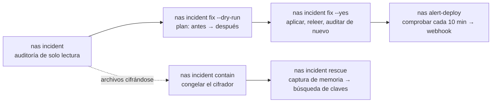

# synology-nas-cli

**Audite un Synology NAS frente a la campaña de ransomware C3RB3R / `.L0CK3D` con un comando, corrija lo que encuentre con un segundo y siga administrando DSM desde la terminal después.**

[English](README.md) · [繁體中文](README.zh-TW.md) · [简体中文](README.zh-CN.md) · [日本語](README.ja.md) · [한국어](README.ko.md) · [Deutsch](README.de.md) · [Español](README.es.md) · [Français](README.fr.md)

[](https://gitlab.com/aa22396584/synology-nas-cli/-/releases) [](LICENSE)

Repositorio canónico, versiones e incidencias: https://gitlab.com/aa22396584/synology-nas-cli


`nas` es una CLI en Python sin dependencias externas (solo biblioteca estándar, Python 3.8+, por lo que también se ejecuta en el propio DSM) y un servidor MCP por stdio para la API web de Synology DSM 7: estado, salud, registros, paquetes, volúmenes, Tailscale, actualizaciones de DSM, alertas de salud programadas enviadas a un webhook y una herramienta de auditoría y remediación de incidentes creada durante la campaña de octubre de 2026 de C3RB3R / `.L0CK3D` contra equipos Synology NAS expuestos a Internet (Synology-SA-24:20, SA-26:13, SA-26:14).

No afiliado a Synology Inc. "Synology", "DSM" y "QuickConnect" son marcas comerciales de Synology Inc.

## Entrégueselo a su agente

Pegue este prompt en Claude Code, Codex, Cursor, Gemini CLI, OpenCode, Grok Bot o cualquier agente de IA con uso de herramientas (configuración de Grok Bot, habilidades y rutina de alertas: [`docs/GROK-BOT.md`](docs/GROK-BOT.md)):

```text
Usa https://github.com/akari-sora/synology-nas-cli para auditar y reparar mi Synology NAS en https://192.0.2.10:5001. Sigue docs/AGENT-RUNBOOK.md.
```

### Qué hace el agente, paso a paso

1. **Instalación**: Clona el repositorio (o instala el paquete) y verifica `./bin/nas --version`.
2. **`nas setup`**: Ejecuta `nas setup --json --no-input ...` para escribir `~/.config/synology-nas-cli/config.json` (modo `0600`), inicia sesión una vez para verificar las credenciales y fija la huella SHA-256 del certificado TLS de DSM en el primer uso.
3. **`nas doctor`**: Ejecuta `nas doctor --json` para verificar la configuración, las credenciales, la accesibilidad del origen, el pin TLS, el inicio de sesión, la versión de DSM frente a SA-26:13, el estado de la verificación en 2 pasos, los permisos de administrador y el desfase del reloj.
4. **`nas incident`**: Ejecuta `nas incident --json` (y opcionalmente `--probe --scan`) para realizar una auditoría de solo lectura de la versión de DSM, paquetes vulnerables, cortafuegos, QuickConnect, reglas UPnP del enrutador, puertos públicos, inicios de sesión externos y fallidos, AutoBlock, SMB1, la cuenta `admin` integrada, programaciones de instantáneas, la trampa del bloqueo WORM en modelos no compatibles, notas de rescate e intentos de explotación de CVE-2024-10441.
5. **Plan**: Ejecuta `nas incident fix --dry-run --json --ransom-scan` y muestra cada cambio previsto (`before -> after`), las llamadas exactas a la API web de DSM y la ruta correspondiente en la interfaz web de DSM.
6. **`nas incident fix --yes`**: Aplica el plan aprobado en orden (`snapshot_worm` → `snapshots` → `packages` → `smb_min_protocol` → `quickconnect` → `router_port_forwarding` → `autoblock` → `admin_account` → `firewall`, además de los opcionales `--rotate-password` y `--upgrade`), vuelve a leer cada ajuste para verificarlo y ejecuta de nuevo la auditoría.
7. **`--deep` y `alert-deploy` opcionales**: Ejecuta `nas incident --deep --json` (un recolector root de solo lectura mediante el Programador de tareas que revisa registros exclusivos de root, crontabs, binarios en `/bin`, cuentas, claves SSH y `/proc`) y `nas alert-deploy --json --test` (supervisión de salud y seguridad cada 10 minutos enviada a un webhook).

### Qué proporciona usted durante el proceso

1. **Dirección y cuenta del NAS (una sola vez)**:
   - URL de DSM (por ejemplo `https://192.0.2.10:5001`, más una URL de VPN/Tailscale si la utiliza).
   - Un nombre de usuario administrador y el origen de su contraseña (`op://VAULT/ITEM/password`, un comando de contraseña o el llavero del sistema operativo).
   - Su(s) subred(es) CIDR de LAN/VPN que deben seguir permitidas en el cortafuegos (por ejemplo `192.0.2.0/24`).
   - Una ruta opcional de carpeta compartida para almacenamiento temporal (por ejemplo `/docker/.nas-cli-deploy`, utilizada por `--deep` y `alert-deploy`).
2. **Un código 2FA de 6 dígitos (una vez, si la verificación en 2 pasos está activada)**:
   - Cuando `nas setup` termina con código `3` y `"field": "otp"`, proporcione el código actual de 6 dígitos; `--trust-device` guarda el token de dispositivo de confianza de DSM (`0600`) para que los comandos posteriores no necesiten código.
3. **Confirmación del plan**:
   - Revise el plan de simulación (`--dry-run`) antes de ejecutar `nas incident fix --yes` (y elija si desea incluir `--rotate-password` o `--upgrade`).

Especificación completa para agentes: [`docs/AGENT-RUNBOOK.md`](docs/AGENT-RUNBOOK.md).



## Qué comprueba y qué corrige

`nas incident` es de solo lectura. Cada elemento imprime `PASS`, `WARN`, `FAIL` o `SKIP` con una indicación de una línea (`--json` genera JSON estructurado; esquema en [`schemas/incident.schema.json`](schemas/incident.schema.json)). El código de salida es `1` cuando cualquier elemento resulta en `FAIL`.

| Elemento | Qué informa `nas incident` | Qué cambia `nas incident fix` |
|---|---|---|
| `dsm_version` | `FAIL` si la compilación de DSM es anterior a la compilación corregida de SA-26:13 para su rama, o si está en una rama sin corrección para SA-26:13 (DSM 7.1 y anteriores); `PASS` si está parcheado | Con `--upgrade`: descarga el archivo `.pat` oficial más reciente para el modelo, ejecuta PreCheck, instala y reinicia |
| `sa_26_14_packages` | Comprueba los paquetes instalados frente a Synology-SA-26:14 (Calendar, MailStation, PHP 7.3–8.4): `FAIL` si una versión vulnerable está en ejecución, `WARN` si está instalada pero detenida | Detiene los paquetes vulnerables en ejecución (`--only packages`) |
| `firewall` | `FAIL` cuando el cortafuegos está desactivado y el propio NAS tiene una IP pública (p. ej., marca PPPoE), `WARN` cuando está desactivado detrás de NAT, o `FAIL`/`WARN` cuando las interfaces aceptan tráfico no coincidente o las reglas permiten cualquier origen (`source_ip: all`) | Activa el cortafuegos, añade reglas de permiso para el `/32` de este equipo (según lo registró DSM) más las redes IPv4 de `allowed_networks` en las interfaces LAN, establece la política de cada interfaz distinta de `global` en `drop` y elimina las reglas que permiten cualquier origen (`--only firewall`) |
| `quickconnect` | `FAIL` cuando QuickConnect o el reenvío automático de puertos del enrutador de QuickConnect está activado | Desactiva QuickConnect y su reenvío de puertos de enrutador por UPnP (`--only quickconnect`) |
| `router_port_forwarding` | `FAIL` cuando DSM tiene activadas reglas de reenvío de puertos UPnP/NAT-PMP en el enrutador | Desactiva todas las reglas de reenvío de puertos del enrutador administradas por DSM (`--only router_port_forwarding`) |
| `public_ports` | Solo con `--probe`: abre conexiones TCP desde este equipo hacia los puertos de DSM y de servicios de archivos en la IP pública del NAS (`FAIL` si algún puerto responde) | Cubierto por `firewall`, `quickconnect` y `router_port_forwarding` |
| `external_signins` | `FAIL` cuando el registro de conexiones contiene inicios de sesión exitosos desde direcciones de origen fuera de `allowed_networks` | Ninguno (investigue el acceso no autorizado; consulte [`docs/INCIDENT-C3RB3R.md`](docs/INCIDENT-C3RB3R.md)) |
| `failed_signins` | `WARN` cuando los inicios de sesión fallidos en las últimas `--hours` (por defecto `24`) superan `--failed-threshold` (por defecto `20`) | Mitigado por `firewall` y `autoblock` |
| `autoblock` | `FAIL` cuando AutoBlock está desactivado | Activa AutoBlock (`10` intentos en `5` minutos, bloqueo permanente) e incluye en la lista de permitidos la IP de este equipo más las redes IPv4 de `allowed_networks` (y `127.0.0.1` si `incident.autoblock_allow_loopback` es `true`) (`--only autoblock`) |
| `smb_min_protocol` | `FAIL` cuando SMB está activado y permite SMB1 (`smb_min_protocol=0`), `WARN` cuando SMB está desactivado pero el protocolo mínimo es SMB1 | Eleva el protocolo mínimo de SMB a SMB2 (`smb_min_protocol=1`, `smb_max_protocol=3`) (`--only smb_min_protocol`) |
| `admin_account` | `FAIL` cuando la cuenta integrada `admin` está activada (`expired: normal`) | Desactiva la cuenta integrada `admin` mediante una tarea temporal como root tras comprobar que existe otro administrador activado y que la sesión actual no es `admin` (`--only admin_account`) |
| `snapshot_schedule:<share>` | Por carpeta compartida: `FAIL` si no existe programación de instantáneas, la programación está desactivada o la instantánea programada más reciente tiene más antigüedad que `snapshot_max_age_hours` (por defecto `26` h) | Crea una programación diaria de instantáneas (`03:30` por defecto) y una política de retención de 14 días en las carpetas compartidas que aún no tienen programación; condicionado a un `--ransom-scan` limpio en la misma ejecución o a `--i-know-snapshots-may-rotate` (`--only snapshots`) |
| `snapshot_worm:<share>` | `FAIL` cuando el bloqueo de instantáneas inmutables (WORM) está activado en un modelo cuyo `SYNO.DisasterRecovery.Retention info` carece de `worm` (DSM acepta la llamada a la API y las instantáneas programadas se detienen silenciosamente) | Desactiva el bloqueo WORM no compatible en las carpetas compartidas afectadas para que se reanuden las instantáneas programadas; condicionado igual que `snapshots` (`--only snapshot_worm`) |
| `ransomware_files` | Solo con `--scan`: busca en las carpetas compartidas mediante File Station archivos `*.L0CK3D`, `*.LOCK3D` y `read-me3.txt` (`FAIL` si se encuentra alguna coincidencia) | Ninguno (se requiere respuesta ante incidentes; consulte [`docs/INCIDENT-C3RB3R.md`](docs/INCIDENT-C3RB3R.md)) |
| `exploit_attempts` | Analiza el registro de conexiones de DSM en busca de marcadores de inyección de inicio de sesión de CVE-2024-10441 (`PLUGIN_VALUE_END`, `LD_PRELOAD=`, `LD_DEBUG_OUTPUT`) e `incident.ioc_ips` (`WARN` cuando se observan intentos) | Ninguno (ejecute `--deep` para verificar si algún intento tuvo éxito) |
| `exploit_attempts_logs`, `ioc_cron`, `ioc_binaries`, `ioc_users`, `ioc_ssh_keys`, `ioc_processes` | Solo con `--deep`: ejecuta un recolector root de solo lectura para inspeccionar `/var/log/synoplugin.log*`, `/var/log/synoscgi.log*`, `/var/log/auth.log*`, crontabs (`/etc/cron.d/synot*`), `/bin/libgld`, `/bin/qnetd`, `/bin/l0ck.enc`, `xdy5*`, cuentas adicionales con uid 0 o desconocidas, `authorized_keys` y procesos/conexiones en `/proc` (`FAIL` ante artefactos conocidos de C3RB3R, `WARN` ante entradas desconocidas) | Ninguno (se requiere respuesta ante incidentes; consulte [`docs/INCIDENT-C3RB3R.md`](docs/INCIDENT-C3RB3R.md)) |

`SKIP` indica siempre el motivo: el elemento necesita una opción (`--probe`, `--scan`), la API devolvió un error o el NAS no utiliza esa función (sin Btrfs/Snapshot Replication, sin enrutador configurado en DSM).

## Instalación

### Desde una copia de Git (sin instalación)

```bash
git clone https://gitlab.com/aa22396584/synology-nas-cli.git synology-nas-cli
cd synology-nas-cli
./bin/nas --help                     # runs directly from the checkout (Python 3.8+ stdlib only)
ln -s "$PWD/bin/nas" ~/bin/nas       # optional: put `nas` on PATH
```

### Con `pip` desde una versión de GitLab o copia local

```bash
pip install https://gitlab.com/aa22396584/synology-nas-cli/-/archive/v1.0.0/synology-nas-cli-v1.0.0.tar.gz
# or from a local checkout:
pip install -e .                     # or: pipx install .
nas --help
```

### En Windows (con `py`)

```powershell
git clone https://gitlab.com/aa22396584/synology-nas-cli.git synology-nas-cli
cd synology-nas-cli
py -3 bin\nas --help
# or install the console script:
py -3 -m pip install -e .
nas --help
```

### Inicializar y verificar el inicio de sesión

Configuración en un solo paso, interactiva o guiada por un agente:

```bash
nas setup --origin https://192.0.2.10:5001 --user ops --password-source op:op://VAULT/ITEM/password --allowed-network 192.0.2.0/24
nas doctor
```

O cree el archivo de configuración a partir de la plantilla y edítelo manualmente:

```bash
nas config init                      # writes ~/.config/synology-nas-cli/config.json (mode 600)
$EDITOR ~/.config/synology-nas-cli/config.json
nas config show                      # effective config, commands masked
nas whoami                           # one login: account, admin flag, DSM version, credential source
```

## Elija su configuración

| Entorno | Backend | Origen de la contraseña | Notas |
|---|---|---|---|
| macOS con 1Password | `password` | Referencias `op://VAULT/ITEM/password`; sesión de `op` iniciada mediante la aplicación 1Password | Autorice `op` en la aplicación la primera vez. Códigos 2FA desde el mismo elemento (`op item get --otp`). |
| macOS sin 1Password | `password` | `nas login --save` (Llavero), o `password_command` = `security find-generic-password -s synology-nas -a USER -w` | `nas login` también guarda en caché la sesión para que los comandos posteriores no vuelvan a iniciar sesión. |
| Servidor Linux, cron, temporizador systemd | `password` | Cuenta de servicio de 1Password (`OP_SERVICE_ACCOUNT_TOKEN` o el archivo de token) + referencias `op://`, o `password_command` (`secret-tool lookup ...`, `pass show ...`) | Sin terminal: la solicitud interactiva está desactivada, por lo que debe configurar un origen no interactivo. |
| Windows | `password` | `password_command` con PowerShell (consulte [Credenciales](README.md#credentials)), o `NAS_USER` + `NAS_PASSWORD` | Guarde la credencial con el módulo de PowerShell CredentialManager (`New-StoredCredential`) y léala con `Get-StoredCredential` en `password_command`. |
| En el propio NAS | `local` | ninguno: se ejecuta como root mediante el Programador de tareas de DSM | `nas alert-deploy` lo configura automáticamente. Utiliza el propio Python 3.8 de DSM. |
| CI / sin cabeza con cuenta de servicio | `password` | `OP_SERVICE_ACCOUNT_TOKEN` (secreto de CI) + referencias `op://` | O `NAS_PASSWORD_COMMAND` leyendo el almacén de secretos de CI. También funciona `NAS_PASSWORD`. |

## Inicio rápido ante incidentes

```bash
nas incident                       # read-only audit
nas incident --probe               # also test the public address from this machine
nas incident --scan                # also search every share for ransom notes (minutes)
nas incident --deep                # also indicators of compromise via one read-only root script (needs deploy.stage_dir)
nas --json incident                # machine-readable

nas incident fix --dry-run         # the plan: every change (current -> new), the API calls, the DSM UI path
nas incident fix                   # same plan, asks before applying
nas incident fix --yes             # apply without asking
nas incident fix --only firewall,smb_min_protocol
nas incident fix --skip admin_account
nas incident fix --ransom-scan --yes          # a clean scan also allows the snapshot fixes
nas incident fix --upgrade --rotate-password --yes   # opt-in extras

nas incident contain                       # list processes that look like an encryptor (signals nothing without --yes / NAS_YES=1)
nas incident contain --yes                 # SIGSTOP them (all threads) so their memory and keys stay intact
nas incident contain --yes --stop-sync     # also stop Cloud Sync, Synology Drive, Hyper Backup, Container Manager
nas incident contain --yes --save-exe /volumeUSB1/usbshare/evidence   # copy each executable (sha256 recorded)
nas incident contain --release             # SIGCONT the frozen PIDs and start the packages --stop-sync stopped

nas incident rescue --yes --capture-dir /usbshare1/rescue                  # freeze, capture memory, recover key candidates
nas incident rescue --yes --capture-dir /usbshare1/rescue --sample /share/a.pdf.L0CK3D   # test each candidate on a copy
nas incident rescue --yes --capture-dir /usbshare1/rescue --decrypt-from /share/docs --decrypt-to /Volumes/USB/out
```

Mientras se están cifrando archivos, `nas incident contain --yes` es el primer comando: congela el cifrador (`SIGSTOP`, nunca lo mata) para que las claves de sesión permanezcan en su memoria y, a continuación, imprime los pasos siguientes.

- Candidatos: nombres conocidos (`libgld`, `qnetd`, `xdy5*`, `incident.ioc_process_names`), ejecutables en `/tmp`, `/var/tmp`, `/dev/shm`, `/volume*/@tmp`, procesos con archivos `*.L0CK3D` / `read-me3.txt` abiertos para escritura y uso elevado de CPU fuera de las rutas de Synology (excluidos los contenedores). Un proceso cuyo ejecutable está bajo una ruta de Synology (`/usr/syno`, `/var/packages`, `/bin`, ...) necesita un motivo adicional además de los archivos abiertos; el análisis lo lista bajo `skipped` junto con el `--pid` para añadirlo. El PID 1, los hilos del kernel y el propio script de análisis con sus procesos padres nunca reciben señales, ni siquiera con `--pid`.
- El congelamiento envía la señal exactamente a los procesos que el análisis enumeró: mismo PID, hora de inicio (campo 22 de `/proc/PID/stat`) y ejecutable; si un PID se reutilizó entre tanto, se informa y se omite.
- `--stop-sync`: tras el congelamiento, cada uno de los paquetes Cloud Sync, Synology Drive, Hyper Backup y Container Manager (o Docker) que esté en ejecución se detiene con `SYNO.Core.Package.Control stop`. Detener Container Manager detiene todos los contenedores. Los ID que detuvo se registran en `contain-packages.json` junto a la caché de sesión en este equipo.
- `--release`: envía `SIGCONT` a los PID registrados en el NAS (`incident.contain_state_file`) y a cualquier `--pid`, y luego ejecuta `SYNO.Core.Package.Control start` para cada paquete registrado; el registro se elimina una vez que todos los paquetes han iniciado. Inicia paquetes, no contenedores individuales: cada contenedor vuelve a arrancar cuando su política de reinicio (reinicio automático en Container Manager) lo inicia junto con el paquete.

`nas incident rescue` realiza la captura de memoria y la recuperación de claves con [soimy/c3rb3r-rescue](https://github.com/soimy/c3rb3r-rescue), obtenido en tiempo de ejecución en el commit indicado por `incident.rescue_commit`:

1. `contain`: el congelamiento descrito arriba (`--no-contain` lo omite).
2. `toolkit`: clona el conjunto de herramientas y verifica el commit. `--rescue-dir DIR` utiliza una copia local existente cuando `git status --porcelain` está vacío y HEAD coincide con ese commit (`--force-unpinned-toolkit` para cualquier otro).
3. `capture`: como root en el NAS (tarea temporal en el Programador de tareas, o directamente con `--backend local`), ejecuta `capture_process_memory.py inspect` y `capture` del toolkit para cada PID congelado dentro de una nueva carpeta de caso bajo `--capture-dir`. La carpeta debe estar en un disco USB o en un volumen distinto al de los datos afectados; los volúmenes se comparan por origen de montaje en `/proc/self/mountinfo` (cada carpeta compartida Btrfs es su propio subvolumen con su propio número de dispositivo, por lo que los números de dispositivo no distinguen volúmenes); `--force-same-volume` permite capturar en el mismo volumen. Se rechaza cualquier `--capture-dir` con un enlace simbólico en su ruta. Con `--backend password`, la herramienta de captura pasa por `deploy.stage_dir` (DSM responde 4803 a un script de tarea que la incluya en línea) y se ejecuta (desde stdin) solo si su sha256 coincide con el archivo subido. La carpeta del caso se entrega después a la cuenta de DSM que inició sesión (`id -u`, `chown`) para que File Station pueda listarla y descargarla.
4. `pull`: descarga la captura al directorio de trabajo (`workdir`) de este equipo tras comprobar el espacio libre disponible (los bytes legibles de la captura más 256 MiB); con `--backend local` se rechaza un directorio de trabajo en la partición del sistema del NAS. `--keep-on-nas` se detiene después de la captura.
5. `venv`: crea un entorno virtual (Python `incident.rescue_min_python`, 3.11 o `--python`) con los requisitos del toolkit instalados mediante `pip --require-hashes`: el sha256 de cada archivo de PyPI de numpy 2.3.5, cryptography 50.0.2, cffi 2.1.1 y pycparser 3.12 se conserva en `nas/rescue.py` para el commit fijado; otros commits se instalan sin comprobación de hashes con `--force-unpinned-toolkit`. A continuación ejecuta las autopruebas del toolkit.
6. `keys`: ejecuta `recover_process_key.py` sobre cada captura; las claves candidatas se guardan como archivos con modo 400 y nunca se imprimen. Un proceso que no corresponda al cifrador analizado se detiene aquí con `ValueError: Executable does not match the reviewed sample profile`.
7. `sample` (`--sample NAS_FILE [--expected-sha256 HEX]`): copia el archivo y prueba cada clave candidata sobre la copia.
8. `decrypt` (`--decrypt-from NAS_FOLDER --decrypt-to DIR`): descifra copias utilizando la clave candidata verificada (`--force-unverified-key`: usa la primera candidata cuando ningún `--sample` verificó una).

`--force` activa simultáneamente `--force-same-volume`, `--force-unverified-key` y `--force-unpinned-toolkit`.

Cada paso se registra en `<workdir>/state.json` (`--workdir`, por defecto `~/.local/share/synology-nas-cli/rescue/<time>`); al volver a ejecutar el mismo comando, continúa desde donde se detuvo. Qué escribe en el NAS:

- la carpeta del caso `--capture-dir/case-<time>-<random>/pid-N` (se conserva; propiedad de la cuenta con sesión iniciada; elimínela cuando la captura esté a salvo en otro lugar). La herramienta de captura se ejecuta desde stdin (los bytes verificados); no se escribe ninguna copia de ella en la carpeta del caso. El recorrido de `chown`/`chmod` utiliza descriptores de archivo abiertos con `O_NOFOLLOW` y no toca los enlaces simbólicos. En pruebas sobre una carpeta compartida de DSM, las carpetas creadas con modo 0700 aparecieron después con 0755 (los archivos conservaron 0400); compruebe quién tiene permiso de lectura en esa carpeta compartida.
- con `--backend password`: la herramienta subida `deploy.stage_dir/nas-rescue-tool-<random>.py` y el archivo de resultado `deploy.stage_dir/nas-incident-rescue-<token>.json`, ambos eliminados tras la ejecución, así como la tarea temporal de root `nas-incident-rescue`, eliminada tras la ejecución.
- el paso `contain`: la tarea temporal `nas-incident-contain` y su archivo de resultado (eliminados), y el archivo de estado del congelamiento `incident.contain_state_file` (`/root/.nas-incident-contain.json`), que se elimina mediante `nas incident contain --release`.

JSON: [`schemas/incident-rescue.schema.json`](schemas/incident-rescue.schema.json).

Si la auditoría muestra `ransomware_files FAIL` o `external_signins FAIL`, ya ha superado la fase de endurecimiento preventivo: siga [`docs/INCIDENT-C3RB3R.md`](docs/INCIDENT-C3RB3R.md) (aísle primero, conserve las pruebas y restaure desde instantáneas).

## `nas incident fix`

Ejecuta la auditoría, imprime el plan, solicita confirmación (`--yes`, `NAS_YES=1` o `assume_yes: true` responden que sí; sin terminal y sin esas opciones termina con código 3 e indica `Not applied: add --yes (or NAS_YES=1).`), aplica los cambios en este orden, vuelve a leer cada uno y luego ejecuta la auditoría de nuevo e imprime `before -> after`. `--dry-run` imprime el plan y las llamadas exactas sin enviar ninguna escritura. El código de salida es 1 cuando falla un cambio o la auditoría final aún contiene algún `FAIL`.

Orden: `snapshot_worm` -> `snapshots` -> `packages` -> `smb_min_protocol` -> `quickconnect` -> `router_port_forwarding` -> `autoblock` -> `admin_account` -> `firewall` -> `rotate_password` (opcional) -> `upgrade` (opcional, reinicia).

| Corrección | Qué cambia | Interfaz web de DSM (método manual) | Llamada directa (`nas api ... --allow-write`) |
|---|---|---|---|
| `snapshot_worm` | Desactiva el bloqueo de instantáneas inmutables en carpetas compartidas cuando el modelo no admite instantáneas inmutables (condicionado igual que `snapshots`: la programación de la carpeta compartida vuelve a tomar instantáneas) | Snapshot Replication > Snapshots > Settings (Snapshot Replication > Instantáneas > Configuración; la opción está oculta en modelos no compatibles, por lo que la API es la única vía) | `SYNO.DisasterRecovery.Retention set_worm_lock --version 1 type=Share name=SHARE worm_lock_enable=false worm_lock_day=7` |
| `snapshots` | Crea una programación diaria (`incident.snapshot_hour:minute`) en las carpetas compartidas que no tengan ninguna, con retención por días (`incident.snapshot_retain_days`, 14) solo cuando la carpeta compartida aún no tenga política de retención. Las programaciones existentes, activadas o no, y la retención existente no se modifican. Se ejecuta tras un `--ransom-scan` limpio en la misma ejecución, o con `--i-know-snapshots-may-rotate` / `--force`: cuando empiezan a tomarse instantáneas se aplica la retención, lo que elimina las instantáneas más antiguas | Snapshot Replication > Snapshots > select the share > Settings > Schedule / Retention Policy (Snapshot Replication > Instantáneas > seleccionar la carpeta compartida > Configuración > Programación / Política de retención) | `SYNO.Core.Share.Snapshot set_schedule --version 1 name=SHARE enable_snapshot_schedule=true 'schedule={...}' task_id=-1` y luego `SYNO.DisasterRecovery.Retention set --version 1 name=SHARE type=Share policyType=64 retainDay=14 ...` |
| `packages` | Detiene los paquetes en ejecución mencionados en SA-26:14 (actualícelos o desinstálelos usted mismo) | Package Center > Installed > package > Update or Stop (Centro de paquetes > Instalado) | `SYNO.Core.Package.Control stop --version 1 id=PHP7.4` |
| `smb_min_protocol` | Establece SMB2 como protocolo SMB mínimo (los clientes que solo admiten SMB1 pierden el acceso) | Control Panel > File Services > SMB > Advanced Settings (Panel de control > Servicios de archivos > SMB > Configuración avanzada) | `SYNO.Core.FileServ.SMB set --version 3 smb_min_protocol=1 smb_max_protocol=3` |
| `quickconnect` | Desactiva QuickConnect y su reenvío automático de puertos en el enrutador | Control Panel > External Access > QuickConnect (Panel de control > Acceso externo > QuickConnect) | `SYNO.Core.QuickConnect set --version 2 enabled=false`; `SYNO.Core.QuickConnect.Upnp set --version 1 enabled=false` |
| `router_port_forwarding` | Desactiva (no elimina) las reglas de reenvío de puertos del enrutador que DSM administra mediante UPnP/NAT-PMP | Control Panel > External Access > Router Configuration (Panel de control > Acceso externo > Configuración del enrutador); revise también la propia página del enrutador | `SYNO.Core.PortForwarding.Rules save --version 1 'rules=[...enable:false...]' task_id_suffix=PF`, consulta `save_status` |
| `autoblock` | Activa AutoBlock (10 intentos / 5 min); incluye en la lista de permitidos la dirección de este equipo según la registró DSM, las redes IPv4 de `allowed_networks` y `127.0.0.1` solo con `incident.autoblock_allow_loopback` | Control Panel > Security > Protection > Auto Block; Allow/Block List (Panel de control > Seguridad > Protección) | `SYNO.Core.Security.AutoBlock set --version 1 enable=true attempts=10 within_mins=5 enable_expire=false expire_day=0`; `SYNO.Core.Security.AutoBlock.Rules create --version 1 type=allow block_days=0 overwrite=true 'ip=["127.0.0.1"]'` |
| `admin_account` | Desactiva la cuenta integrada `admin`. Comprueba primero si la CLI inició sesión como `admin`, qué cuenta utiliza una sesión pegada mediante `NAS_SID` (`SYNO.Core.Desktop.Initdata`) y si existe otro miembro habilitado de `administrators`; `--force-admin` (o `--force`) lo aplica independientemente de esas comprobaciones. `SYNO.Core.User set` responde 105 desde una sesión con contraseña, por lo que se ejecuta como root en una tarea temporal del Programador de tareas que se elimina después | Control Panel > User & Group > admin > Edit > Disable this account (Panel de control > Usuario y grupo) | script de tarea root: `/usr/syno/bin/synowebapi --exec api=SYNO.Core.User method=set version=1 name='"admin"' expired='"now"'` (con `--backend local`: `SYNO.Core.User set --version 1 name=admin expired=now`) |
| `firewall` | Activa el cortafuegos; añade reglas de permiso (el `/32` de este equipo según lo registró DSM + redes IPv4 de `allowed_networks`) en las interfaces LAN (`global` solo cuando el perfil no tiene interfaz LAN); todas las interfaces excepto `global` (eth*, pppoe, ppp0, vpn, wlan0, ...) descartan el tráfico no coincidente; se eliminan las reglas que permiten cualquier origen | Control Panel > Security > Firewall > Edit Rules (Panel de control > Seguridad > Cortafuegos > Editar reglas) | `SYNO.Core.Security.Firewall.Profile set --version 1 'profile={...}' profile_applying=false`, luego `SYNO.Core.Security.Firewall.Profile.Apply start --version 1 name=default profile_applying=false`, consulta `status task_id=...`, `stop` |
| `rotate_password` (`--rotate-password`) | Nueva contraseña aleatoria de 24 caracteres para la cuenta con sesión iniciada. Se escribe primero en el almacén (elemento de 1Password mediante `op item edit` por stdin, conservando el valor anterior en el historial del elemento; o la entrada del llavero, copiando el valor anterior a `<store_service>-previous`) y luego se cambia en DSM; si DSM la rechaza, la contraseña anterior vuelve a escribirse en el almacén; si la llamada a DSM se interrumpe, el almacén conserva la nueva. Se vuelve a leer y se verifica un inicio de sesión nuevo. Nunca se imprime. Escribe en 1Password o en la entrada del llavero; para una contraseña procedente de un comando, variable de entorno o solicitud interactiva, cámbiela en DSM y en ese origen | Personal > Account > change password (Personal > Cuenta) | `SYNO.Core.NormalUser set --version 2 password=... old_password=...` |
| `upgrade` (`--upgrade`) | Descarga el `.pat` oficial más reciente, lo sube, ejecuta PreCheck e instala; el NAS se reinicia | Control Panel > Update & Restore > Manual DSM Update (Panel de control > Actualizar y restaurar) | `nas upgrade --yes` |

**Comprobación contra bloqueo del cortafuegos.** Antes de modificar el cortafuegos, la CLI comprueba e incluye en el plan si: hay proxies HTTP(S) configurados para el origen; el origen es una dirección de loopback (túnel SSH, proxy local) o una dirección pública; el inicio de sesión exitoso más reciente de esta cuenta en el registro de conexiones de DSM muestra un origen de loopback, IPv6 o público; o ese origen registrado difiere de la dirección local que utiliza este equipo para llegar al NAS (NAT, un proxy o el inicio de sesión provino de otro dispositivo). Cuando una comprobación no se supera, el cambio espera a `--force-firewall` (o `--force`), que lo aplica dejando el resultado de la comprobación en la nota del plan. El conjunto permitido incluye la dirección que registró DSM. Tras aplicarlo, vuelve a iniciar sesión desde cero a través del mismo origen; si falla, imprime los pasos de recuperación: otro equipo en la LAN, Synology Assistant / find.synology.com, modo de espacio de usuario de Tailscale (DSM ve `127.0.0.1`, que el cortafuegos no filtró en las pruebas) y el botón RESET (modo 1). Las entradas IPv6 de la lista de permitidos no se escriben como reglas, por lo que los orígenes IPv6 se descartan. `100.64.0.0/10` (Tailscale) es también el rango que los ISP con CGNAT utilizan en el lado WAN: en un NAS que marca PPPoE por sí mismo, una regla de permiso `global` para ese rango admitiría a otros abonados, razón por la cual las reglas se colocan en las interfaces LAN.

**Un NAS con su propia dirección pública** (marca PPPoE por sí mismo o está en una DMZ) no tiene NAT de un enrutador delante: el cortafuegos de DSM es entonces la única capa entre cada servicio de DSM e Internet. QuickConnect y el reenvío de puertos UPnP abren DSM a Internet incluso detrás de NAT.

## Servidor MCP y habilidades de agentes

### Servidor MCP (`nas mcp`)

`nas mcp` ejecuta un servidor del protocolo Model Context Protocol sobre stdio (JSON-RPC 2.0; versiones de protocolo `2025-11-25`, `2025-06-18`, `2025-03-26`, `2024-11-05`) que expone 15 herramientas: `setup`, `doctor`, `whoami`, `status`, `health`, `net`, `services`, `logs`, `alert`, `incident_audit`, `incident_fix`, `pkg_list`, `volume_list`, `tailscale_status` y `api_read`.

```bash
claude mcp add synology-nas --scope user -- /path/to/synology-nas-cli/bin/nas mcp
claude mcp add synology-nas --scope user -- /path/to/synology-nas-cli/bin/nas mcp --auto-confirm
```

`incident_fix` aplica su plan cuando una llamada incluye `confirm: true`, o cuando no incluye `confirm` en un servidor iniciado con `--auto-confirm`; `confirm: false` es siempre una simulación (`dry run`). `NAS_YES` y `assume_yes` no modifican el comportamiento de las llamadas MCP. La herramienta `setup` rellena los campos que la configuración aún no tiene y acepta orígenes de credenciales `op:`, `keychain` y `env`; para cambiar un valor que ya esté en vigor (archivo de configuración, variables de entorno como `NAS_ORIGINS` o `--lan-origin` del servidor) en `origins`, `user`, `password_source`, `otp_source`, `tls`, `allowed_networks`, `stage_dir` o `webhook_file`, así como orígenes `command:`, debe usarse `nas setup` en la línea de comandos (la herramienta responde con código de salida 2 indicando el campo). Los valores predeterminados integrados (`tls` `pin`, `otp_source` `op`) no cuentan como ya definidos; las entradas públicas en `allowed_networks` se añaden desde la línea de comandos. Campos como `user`, `descr`, `text` de registros, `cmdline` y los nombres de archivo contienen texto elegido por quien envía inicios de sesión al NAS o ejecuta procesos en él.

Lista completa de herramientas, esquemas y configuración para Claude Code, Claude Desktop, Cursor y Codex: [`docs/MCP.md`](docs/MCP.md).

### Instalador de habilidades para agentes

La carpeta [`skills/`](skills/) contiene [`skills/synology-nas/SKILL.md`](skills/synology-nas/SKILL.md) y [`skills/synology-ransomware-response/SKILL.md`](skills/synology-ransomware-response/SKILL.md). Instálelas en los directorios de habilidades existentes (`~/.claude/skills`, `~/.cursor/skills`, `~/.codex/skills`, `~/.agents/skills`, `~/.grok/skills`, `~/.gemini/skills`, `~/.config/opencode/skills`, `~/.hermes/shared-skills`):

```bash
./skills/install.sh                  # symlink skills into detected agent folders
./skills/install.sh --copy           # copy instead of symlink (--dry-run, --uninstall also available)
```

En Windows PowerShell:

```powershell
.\skills\install.ps1                 # supports --copy, --dry-run, --uninstall
```

## Alertas y webhooks

`nas alert` ejecuta una vez todas las comprobaciones de salud y seguridad y termina con código 1 cuando hay algún elemento en nivel de advertencia o crítico. Cada hallazgo tiene la forma `{level, code, kind, message}`. Con `--push FILE` envía mediante POST únicamente lo que cambió desde el último envío exitoso a `{"url", "header"}` de FILE: nuevas condiciones, un recordatorio cada 24 h para las condiciones de advertencia/críticas que sigan presentes, cada evento, las claves resueltas y un latido (`heartbeat`) al día. Los códigos, el formato del cuerpo y ejemplos de receptores se encuentran en [`docs/ALERTS.md`](docs/ALERTS.md).

Tres formas de ejecutarlo:

1. **En el NAS, configurado automáticamente:** `nas alert-deploy` copia el código en una carpeta exclusiva de root (`deploy.root_dir`), crea una tarea de root en el Programador de tareas que ejecuta `nas --backend local alert --push` cada 10 minutos y apunta el webhook de notificaciones propio de DSM (Control Panel > Notification > Webhooks) a la misma URL.
2. **En el NAS, manualmente:** las mismas tres partes configuradas desde la interfaz de DSM. Pasos en [`docs/ALERTS.md`](docs/ALERTS.md#manual-install-on-the-nas).
3. **Desde otro equipo siempre encendido:** cron o launchd ejecutando `nas alert --push ...` con el backend `password`. Consulte [`docs/ALERTS.md`](docs/ALERTS.md#from-another-machine-cron--launchd).

Receptores: cualquier endpoint HTTPS que acepte un POST JSON con una cabecera (receptor JSON genérico), un webhook de "rutina" de bot de chat que inicie una ejecución de agente por cada POST (al estilo de Grok Bot), o ningún webhook en absoluto: las notificaciones integradas de DSM (correo electrónico, notificaciones push móviles de Synology a través de DS finder / aplicación Synology) cubren los propios eventos de advertencia/error de DSM. Los tres se detallan en [`docs/ALERTS.md`](docs/ALERTS.md#receivers).

## Qué modifica el NAS

- Comandos que modifican el NAS: `incident fix` (pregunta, o `--yes`), `incident contain` (`SIGSTOP` con `--yes`; `--stop-sync` detiene paquetes; `--release`), `incident rescue` (pregunta, o `--yes`: congelamiento, tareas temporales de root, la carpeta de captura), `upgrade` (sin `--yes` igual sube el `.pat` y ejecuta PreCheck, y luego elimina el archivo subido; `--yes` instala), `pkg start|stop|install|uninstall|default-volume VOL`, `volume atime`, `tailscale login-url`, `alert-deploy`, `login --save` / `logout --forget` (solo llavero local), `trust --reset` (archivo local) y `api` con `--allow-write`. `ransom-scan`, `incident --scan` e `incident fix --ransom-scan` crean tareas temporales de búsqueda de File Station en el NAS (se detienen y limpian al terminar). `nas api` envía métodos que no son de lectura con `--allow-write`, `--yes` o `NAS_YES=1`.
- `--yes`, `NAS_YES=1` y `assume_yes: true` en la configuración responden afirmativamente a todas las confirmaciones de la CLI: `incident fix` aplica su plan (con `--upgrade` instala DSM y el NAS se reinicia, incluso si PreCheck devuelve notas; con `--rotate-password` cambia la contraseña); `upgrade` instala tras PreCheck y el NAS se reinicia; `incident contain` congela los procesos candidatos (y con `--stop-sync` detiene los paquetes); `incident rescue` ejecuta sus pasos; `api` envía métodos de escritura igual que con `--allow-write`. `nas mcp` toma su respuesta del parámetro `confirm` de cada llamada y de `--auto-confirm`, no de estas opciones.
- `incident fix --dry-run` imprime cada llamada de escritura que enviaría. El plan muestra siempre los valores `current -> new`.
- Las contraseñas, los SID y los SynoToken nunca se imprimen. `nas api` imprime la salida sin procesar de DSM, que puede incluir números de serie y nombres de cuenta; los demás comandos los filtran.
- Cada inicio de sesión con contraseña que falla cuenta para AutoBlock; la CLI informa de un inicio de sesión fallido una sola vez y se detiene.
- `alert-deploy` instala código que se ejecuta como root en el NAS dentro de una carpeta exclusiva de root fuera de las carpetas compartidas.

## Configuración, credenciales, TLS, backends y referencia completa de comandos

Para la tabla completa de claves de `config.json` y variables de entorno, la cadena de resolución de contraseñas, 2FA, caché de sesiones y fijación de certificados TLS (`known-certs.json`), la comparativa de backends (`password`, `chrome`, `local`) y el resumen completo de comandos de la CLI, consulte las secciones correspondientes del README en inglés: [Configuration](README.md#configuration), [Credentials](README.md#credentials) (incluyendo [TLS](README.md#tls)), [Backends](README.md#backends) y [Command reference summary](README.md#command-reference-summary).

### Índice de documentación

- [`docs/AGENT-RUNBOOK.md`](docs/AGENT-RUNBOOK.md) — Secuencia paso a paso para agentes de IA (`setup` → `doctor` → `incident` → `incident fix` → `--deep` → `alert-deploy`).
- [`docs/INCIDENT-C3RB3R.md`](docs/INCIDENT-C3RB3R.md) — Página pública del incidente sobre la campaña de ransomware C3RB3R / `.L0CK3D` de 2026, avisos de seguridad, cronología, IOC, pasos de decisión, recuperación y prevención.
- [`docs/HARDENING.md`](docs/HARDENING.md) — Lista de comprobación de endurecimiento de seguridad de Synology DSM con explicaciones documentadas, rutas de la interfaz de DSM en inglés / 繁體中文 y comandos `nas` equivalentes.
- [`docs/TROUBLESHOOTING.md`](docs/TROUBLESHOOTING.md) — Soluciones para bloqueos de cortafuegos/AutoBlock/2FA, restablecimiento de Modo 1, proxies inversos y `127.0.0.1` de Tailscale, modelos sin soporte WORM, cuota de 750 GB/día de Google Drive, dispositivos SMB1, códigos de error de la API de DSM, trampas de ramas "actualizadas" y restablecimiento de pines TLS.
- [`docs/MCP.md`](docs/MCP.md) — Herramientas del servidor MCP, argumentos, esquemas y configuración de clientes.
- [`docs/GROK-BOT.md`](docs/GROK-BOT.md) — Grok Bot: `nas` en el equipo en la nube del bot (Tailscale) o en un equipo con la aplicación Grok Bot, habilidades, el webhook de la rutina de alertas y una descripción del bot.
- [`docs/ALERTS.md`](docs/ALERTS.md) — Códigos de alerta, carga útil del webhook, receptores y despliegue (`alert-deploy`, tarea manual de DSM, cron/launchd).
- [`docs/DSM-API-NOTES.md`](docs/DSM-API-NOTES.md) — Particularidades de la API web de DSM 7 y reglas de codificación de parámetros en las que se basa `nas`.
- [`docs/EXIT-CODES.md`](docs/EXIT-CODES.md) — Definiciones de códigos de salida de la CLI y `_meta.exit_code` de MCP (`0`–`7`, `130`).
- [`schemas/`](schemas/) — Esquemas JSON para `incident`, `incident-fix`, `incident-contain`, `incident-rescue`, `alert`, `status`, `health` y `whoami`.
- [`llms.txt`](llms.txt) — Índice de punto de entrada para agentes LLM.

## Licencia

MIT, Copyright (c) 2026 Akari Sora. Consulte [LICENSE](LICENSE).
