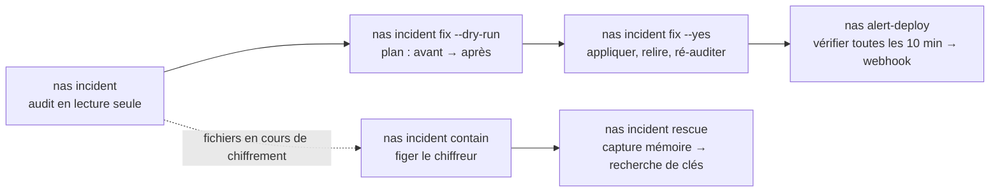

# synology-nas-cli

**Auditez un NAS Synology face à la campagne de ransomware C3RB3R / `.L0CK3D` en une seule commande, corrigez ce qu'elle détecte avec une seconde, puis administrez DSM depuis votre terminal au quotidien.**

[English](README.md) · [繁體中文](README.zh-TW.md) · [简体中文](README.zh-CN.md) · [日本語](README.ja.md) · [한국어](README.ko.md) · [Deutsch](README.de.md) · [Español](README.es.md) · [Français](README.fr.md)

[](https://gitlab.com/aa22396584/synology-nas-cli/-/releases) [](LICENSE)

Dépôt canonique, versions et tickets : https://gitlab.com/aa22396584/synology-nas-cli


`nas` est une interface en ligne de commande (CLI) Python sans dépendance externe (bibliothèque standard uniquement, Python 3.8+, ce qui lui permet aussi de tourner directement sur DSM) et un serveur MCP stdio pour l'API Web de Synology DSM 7 : état du système, santé matérielle, journaux, paquets, volumes, Tailscale, mises à niveau de DSM, alertes de santé planifiées envoyées vers un webhook, ainsi qu'un outil d'audit et de remédiation d'incident conçu lors de la campagne de ransomware C3RB3R / `.L0CK3D` d'octobre 2026 ciblant les boîtiers NAS Synology exposés sur Internet (Synology-SA-24:20, SA-26:13, SA-26:14).

Non affilié à Synology Inc. "Synology", "DSM" et "QuickConnect" sont des marques déposées de Synology Inc.

## Confiez-le à votre agent IA

Collez ce prompt dans Claude Code, Codex, Cursor, Gemini CLI, OpenCode, Grok Bot, ou tout agent IA doté d'outils (configuration, skills et routine d'alerte Grok Bot : [`docs/GROK-BOT.md`](docs/GROK-BOT.md)) :

```text
Utilise https://github.com/akari-sora/synology-nas-cli pour auditer et corriger mon NAS Synology sur https://192.0.2.10:5001. Suis docs/AGENT-RUNBOOK.md.
```

### Ce que fait l'agent, étape par étape

1. **Installation** : Clone le dépôt (ou installe le paquet) et vérifie `./bin/nas --version`.
2. **`nas setup`** : Exécute `nas setup --json --no-input ...` pour écrire `~/.config/synology-nas-cli/config.json` (mode `0600`), se connecte une fois pour vérifier les identifiants et épingle l'empreinte SHA-256 du certificat TLS de DSM lors de la première utilisation.
3. **`nas doctor`** : Exécute `nas doctor --json` pour vérifier la configuration, les identifiants, la joignabilité de l'origine, l'épinglage TLS, la connexion, la version de DSM par rapport à SA-26:13, l'état de la vérification en 2 étapes, les privilèges d'administrateur et le décalage d'horloge.
4. **`nas incident`** : Exécute `nas incident --json` (et en option `--probe --scan`) pour un audit en lecture seule portant sur la version de DSM, les paquets vulnérables, le pare-feu, QuickConnect, les règles de routeur UPnP, les ports publics, les connexions externes et les échecs de connexion, AutoBlock, SMB1, le compte `admin` intégré, les planifications d'instantanés, le piège du verrouillage WORM sur les modèles non pris en charge, les demandes de rançon et les tentatives d'exploitation de CVE-2024-10441.
5. **Plan** : Exécute `nas incident fix --dry-run --json --ransom-scan` et affiche chaque modification prévue (`before -> after`), les appels exacts à l'API Web de DSM et le chemin correspondant dans l'interface web de DSM.
6. **`nas incident fix --yes`** : Applique le plan approuvé dans l'ordre (`snapshot_worm` → `snapshots` → `packages` → `smb_min_protocol` → `quickconnect` → `router_port_forwarding` → `autoblock` → `admin_account` → `firewall`, plus en option `--rotate-password` et `--upgrade`), relit chaque paramètre pour vérifier son application, puis relance l'audit.
7. **Options `--deep` et `alert-deploy`** : Exécute `nas incident --deep --json` (un collecteur root en lecture seule via le Planificateur de tâches inspectant les journaux réservés à root, les crontabs, les binaires dans `/bin`, les comptes, les clés SSH et `/proc`) et `nas alert-deploy --json --test` (surveillance de la santé et de la sécurité toutes les 10 minutes poussée vers un webhook).

### Ce que vous fournissez en cours de route

1. **Adresse et compte du NAS (une seule fois)** :
   - L'URL de DSM (par exemple `https://192.0.2.10:5001`, plus une URL VPN/Tailscale le cas échéant).
   - Un nom d'utilisateur administrateur et la provenance de son mot de passe (`op://VAULT/ITEM/password`, une commande de mot de passe ou le trousseau du système d'exploitation).
   - Votre ou vos sous-réseaux CIDR LAN/VPN à conserver autorisés dans le pare-feu (par exemple `192.0.2.0/24`).
   - Un chemin optionnel de dossier partagé pour le stockage temporaire (par exemple `/docker/.nas-cli-deploy`, utilisé par `--deep` et `alert-deploy`).
2. **Un code 2FA à 6 chiffres (une seule fois, si la vérification en 2 étapes est activée)** :
   - Lorsque `nas setup` se termine avec le code `3` et `"field": "otp"`, fournissez le code actuel à 6 chiffres ; `--trust-device` enregistre le jeton d'appareil de confiance de DSM (`0600`) pour que les commandes suivantes n'aient plus besoin de code.
3. **Confirmation du plan** :
   - Relisez le plan généré à blanc avant l'exécution de `nas incident fix --yes` (et choisissez d'inclure ou non `--rotate-password` ou `--upgrade`).

Spécification complète pour l'agent : [`docs/AGENT-RUNBOOK.md`](docs/AGENT-RUNBOOK.md).



## Ce qui est vérifié et corrigé

`nas incident` fonctionne en lecture seule. Chaque élément affiche `PASS`, `WARN`, `FAIL` ou `SKIP` avec une indication sur une ligne (`--json` génère un JSON structuré ; schéma dans [`schemas/incident.schema.json`](schemas/incident.schema.json)). Le code de sortie est `1` lorsqu'au moins un élément est en `FAIL`.

| Élément | Ce que `nas incident` signale | Ce que `nas incident fix` modifie |
|---|---|---|
| `dsm_version` | `FAIL` si le build de DSM est antérieur au build corrigeant SA-26:13 pour sa branche, ou s'il appartient à une branche sans correctif SA-26:13 (DSM 7.1 et versions antérieures) ; `PASS` s'il est corrigé | Avec `--upgrade` : télécharge le dernier fichier `.pat` officiel pour le modèle, exécute PreCheck, l'installe et redémarre |
| `sa_26_14_packages` | Vérifie les paquets installés par rapport à Synology-SA-26:14 (Calendar, MailStation, PHP 7.3–8.4) : `FAIL` si une version vulnérable est en cours d'exécution, `WARN` si elle est installée mais arrêtée | Arrête les paquets vulnérables en cours d'exécution (`--only packages`) |
| `firewall` | `FAIL` lorsque le pare-feu est désactivé et que le NAS détient lui-même une IP publique (p. ex. connexion PPPoE directe), `WARN` lorsqu'il est désactivé derrière un NAT, ou `FAIL`/`WARN` lorsque des interfaces acceptent le trafic non filtré ou que des règles autorisent toute source (`source_ip: all`) | Active le pare-feu, ajoute des règles d'autorisation pour le `/32` de cet ordinateur (tel que journalisé par DSM) ainsi que les réseaux IPv4 de `allowed_networks` sur les interfaces LAN, configure la politique de chaque interface non-`global` sur `drop` et supprime les règles autorisant toute source (`--only firewall`) |
| `quickconnect` | `FAIL` lorsque QuickConnect ou le transfert de port de routeur automatique de QuickConnect est activé | Désactive QuickConnect et son transfert de port de routeur UPnP (`--only quickconnect`) |
| `router_port_forwarding` | `FAIL` lorsque DSM a activé des règles de transfert de port UPnP/NAT-PMP sur le routeur | Désactive toutes les règles de transfert de port du routeur gérées par DSM (`--only router_port_forwarding`) |
| `public_ports` | Uniquement avec `--probe` : ouvre des connexions TCP depuis cette machine vers les ports DSM et de services de fichiers sur l'IP publique du NAS (`FAIL` si un port répond) | Couvert par `firewall`, `quickconnect` et `router_port_forwarding` |
| `external_signins` | `FAIL` lorsque le journal des connexions contient des connexions réussies provenant d'adresses sources situées hors de `allowed_networks` | Aucune modification (enquêter sur un accès non autorisé ; voir [`docs/INCIDENT-C3RB3R.md`](docs/INCIDENT-C3RB3R.md)) |
| `failed_signins` | `WARN` lorsque les échecs de connexion au cours des dernières `--hours` heures (par défaut `24`) dépassent `--failed-threshold` (par défaut `20`) | Atténué par `firewall` et `autoblock` |
| `autoblock` | `FAIL` lorsque AutoBlock est désactivé | Active AutoBlock (`10` tentatives en `5` minutes, blocage permanent) et ajoute à la liste d'autorisation l'IP de cet ordinateur ainsi que les réseaux IPv4 de `allowed_networks` (et `127.0.0.1` si `incident.autoblock_allow_loopback` vaut true) (`--only autoblock`) |
| `smb_min_protocol` | `FAIL` lorsque SMB est activé et autorise SMB1 (`smb_min_protocol=0`), `WARN` lorsque SMB est désactivé mais que le protocole minimal est SMB1 | Relève le protocole SMB minimal à SMB2 (`smb_min_protocol=1`, `smb_max_protocol=3`) (`--only smb_min_protocol`) |
| `admin_account` | `FAIL` lorsque le compte intégré `admin` est activé (`expired: normal`) | Désactive le compte intégré `admin` via une tâche root temporaire après avoir vérifié qu'un autre administrateur activé existe et que la session actuelle n'est pas `admin` (`--only admin_account`) |
| `snapshot_schedule:<share>` | Par dossier partagé : `FAIL` s'il n'existe aucune planification d'instantanés, si la planification est désactivée, ou si l'instantané planifié le plus récent date de plus de `snapshot_max_age_hours` (par défaut `26` h) | Crée une planification quotidienne d'instantanés (`03:30` par défaut) et une politique de conservation de 14 jours sur les dossiers partagés qui n'ont pas encore de planification ; conditionné à un `--ransom-scan` propre dans la même exécution ou à `--i-know-snapshots-may-rotate` (`--only snapshots`) |
| `snapshot_worm:<share>` | `FAIL` lorsque le verrouillage d'instantanés immuables (WORM) est activé sur un modèle dont `SYNO.DisasterRecovery.Retention info` ne contient pas `worm` (DSM accepte l'appel API et les instantanés planifiés s'arrêtent silencieusement) | Désactive le verrouillage WORM non pris en charge sur les dossiers partagés concernés afin que les instantanés planifiés reprennent ; soumis à la même condition que `snapshots` (`--only snapshot_worm`) |
| `ransomware_files` | Uniquement avec `--scan` : recherche dans les dossiers partagés via File Station les fichiers `*.L0CK3D`, `*.LOCK3D` et `read-me3.txt` (`FAIL` si une correspondance est trouvée) | Aucune modification (réponse à incident requise ; voir [`docs/INCIDENT-C3RB3R.md`](docs/INCIDENT-C3RB3R.md)) |
| `exploit_attempts` | Analyse le journal des connexions DSM à la recherche de marqueurs d'injection de connexion CVE-2024-10441 (`PLUGIN_VALUE_END`, `LD_PRELOAD=`, `LD_DEBUG_OUTPUT`) et d'adresses de `incident.ioc_ips` (`WARN` si des tentatives sont détectées) | Aucune modification (exécuter `--deep` pour vérifier si une tentative a abouti) |
| `exploit_attempts_logs`, `ioc_cron`, `ioc_binaries`, `ioc_users`, `ioc_ssh_keys`, `ioc_processes` | Uniquement avec `--deep` : exécute un collecteur root en lecture seule pour inspecter `/var/log/synoplugin.log*`, `/var/log/synoscgi.log*`, `/var/log/auth.log*`, les crontabs (`/etc/cron.d/synot*`), `/bin/libgld`, `/bin/qnetd`, `/bin/l0ck.enc`, `xdy5*`, les comptes uid-0 supplémentaires ou inconnus, `authorized_keys` et les processus/connexions dans `/proc` (`FAIL` sur les artefacts C3RB3R connus, `WARN` sur les entrées inconnues) | Aucune modification (réponse à incident requise ; voir [`docs/INCIDENT-C3RB3R.md`](docs/INCIDENT-C3RB3R.md)) |

`SKIP` indique toujours la raison : l'élément nécessite une option (`--probe`, `--scan`), l'API a renvoyé une erreur, ou le NAS n'utilise pas cette fonctionnalité (pas de Btrfs/Snapshot Replication, aucun routeur configuré dans DSM).

## Installation

### Depuis un clone Git (sans installation)

```bash
git clone https://gitlab.com/aa22396584/synology-nas-cli.git synology-nas-cli
cd synology-nas-cli
./bin/nas --help                     # runs directly from the checkout (Python 3.8+ stdlib only)
ln -s "$PWD/bin/nas" ~/bin/nas       # optional: put `nas` on PATH
```

### Avec `pip` depuis une version GitLab ou un clone local

```bash
pip install https://gitlab.com/aa22396584/synology-nas-cli/-/archive/v1.0.0/synology-nas-cli-v1.0.0.tar.gz
# or from a local checkout:
pip install -e .                     # or: pipx install .
nas --help
```

### Sous Windows (avec `py`)

```powershell
git clone https://gitlab.com/aa22396584/synology-nas-cli.git synology-nas-cli
cd synology-nas-cli
py -3 bin\nas --help
# or install the console script:
py -3 -m pip install -e .
nas --help
```

### Initialiser et vérifier la connexion

Configuration en une étape, interactive ou pilotée par un agent :

```bash
nas setup --origin https://192.0.2.10:5001 --user ops --password-source op:op://VAULT/ITEM/password --allowed-network 192.0.2.0/24
nas doctor
```

Ou créez le fichier de configuration à partir du modèle et modifiez-le manuellement :

```bash
nas config init                      # writes ~/.config/synology-nas-cli/config.json (mode 600)
$EDITOR ~/.config/synology-nas-cli/config.json
nas config show                      # effective config, commands masked
nas whoami                           # one login: account, admin flag, DSM version, credential source
```

## Choisir votre configuration

| Environnement | Backend | Source du mot de passe | Notes |
|---|---|---|---|
| macOS avec 1Password | `password` | Références `op://VAULT/ITEM/password` ; `op` connecté via l'application 1Password | Approuvez `op` dans l'application la première fois. Codes 2FA lus depuis le même élément (`op item get --otp`). |
| macOS sans 1Password | `password` | `nas login --save` (Trousseau), ou `password_command` = `security find-generic-password -s synology-nas -a USER -w` | `nas login` met également la session en cache pour éviter aux commandes suivantes de se reconnecter. |
| Serveur Linux, cron, timer systemd | `password` | Compte de service 1Password (`OP_SERVICE_ACCOUNT_TOKEN` ou le fichier de jeton) + références `op://`, ou `password_command` (`secret-tool lookup ...`, `pass show ...`) | Sans terminal : l'invite interactive est désactivée, configurez donc une source non interactive. |
| Windows | `password` | `password_command` avec PowerShell (voir [Credentials](README.md#credentials)), ou `NAS_USER` + `NAS_PASSWORD` | Enregistrez l'identifiant avec le module PowerShell CredentialManager (`New-StoredCredential`) et lisez-le avec `Get-StoredCredential` dans `password_command`. |
| Sur le NAS lui-même | `local` | aucune : s'exécute en tant que root via le Planificateur de tâches de DSM | Configuré automatiquement par `nas alert-deploy`. Utilise le Python 3.8 intégré à DSM. |
| CI / sans interface avec compte de service | `password` | `OP_SERVICE_ACCOUNT_TOKEN` (secret CI) + références `op://` | Ou `NAS_PASSWORD_COMMAND` lisant le coffre de secrets CI. `NAS_PASSWORD` fonctionne également. |

## Démarrage rapide en cas d'incident

```bash
nas incident                       # read-only audit
nas incident --probe               # also test the public address from this machine
nas incident --scan                # also search every share for ransom notes (minutes)
nas incident --deep                # also indicators of compromise via one read-only root script (needs deploy.stage_dir)
nas --json incident                # machine-readable

nas incident fix --dry-run         # the plan: every change (current -> new), the API calls, the DSM UI path
nas incident fix                   # same plan, asks before applying
nas incident fix --yes             # apply without asking
nas incident fix --only firewall,smb_min_protocol
nas incident fix --skip admin_account
nas incident fix --ransom-scan --yes          # a clean scan also allows the snapshot fixes
nas incident fix --upgrade --rotate-password --yes   # opt-in extras

nas incident contain                       # list processes that look like an encryptor (signals nothing without --yes / NAS_YES=1)
nas incident contain --yes                 # SIGSTOP them (all threads) so their memory and keys stay intact
nas incident contain --yes --stop-sync     # also stop Cloud Sync, Synology Drive, Hyper Backup, Container Manager
nas incident contain --yes --save-exe /volumeUSB1/usbshare/evidence   # copy each executable (sha256 recorded)
nas incident contain --release             # SIGCONT the frozen PIDs and start the packages --stop-sync stopped

nas incident rescue --yes --capture-dir /usbshare1/rescue                  # freeze, capture memory, recover key candidates
nas incident rescue --yes --capture-dir /usbshare1/rescue --sample /share/a.pdf.L0CK3D   # test each candidate on a copy
nas incident rescue --yes --capture-dir /usbshare1/rescue --decrypt-from /share/docs --decrypt-to /Volumes/USB/out
```

Lorsque des fichiers sont en cours de chiffrement, `nas incident contain --yes` est la première commande à lancer : elle fige le processus de chiffrement (`SIGSTOP`, sans jamais le tuer) afin que les clés de session restent intactes dans sa mémoire, puis affiche les étapes suivantes.

- Candidats : noms connus (`libgld`, `qnetd`, `xdy5*`, `incident.ioc_process_names`), exécutables situés dans `/tmp`, `/var/tmp`, `/dev/shm`, `/volume*/@tmp`, processus ayant des fichiers `*.L0CK3D` / `read-me3.txt` ouverts en écriture, et forte utilisation CPU en dehors des chemins Synology (conteneurs exclus). Un processus dont l'exécutable se trouve sous un chemin Synology (`/usr/syno`, `/var/packages`, `/bin`, ...) doit présenter un autre indice en plus des fichiers ouverts ; l'analyse le répertorie sous `skipped` avec l'option `--pid` permettant de l'inclure. Le PID 1, les threads du noyau ainsi que le script d'analyse et ses processus parents ne reçoivent jamais de signal, même avec `--pid`.
- Le gel envoie le signal exactement aux processus listés lors de l'analyse : même PID, même heure de démarrage (champ 22 de `/proc/PID/stat`) et même exécutable ; un PID réutilisé entre-temps est signalé et ignoré.
- `--stop-sync` : après le gel, chacun des paquets Cloud Sync, Synology Drive, Hyper Backup et Container Manager (ou Docker) en cours d'exécution est arrêté via `SYNO.Core.Package.Control stop`. L'arrêt de Container Manager arrête tous les conteneurs. Les identifiants des paquets arrêtés sont enregistrés dans `contain-packages.json` à côté du cache de session sur cet ordinateur.
- `--release` : envoie `SIGCONT` aux PID enregistrés sur le NAS (`incident.contain_state_file`) ainsi qu'à tout `--pid` indiqué, puis exécute `SYNO.Core.Package.Control start` pour chaque paquet enregistré ; l'enregistrement est supprimé une fois tous les paquets redémarrés. Cette commande redémarre les paquets et non les conteneurs individuels : un conteneur redémarre lorsque sa politique de redémarrage (redémarrage automatique dans Container Manager) le relance avec le paquet.

`nas incident rescue` effectue la capture mémoire et la récupération des clés à l'aide de [soimy/c3rb3r-rescue](https://github.com/soimy/c3rb3r-rescue), récupéré à l'exécution au commit défini dans `incident.rescue_commit` :

1. `contain` : le gel décrit ci-dessus (`--no-contain` permet de l'ignorer).
2. `toolkit` : clone la boîte à outils et vérifie le commit. `--rescue-dir DIR` utilise un clone existant lorsque `git status --porcelain` est vide et que HEAD correspond à ce commit (`--force-unpinned-toolkit` pour tout autre commit).
3. `capture` : en tant que root sur le NAS (tâche temporaire dans le Planificateur de tâches, ou directement avec `--backend local`), exécute `capture_process_memory.py inspect` et `capture` de la boîte à outils pour chaque PID figé vers un nouveau dossier de cas sous `--capture-dir`. Ce dossier doit se trouver sur un disque USB ou sur un autre volume que les données touchées ; les volumes sont comparés selon leur source de montage dans `/proc/self/mountinfo` (chaque dossier partagé Btrfs étant son propre sous-volume avec son propre numéro de périphérique, les numéros de périphérique ne permettent pas de distinguer les volumes) ; `--force-same-volume` autorise la capture sur le même volume. Un `--capture-dir` comportant un lien symbolique dans son chemin est refusé. Avec `--backend password`, l'outil de capture transite par `deploy.stage_dir` (DSM renvoie l'erreur 4803 si un script de tâche l'embarque directement) et ne s'exécute (depuis stdin) que si son empreinte sha256 correspond au fichier téléversé. Le dossier du cas est ensuite attribué au compte DSM connecté (`id -u`, `chown`) afin que File Station puisse le lister et le télécharger.
4. `pull` : télécharge la capture dans le répertoire de travail sur cet ordinateur après avoir vérifié l'espace libre disponible (la taille des octets lisibles de la capture plus 256 MiB) ; avec `--backend local`, un répertoire de travail situé sur la partition système du NAS est refusé. `--keep-on-nas` s'arrête après la capture.
5. `venv` : crée un environnement virtuel (Python `incident.rescue_min_python`, 3.11, ou `--python`) et installe les dépendances de la boîte à outils avec `pip --require-hashes` : le sha256 de chaque fichier PyPI de numpy 2.3.5, cryptography 50.0.2, cffi 2.1.1 et pycparser 3.12 est conservé dans `nas/rescue.py` pour le commit épinglé ; les autres commits s'installent sans vérification de hachage avec `--force-unpinned-toolkit`. Exécute ensuite les autotests de la boîte à outils.
6. `keys` : exécute `recover_process_key.py` sur chaque capture ; les clés candidates sont écrites dans des fichiers en mode 400 et ne sont jamais affichées. Un processus qui ne correspond pas au chiffreur analysé s'arrête ici avec `ValueError: Executable does not match the reviewed sample profile`.
7. `sample` (`--sample NAS_FILE [--expected-sha256 HEX]`) : copie le fichier et teste chaque clé candidate sur la copie.
8. `decrypt` (`--decrypt-from NAS_FOLDER --decrypt-to DIR`) : déchiffre des copies à l'aide de la clé candidate vérifiée (`--force-unverified-key` utilise la première clé candidate lorsqu'aucun `--sample` n'en a validé une).

`--force` active simultanément `--force-same-volume`, `--force-unverified-key` et `--force-unpinned-toolkit`.

Chaque étape est enregistrée dans `<workdir>/state.json` (`--workdir`, par défaut `~/.local/share/synology-nas-cli/rescue/<time>`) ; relancer la même commande reprend là où elle s'était arrêtée. Ce qui est écrit sur le NAS :

- le dossier du cas `--capture-dir/case-<time>-<random>/pid-N` (conservé ; appartenant au compte connecté ; supprimez-le une fois la capture sauvegardée ailleurs en lieu sûr). L'outil de capture s'exécute depuis stdin (les octets vérifiés) ; aucune copie de l'outil n'est écrite dans le dossier du cas. Le parcours chown/chmod passe par des descripteurs de fichiers ouverts avec `O_NOFOLLOW` et ignore les liens symboliques. Lors des tests sur un dossier partagé DSM, les dossiers créés en mode 0700 apparaissaient ensuite en 0755 (les fichiers ont conservé 0400) ; vérifiez qui a accès en lecture à ce dossier partagé.
- avec `--backend password` : l'outil téléversé `deploy.stage_dir/nas-rescue-tool-<random>.py` et le fichier de résultat `deploy.stage_dir/nas-incident-rescue-<token>.json`, tous deux supprimés après l'exécution, ainsi que la tâche root temporaire `nas-incident-rescue`, également supprimée après l'exécution.
- l'étape `contain` : la tâche temporaire `nas-incident-contain` et son fichier de résultat (supprimés), ainsi que le fichier d'état du gel `incident.contain_state_file` (`/root/.nas-incident-contain.json`), supprimé par `nas incident contain --release`.

JSON : [`schemas/incident-rescue.schema.json`](schemas/incident-rescue.schema.json).

Si l'audit affiche `ransomware_files FAIL` ou `external_signins FAIL`, vous avez dépassé le stade du durcissement préventif : suivez [`docs/INCIDENT-C3RB3R.md`](docs/INCIDENT-C3RB3R.md) (isolez d'abord le NAS, conservez les preuves, restaurez depuis les instantanés).

## `nas incident fix`

Exécute l'audit, affiche le plan, demande confirmation (`--yes`, `NAS_YES=1` ou `assume_yes: true` répondent oui automatiquement ; sans terminal et sans l'une de ces options, la commande quitte avec le code 3 et `Not applied: add --yes (or NAS_YES=1).`), applique les modifications dans l'ordre ci-dessous, relit chacune d'elles, puis relance l'audit et affiche le comparatif avant -> après. `--dry-run` affiche le plan et les appels exacts sans envoyer aucune écriture. Le code de sortie est 1 lorsqu'une modification échoue ou que l'audit final comporte encore un FAIL.

Ordre : `snapshot_worm` -> `snapshots` -> `packages` -> `smb_min_protocol` -> `quickconnect` -> `router_port_forwarding` -> `autoblock` -> `admin_account` -> `firewall` -> `rotate_password` (sur demande) -> `upgrade` (sur demande, redémarre le NAS).

| Correctif | Ce qui change | Interface web de DSM (méthode manuelle) | Appel brut (`nas api ... --allow-write`) |
|---|---|---|---|
| `snapshot_worm` | Désactive le verrouillage d'instantanés immuables sur les dossiers partagés lorsque le modèle ne prend pas en charge les instantanés immuables (soumis à la même condition que `snapshots` : la planification du dossier partagé recommence alors à prendre des instantanés) | Snapshot Replication > Snapshots > Settings (l'option étant masquée sur les modèles non pris en charge, l'API est le seul moyen) (Snapshot Replication > Instantanés > Paramètres) | `SYNO.DisasterRecovery.Retention set_worm_lock --version 1 type=Share name=SHARE worm_lock_enable=false worm_lock_day=7` |
| `snapshots` | Crée une planification quotidienne (`incident.snapshot_hour:minute`) sur les dossiers partagés qui n'en ont pas, avec une conservation en jours (`incident.snapshot_retain_days`, 14) uniquement lorsque le dossier partagé n'a pas encore de politique de conservation. Les planifications existantes (activées ou non) et les politiques de conservation existantes ne sont pas modifiées. S'exécute après un `--ransom-scan` propre dans la même exécution, ou avec `--i-know-snapshots-may-rotate` / `--force` : la reprise des instantanés applique la politique de conservation, ce qui supprime les instantanés les plus anciens | Snapshot Replication > Snapshots > select the share > Settings > Schedule / Retention Policy (Snapshot Replication > Instantanés > sélectionner le dossier partagé > Paramètres > Planification / Politique de conservation) | `SYNO.Core.Share.Snapshot set_schedule --version 1 name=SHARE enable_snapshot_schedule=true 'schedule={...}' task_id=-1` puis `SYNO.DisasterRecovery.Retention set --version 1 name=SHARE type=Share policyType=64 retainDay=14 ...` |
| `packages` | Arrête les paquets en cours d'exécution mentionnés dans SA-26:14 (mettez-les à jour ou désinstallez-les vous-même) | Package Center > Installed > package > Update or Stop (Centre de paquets > Installés) | `SYNO.Core.Package.Control stop --version 1 id=PHP7.4` |
| `smb_min_protocol` | Définit le protocole SMB minimal sur SMB2 (les clients compatibles uniquement avec SMB1 perdent l'accès) | Control Panel > File Services > SMB > Advanced Settings (Panneau de configuration > Services de fichiers > SMB > Paramètres avancés) | `SYNO.Core.FileServ.SMB set --version 3 smb_min_protocol=1 smb_max_protocol=3` |
| `quickconnect` | Désactive QuickConnect ainsi que son transfert de port de routeur automatique | Control Panel > External Access > QuickConnect (Panneau de configuration > Accès externe > QuickConnect) | `SYNO.Core.QuickConnect set --version 2 enabled=false` ; `SYNO.Core.QuickConnect.Upnp set --version 1 enabled=false` |
| `router_port_forwarding` | Désactive (sans les supprimer) les règles de transfert de port du routeur gérées par DSM via UPnP/NAT-PMP | Control Panel > External Access > Router Configuration (Panneau de configuration > Accès externe > Configuration du routeur) ; vérifiez également l'interface d'administration du routeur lui-même | `SYNO.Core.PortForwarding.Rules save --version 1 'rules=[...enable:false...]' task_id_suffix=PF`, interroge `save_status` |
| `autoblock` | Active AutoBlock (10 tentatives / 5 min) ; ajoute à la liste d'autorisation l'adresse de cet ordinateur telle que journalisée par DSM, les réseaux IPv4 de `allowed_networks`, et `127.0.0.1` uniquement avec `incident.autoblock_allow_loopback` | Control Panel > Security > Protection > Auto Block; Allow/Block List (Panneau de configuration > Sécurité > Protection > Blocage automatique ; Liste d'autorisation/de blocage) | `SYNO.Core.Security.AutoBlock set --version 1 enable=true attempts=10 within_mins=5 enable_expire=false expire_day=0` ; `SYNO.Core.Security.AutoBlock.Rules create --version 1 type=allow block_days=0 overwrite=true 'ip=["127.0.0.1"]'` |
| `admin_account` | Désactive le compte intégré `admin`. Vérifie d'abord si le CLI est connecté en tant que `admin`, quel compte utilise une session `NAS_SID` fournie (`SYNO.Core.Desktop.Initdata`), et s'il existe un autre membre activé du groupe `administrators` ; `--force-admin` (ou `--force`) l'applique quel que soit le résultat de ces vérifications. Comme `SYNO.Core.User set` renvoie l'erreur 105 depuis une session par mot de passe, l'opération s'exécute en tant que root dans une tâche temporaire du Planificateur de tâches supprimée aussitôt après | Control Panel > User & Group > admin > Edit > Disable this account (Panneau de configuration > Utilisateur et groupe) | script de tâche root : `/usr/syno/bin/synowebapi --exec api=SYNO.Core.User method=set version=1 name='"admin"' expired='"now"'` (avec `--backend local` : `SYNO.Core.User set --version 1 name=admin expired=now`) |
| `firewall` | Active le pare-feu ; ajoute des règles d'autorisation (le `/32` de cet ordinateur tel que journalisé par DSM + les réseaux IPv4 de `allowed_networks`) sur les interfaces LAN (`global` uniquement lorsque le profil ne comporte aucune interface LAN) ; chaque interface à l'exception de `global` (eth*, pppoe, ppp0, vpn, wlan0, ...) rejette (`drop`) le trafic non apparié ; les règles autorisant toute source sont supprimées | Control Panel > Security > Firewall > Edit Rules (Panneau de configuration > Sécurité > Pare-feu > Modifier les règles) | `SYNO.Core.Security.Firewall.Profile set --version 1 'profile={...}' profile_applying=false`, puis `SYNO.Core.Security.Firewall.Profile.Apply start --version 1 name=default profile_applying=false`, interroge `status task_id=...`, `stop` |
| `rotate_password` (`--rotate-password`) | Génère un nouveau mot de passe aléatoire de 24 caractères pour le compte connecté. Écrit d'abord dans le coffre (élément 1Password via `op item edit` sur stdin, en conservant l'ancienne valeur dans l'historique de l'élément ; ou entrée du trousseau, avec copie de l'ancienne valeur vers `<store_service>-previous`), puis modifié dans DSM ; si DSM le refuse, l'ancien mot de passe est restauré dans le coffre ; si l'appel DSM est interrompu, le coffre conserve le nouveau. Relu et vérifié par une nouvelle connexion. Jamais affiché. Écrit dans 1Password ou le trousseau système ; pour un mot de passe issu d'une commande, d'une variable d'environnement ou d'une invite, modifiez-le dans DSM et dans cette source | Personal > Account > change password (Personnel > Compte) | `SYNO.Core.NormalUser set --version 2 password=... old_password=...` |
| `upgrade` (`--upgrade`) | Télécharge le dernier fichier `.pat` officiel, le téléverse, exécute PreCheck et l'installe ; le NAS redémarre | Control Panel > Update & Restore > Manual DSM Update (Panneau de configuration > Mise à jour et restauration > Mise à jour manuelle de DSM) | `nas upgrade --yes` |

**Vérification anti-verrouillage du pare-feu.** Avant de modifier le pare-feu, le CLI vérifie et signale dans le plan si : des proxys HTTP(S) sont configurés pour l'origine ; l'origine est une adresse de bouclage locale (tunnel SSH, proxy local) ou une adresse publique ; la connexion réussie la plus récente de ce compte dans le journal des connexions de DSM affiche une source de bouclage, IPv6 ou publique ; ou cette source journalisée diffère de l'adresse locale utilisée par cet ordinateur pour joindre le NAS (NAT, proxy, ou connexion provenant d'un autre appareil). Lorsqu'une vérification échoue, la modification attend `--force-firewall` (ou `--force`), qui l'applique en consignant le résultat dans la note du plan. L'ensemble des adresses autorisées inclut l'adresse journalisée par DSM. Après application, le CLI se reconnecte de zéro via la même origine ; en cas d'échec, il affiche les procédures de secours : un autre ordinateur sur le LAN, Synology Assistant / find.synology.com, Tailscale en mode espace utilisateur (DSM voit `127.0.0.1`, que le pare-feu n'a pas filtré lors des tests) et le bouton RESET (mode 1). Les entrées IPv6 de la liste d'autorisation ne sont pas écrites sous forme de règles, de sorte que les sources IPv6 sont rejetées. La plage `100.64.0.0/10` (Tailscale) est également celle utilisée par les FAI en CGNAT côté WAN : sur un NAS qui établit lui-même une connexion PPPoE, une règle d'autorisation `global` pour cette plage laisserait entrer d'autres abonnés du FAI, c'est pourquoi les règles sont placées sur les interfaces LAN.

**Un NAS disposant de sa propre adresse publique** (qui compose lui-même sa connexion PPPoE ou se trouve en DMZ) n'a aucun routeur NAT devant lui : le pare-feu de DSM constitue alors l'unique barrière entre l'ensemble des services DSM et Internet. QuickConnect et le transfert de port UPnP exposent DSM sur Internet même derrière un NAT.

## Serveur MCP et skills pour agents

### Serveur MCP (`nas mcp`)

`nas mcp` exécute un serveur Model Context Protocol sur stdio (JSON-RPC 2.0 ; versions du protocole `2025-11-25`, `2025-06-18`, `2025-03-26`, `2024-11-05`) exposant 15 outils : `setup`, `doctor`, `whoami`, `status`, `health`, `net`, `services`, `logs`, `alert`, `incident_audit`, `incident_fix`, `pkg_list`, `volume_list`, `tailscale_status` et `api_read`.

```bash
claude mcp add synology-nas --scope user -- /path/to/synology-nas-cli/bin/nas mcp
claude mcp add synology-nas --scope user -- /path/to/synology-nas-cli/bin/nas mcp --auto-confirm
```

`incident_fix` applique son plan lorsqu'un appel comporte `confirm: true`, ou ne comporte pas de paramètre `confirm` sur un serveur démarré avec `--auto-confirm` ; `confirm: false` effectue toujours une exécution à blanc. `NAS_YES` et `assume_yes` ne modifient pas le comportement des appels MCP. L'outil `setup` renseigne uniquement les champs qui ne sont pas encore définis dans la configuration et accepte les sources d'identifiants `op:`, `keychain` et `env` ; la modification d'une valeur déjà active (fichier de configuration, variable d'environnement telle que `NAS_ORIGINS`, ou option `--lan-origin` du serveur) pour `origins`, `user`, `password_source`, `otp_source`, `tls`, `allowed_networks`, `stage_dir` ou `webhook_file`, ainsi que les sources `command:`, doit passer par `nas setup` en ligne de commande (l'outil renvoie le code de sortie 2 en nommant le champ). Les valeurs par défaut intégrées (`tls` `pin`, `otp_source` `op`) ne sont pas considérées comme déjà définies ; les entrées publiques de `allowed_networks` s'ajoutent en ligne de commande. Les champs tels que `user`, `descr`, le champ `text` des journaux, `cmdline` et les noms de fichiers contiennent du texte choisi par quiconque envoie des tentatives de connexion au NAS ou y exécute des processus.

Liste complète des outils, schémas et configuration pour Claude Code, Claude Desktop, Cursor et Codex : [`docs/MCP.md`](docs/MCP.md).

### Installateur de skills pour agents

Le dossier [`skills/`](skills/) contient [`skills/synology-nas/SKILL.md`](skills/synology-nas/SKILL.md) et [`skills/synology-ransomware-response/SKILL.md`](skills/synology-ransomware-response/SKILL.md). Installez-les dans les répertoires de skills existants (`~/.claude/skills`, `~/.cursor/skills`, `~/.codex/skills`, `~/.agents/skills`, `~/.grok/skills`, `~/.gemini/skills`, `~/.config/opencode/skills`, `~/.hermes/shared-skills`) :

```bash
./skills/install.sh                  # symlink skills into detected agent folders
./skills/install.sh --copy           # copy instead of symlink (--dry-run, --uninstall also available)
```

Sous Windows PowerShell :

```powershell
.\skills\install.ps1                 # supports --copy, --dry-run, --uninstall
```

## Alertes et webhooks

`nas alert` exécute une fois tous les contrôles de santé et de sécurité et quitte avec le code 1 lorsqu'un élément atteint le niveau d'avertissement ou critique (warning/critical). Chaque résultat a la forme `{level, code, kind, message}`. Avec `--push FILE`, il envoie en POST uniquement ce qui a changé depuis le dernier envoi réussi vers `{"url", "header"}` lu depuis FILE : nouvelles alertes, rappel toutes les 24 h pour les alertes warning/critical toujours présentes, chaque événement, les clés résolues et un battement de cœur (heartbeat) par jour. Les codes, le format du corps JSON et des exemples de récepteurs sont détaillés dans [`docs/ALERTS.md`](docs/ALERTS.md).

Trois façons de l'exécuter :

1. **Sur le NAS, configuré automatiquement :** `nas alert-deploy` copie le code dans un dossier réservé à root (`deploy.root_dir`), crée une tâche root dans le Planificateur de tâches exécutant `nas --backend local alert --push` toutes les 10 minutes, et configure le webhook de notification intégré de DSM (Control Panel > Notification > Webhooks) vers la même URL.
2. **Sur le NAS, manuellement :** les trois mêmes éléments configurés via l'interface de DSM. Étapes détaillées dans [`docs/ALERTS.md`](docs/ALERTS.md#manual-install-on-the-nas).
3. **Depuis une autre machine allumée en permanence :** cron ou launchd exécutant `nas alert --push ...` avec le backend `password`. Voir [`docs/ALERTS.md`](docs/ALERTS.md#from-another-machine-cron--launchd).

Récepteurs : n'importe quel point de terminaison HTTPS acceptant un POST JSON avec un en-tête (récepteur JSON générique), un webhook de « routine » de chatbot qui démarre une exécution d'agent à chaque POST (de type Grok Bot), ou aucun webhook : les notifications intégrées de DSM (e-mail, notifications push mobiles Synology via DS finder / l'application Synology) couvrent les événements d'avertissement et d'erreur propres à DSM. Les trois approches sont décrites dans [`docs/ALERTS.md`](docs/ALERTS.md#receivers).

## Ce qui modifie le NAS

- Commandes qui modifient le NAS : `incident fix` (demande confirmation, ou `--yes`), `incident contain` (`SIGSTOP` avec `--yes` ; `--stop-sync` arrête des paquets ; `--release`), `incident rescue` (demande confirmation, ou `--yes` : gel, tâches root temporaires, dossier de capture), `upgrade` (sans `--yes`, téléverse tout de même le `.pat` et exécute PreCheck, puis supprime le fichier téléversé ; `--yes` l'installe), `pkg start|stop|install|uninstall|default-volume VOL`, `volume atime`, `tailscale login-url`, `alert-deploy`, `login --save` / `logout --forget` (trousseau local uniquement), `trust --reset` (fichier local), et `api` avec `--allow-write`. `ransom-scan`, `incident --scan` et `incident fix --ransom-scan` créent des tâches temporaires de recherche File Station sur le NAS (arrêtées et nettoyées ensuite). `nas api` n'envoie des méthodes autres que de lecture qu'avec `--allow-write`, `--yes` ou `NAS_YES=1`.
- `--yes`, `NAS_YES=1` et l'option de configuration `assume_yes: true` acceptent toutes les confirmations du CLI : `incident fix` applique son plan (avec `--upgrade`, il installe DSM et le NAS redémarre, même si PreCheck renvoie des notes ; avec `--rotate-password`, il change le mot de passe) ; `upgrade` installe la mise à jour après PreCheck et le NAS redémarre ; `incident contain` fige les processus candidats (et arrête les paquets avec `--stop-sync`) ; `incident rescue` exécute ses étapes ; `api` envoie les méthodes d'écriture comme avec `--allow-write`. `nas mcp` tire sa confirmation du paramètre `confirm` de chaque appel et de `--auto-confirm`, jamais de ces options.
- `incident fix --dry-run` affiche chaque appel d'écriture qu'il enverrait. Le plan indique toujours les valeurs actuelles -> nouvelles.
- Les mots de passe, SID et SynoToken ne sont jamais affichés. `nas api` affiche la réponse brute de DSM, qui peut inclure des numéros de série et des noms de comptes ; les autres commandes les filtrent.
- Chaque échec de connexion par mot de passe est comptabilisé par AutoBlock ; le CLI signale un échec de connexion une seule fois et s'arrête immédiatement.
- `alert-deploy` installe du code qui s'exécute en tant que root sur le NAS dans un dossier réservé à root situé en dehors des dossiers partagés.

## Configuration, identifiants, TLS, backends et référence complète des commandes

Pour le détail des clés du fichier `~/.config/synology-nas-cli/config.json` et des variables d'environnement ([Configuration](README.md#configuration)), la chaîne de résolution des mots de passe, du 2FA et des sessions ([Credentials](README.md#credentials)), l'épinglage des certificats TLS à la première utilisation et AutoBlock ([TLS](README.md#tls)), les trois backends `password`, `chrome` et `local` ([Backends](README.md#backends)), ainsi que le résumé complet de toutes les commandes et options de la CLI ([Command reference summary](README.md#command-reference-summary)), consultez le README en anglais.

### Index de la documentation

- [`docs/AGENT-RUNBOOK.md`](docs/AGENT-RUNBOOK.md) — Séquence étape par étape pour les agents IA (`setup` → `doctor` → `incident` → `incident fix` → `--deep` → `alert-deploy`).
- [`docs/INCIDENT-C3RB3R.md`](docs/INCIDENT-C3RB3R.md) — Page publique d'incident consacrée à la campagne de ransomware C3RB3R / `.L0CK3D` de 2026 : avis de sécurité, chronologie, IOC, étapes de décision, récupération et prévention.
- [`docs/HARDENING.md`](docs/HARDENING.md) — Liste de contrôle de durcissement de sécurité pour Synology DSM avec explications sourcées, chemins de l'interface DSM en anglais / 繁體中文 et commandes `nas` correspondantes.
- [`docs/TROUBLESHOOTING.md`](docs/TROUBLESHOOTING.md) — Solutions en cas de blocage par le pare-feu, AutoBlock ou la 2FA, réinitialisation Mode 1, proxys inverses et `127.0.0.1` avec Tailscale, modèles sans prise en charge WORM, quota Google Drive de 750 Go/jour, appareils SMB1, codes d'erreur de l'API DSM, pièges des branches indiquées « à jour » et réinitialisation de l'épinglage TLS.
- [`docs/MCP.md`](docs/MCP.md) — Outils du serveur MCP, arguments, schémas et configuration des clients.
- [`docs/GROK-BOT.md`](docs/GROK-BOT.md) — Grok Bot : exécution de `nas` sur l'ordinateur cloud du bot (Tailscale) ou sur un ordinateur disposant de l'application Grok Bot, skills, webhook de routine d'alerte et description du bot.
- [`docs/ALERTS.md`](docs/ALERTS.md) — Codes d'alerte, format de la charge utile webhook, récepteurs et déploiement (`alert-deploy`, tâche DSM manuelle, cron/launchd).
- [`docs/DSM-API-NOTES.md`](docs/DSM-API-NOTES.md) — Particularités de l'API Web de DSM 7 et règles d'encodage des paramètres sur lesquelles s'appuie `nas`.
- [`docs/EXIT-CODES.md`](docs/EXIT-CODES.md) — Définitions des codes de sortie du CLI et de `_meta.exit_code` pour MCP (`0`–`7`, `130`).
- [`schemas/`](schemas/) — Schémas JSON pour `incident`, `incident-fix`, `incident-contain`, `incident-rescue`, `alert`, `status`, `health` et `whoami`.
- [`llms.txt`](llms.txt) — Index de point d'entrée pour les agents LLM.

## Licence

MIT, Copyright (c) 2026 Akari Sora. Voir [LICENSE](LICENSE).
