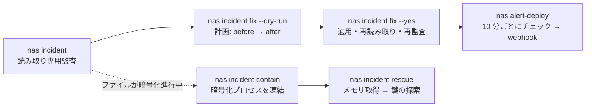

# synology-nas-cli

**1 つのコマンドで Synology NAS を C3RB3R / `.L0CK3D` ランサムウェア攻撃に対して監査し、2 つ目のコマンドで検出された問題を修正し、その後もターミナルから DSM を運用できます。**

[English](README.md) · [繁體中文](README.zh-TW.md) · [简体中文](README.zh-CN.md) · [日本語](README.ja.md) · [한국어](README.ko.md) · [Deutsch](README.de.md) · [Español](README.es.md) · [Français](README.fr.md)

[](https://gitlab.com/aa22396584/synology-nas-cli/-/releases) [](LICENSE)

正規リポジトリ、リリース、Issue: https://gitlab.com/aa22396584/synology-nas-cli


`nas` は外部依存のない Python 製 CLI（標準ライブラリのみ、Python 3.8 以上で動作するため DSM 本体上でも実行可能）および Synology DSM 7 Web API 用の stdio MCP サーバーです。ステータス、ヘルスチェック、ログ、パッケージ、ボリューム、Tailscale、DSM アップグレード、Webhook へプッシュ通知する定期ヘルスアラートのほか、2026 年 10 月にインターネットへ公開された Synology NAS を標的とした C3RB3R / `.L0CK3D` 攻撃キャンペーン（Synology-SA-24:20、SA-26:13、SA-26:14）への対策として構築されたインシデント監査・修復ツールを備えています。

Not affiliated with Synology Inc. Synology Inc. とは提携していません。"Synology"、"DSM"、"QuickConnect" は Synology Inc. の商標です。

## AI エージェントに任せる

以下のプロンプトを Claude Code、Codex、Cursor、Gemini CLI、OpenCode、Grok Bot、またはツール呼び出しに対応する任意の AI エージェントに貼り付けてください（Grok Bot のセットアップ、スキル、アラートルーチンについては [`docs/GROK-BOT.md`](docs/GROK-BOT.md) を参照）：

```text
https://github.com/akari-sora/synology-nas-cli を使用して、https://192.0.2.10:5001 にある私の Synology NAS を監査・修復してください。docs/AGENT-RUNBOOK.md の手順に従ってください。
```

### エージェントが実行するステップ

1. **インストール**: リポジトリをクローン（またはパッケージをインストール）し、`./bin/nas --version` で動作を確認します。
2. **`nas setup`**: `nas setup --json --no-input ...` を実行して `~/.config/synology-nas-cli/config.json`（パーミッション `0600`）を書き込み、一度サインインして認証情報を検証し、初回接続時に DSM の TLS 証明書の SHA-256 フィンガープリントをピン留め（固定）します。
3. **`nas doctor`**: `nas doctor --json` を実行して、設定、認証情報、接続先への到達性、TLS ピン留め、ログイン、SA-26:13 に対する DSM バージョン、2 段階認証の状態、管理者権限、および時刻のずれ（クロックスキュー）を検証します。
4. **`nas incident`**: `nas incident --json`（および必要に応じて `--probe --scan`）を実行し、DSM バージョン、脆弱なパッケージ、ファイアウォール、QuickConnect、UPnP ルーター規則、公開ポート、外部からのサインインおよび失敗したサインイン、AutoBlock、SMB1、ビルトイン `admin`、スナップショットスケジュール、非対応モデルにおける WORM ロックの罠、ランサムノート（身代金要求メモ）、および CVE-2024-10441 悪用試行の読み取り専用監査を行います。
5. **計画の作成**: `nas incident fix --dry-run --json --ransom-scan` を実行し、予定されているすべての変更（`before -> after`）、正確な DSM Web API 呼び出し、および対応する DSM Web UI のパスを表示します。
6. **`nas incident fix --yes`**: 承認された計画を順番どおり（`snapshot_worm` → `snapshots` → `packages` → `smb_min_protocol` → `quickconnect` → `router_port_forwarding` → `autoblock` → `admin_account` → `firewall`、およびオプションの `--rotate-password` と `--upgrade`）に適用し、すべての設定を再読み取りして検証したうえで、監査を再実行します。
7. **オプションの `--deep` と `alert-deploy`**: `nas incident --deep --json`（タスクスケジューラ経由で 1 つの読み取り専用 root コレクターを実行し、root 専用ログ、crontab、`/bin` バイナリ、アカウント、SSH 鍵、および `/proc` を検査）と `nas alert-deploy --json --test`（10 分ごとのヘルス・セキュリティ監視結果を Webhook へプッシュ通知）を実行します。

### 途中でユーザーが提供する情報

1. **NAS のアドレスとアカウント（初回のみ）**:
   - DSM の URL（例: `https://192.0.2.10:5001`、および併用している場合は VPN/Tailscale の URL）。
   - 管理者ユーザー名とパスワードの取得元（`op://VAULT/ITEM/password`、パスワード取得コマンド、または OS のキーチェーン）。
   - ファイアウォールで許可を維持する LAN/VPN サブネットの CIDR（例: `192.0.2.0/24`）。
   - 一時ステージング用の共有フォルダパス（オプション、例: `/docker/.nas-cli-deploy`、`--deep` と `alert-deploy` で使用）。
2. **6 桁の 2FA コード（2 段階認証が有効な場合、初回のみ）**:
   - `nas setup` が終了コード `3` と `"field": "otp"` を返した際に、現在の 6 桁のコードを提供します。`--trust-device` を付けると DSM の信頼済みデバイストークン（`0600`）が保存され、以降のコマンドではコード入力が不要になります。
3. **計画の確認**:
   - `nas incident fix --yes` を実行する前にドライランの計画を確認します（また、`--rotate-password` や `--upgrade` を含めるかどうかを選択します）。

エージェント向けの詳細仕様: [`docs/AGENT-RUNBOOK.md`](docs/AGENT-RUNBOOK.md)。



## 検査項目と修復内容

`nas incident` は読み取り専用です。各項目は `PASS`、`WARN`、`FAIL`、または `SKIP` と 1 行のヒントを表示します（`--json` は構造化 JSON を出力します。スキーマは [`schemas/incident.schema.json`](schemas/incident.schema.json) にあります）。いずれかの項目が `FAIL` の場合、終了ステータスは `1` になります。

| 項目 | `nas incident` の報告内容 | `nas incident fix` の変更内容 |
|---|---|---|
| `dsm_version` | DSM ビルドがそのブランチの SA-26:13 修正済みビルドより古い場合、または SA-26:13 の修正がないブランチ（DSM 7.1 以前）の場合は `FAIL`。修正適用済みの場合は `PASS` | `--upgrade` 指定時: そのモデル向けの最新の公式 `.pat` をダウンロードし、PreCheck を実行してインストールし、再起動します |
| `sa_26_14_packages` | インストール済みパッケージを Synology-SA-26:14（Calendar、MailStation、PHP 7.3–8.4）と照合: 脆弱なバージョンが実行中の場合は `FAIL`、インストールされているが停止中の場合は `WARN` | 実行中の脆弱なパッケージを停止します（`--only packages`） |
| `firewall` | ファイアウォールが無効で NAS 自身がグローバル IP を保持している場合（PPPoE 接続など）は `FAIL`、NAT 配下で無効な場合は `WARN`、またはインターフェースが条件に一致しないトラフィックを許可している場合や規則が任意の送信元（`source_ip: all`）を許可している場合は `FAIL`/`WARN` | ファイアウォールを有効化し、LAN インターフェース上でこのコンピュータの `/32`（DSM に記録されたアドレス）および IPv4 の `allowed_networks` に対する許可規則を追加し、`global` 以外のすべてのインターフェースポリシーを `drop` に設定し、任意の送信元を許可する規則を削除します（`--only firewall`） |
| `quickconnect` | QuickConnect または QuickConnect の自動ルーターポート転送が有効な場合は `FAIL` | QuickConnect とその UPnP ルーターポート転送を無効化します（`--only quickconnect`） |
| `router_port_forwarding` | DSM がルーター上で UPnP/NAT-PMP ポート転送規則を有効にしている場合は `FAIL` | DSM が管理するすべてのルーターポート転送規則を無効化します（`--only router_port_forwarding`） |
| `public_ports` | `--probe` 指定時のみ: このマシンから NAS のグローバル IP 上の DSM およびファイルサービスポートへ TCP 接続を試行します（いずれかのポートが応答した場合は `FAIL`） | `firewall`、`quickconnect`、および `router_port_forwarding` によって対処されます |
| `external_signins` | 接続ログに `allowed_networks` 外の送信元アドレスからの成功したサインインが含まれている場合は `FAIL` | なし（不正アクセスを調査してください。[`docs/INCIDENT-C3RB3R.md`](docs/INCIDENT-C3RB3R.md) を参照） |
| `failed_signins` | 直近 `--hours`（デフォルト `24` 時間）以内のサインイン失敗回数が `--failed-threshold`（デフォルト `20` 回）を超えている場合は `WARN` | `firewall` と `autoblock` によって緩和されます |
| `autoblock` | AutoBlock が無効な場合は `FAIL` | AutoBlock を有効化（`5` 分以内に `10` 回失敗で無期限ブロック）し、このコンピュータの IP と IPv4 の `allowed_networks`（および `incident.autoblock_allow_loopback` が true の場合は `127.0.0.1`）を許可リストに登録します（`--only autoblock`） |
| `smb_min_protocol` | SMB が有効で SMB1 を許可している場合（`smb_min_protocol=0`）は `FAIL`、SMB が無効だが最小プロトコルが SMB1 の場合は `WARN` | 最小 SMB プロトコルを SMB2 に引き上げます（`smb_min_protocol=1`、`smb_max_protocol=3`）（`--only smb_min_protocol`） |
| `admin_account` | ビルトインの `admin` アカウントが有効（`expired: normal`）な場合は `FAIL` | 別の有効な管理者が存在し、かつ現在のセッションが `admin` ではないことを確認したうえで、一時的な root タスク経由でビルトインの `admin` アカウントを無効化します（`--only admin_account`） |
| `snapshot_schedule:<share>` | 共有フォルダごと: スナップショットスケジュールが存在しない、スケジュールが無効、または最新の定期スナップショットが `snapshot_max_age_hours`（デフォルト `26` 時間）より古い場合は `FAIL` | スケジュールがまだない共有フォルダに対して日次スナップショットスケジュール（デフォルト `03:30`）と 14 日間の保持ポリシーを作成します。同一実行内での問題のない `--ransom-scan` 結果、または `--i-know-snapshots-may-rotate` の指定が条件となります（`--only snapshots`） |
| `snapshot_worm:<share>` | `SYNO.DisasterRecovery.Retention info` に `worm` がないモデルでイミュータブルスナップショット（WORM）ロックが有効になっている場合は `FAIL`（DSM は API 呼び出しを受け付けますが、定期スナップショットが黙って停止します） | 該当する共有フォルダで非対応の WORM ロックをオフにし、定期スナップショットを再開させます。`snapshots` と同じ安全条件が適用されます（`--only snapshot_worm`） |
| `ransomware_files` | `--scan` 指定時のみ: File Station 経由で共有フォルダ内の `*.L0CK3D`、`*.LOCK3D`、`read-me3.txt` を検索します（一致するファイルが見つかった場合は `FAIL`） | なし（インシデント対応が必要です。[`docs/INCIDENT-C3RB3R.md`](docs/INCIDENT-C3RB3R.md) を参照） |
| `exploit_attempts` | DSM 接続ログから CVE-2024-10441 サインインインジェクションの痕跡（`PLUGIN_VALUE_END`、`LD_PRELOAD=`、`LD_DEBUG_OUTPUT`）および `incident.ioc_ips` をスキャンします（試行が見られた場合は `WARN`） | なし（`--deep` を実行して試行が成功していないか確認してください） |
| `exploit_attempts_logs`, `ioc_cron`, `ioc_binaries`, `ioc_users`, `ioc_ssh_keys`, `ioc_processes` | `--deep` 指定時のみ: 1 つの読み取り専用 root コレクターを実行し、`/var/log/synoplugin.log*`、`/var/log/synoscgi.log*`、`/var/log/auth.log*`、crontab（`/etc/cron.d/synot*`）、`/bin/libgld`、`/bin/qnetd`、`/bin/l0ck.enc`、`xdy5*`、余分な uid-0 または不明なアカウント、`authorized_keys`、および `/proc` のプロセス/接続を検査します（既知の C3RB3R アーティファクトがある場合は `FAIL`、不明なエントリがある場合は `WARN`） | なし（インシデント対応が必要です。[`docs/INCIDENT-C3RB3R.md`](docs/INCIDENT-C3RB3R.md) を参照） |

`SKIP` には常に理由が示されます。フラグ（`--probe`、`--scan`）が必要である、API がエラーを返した、または NAS がその機能を使用していない（Btrfs/Snapshot Replication がない、DSM にルーターが設定されていない）のいずれかです。

## インストール

### Git チェックアウトから実行（インストール不要）

```bash
git clone https://gitlab.com/aa22396584/synology-nas-cli.git synology-nas-cli
cd synology-nas-cli
./bin/nas --help                     # runs directly from the checkout (Python 3.8+ stdlib only)
ln -s "$PWD/bin/nas" ~/bin/nas       # optional: put `nas` on PATH
```

### GitLab リリースまたはローカルチェックアウトから `pip` でインストール

```bash
pip install https://gitlab.com/aa22396584/synology-nas-cli/-/archive/v1.0.0/synology-nas-cli-v1.0.0.tar.gz
# or from a local checkout:
pip install -e .                     # or: pipx install .
nas --help
```

### Windows の場合（`py` を使用）

```powershell
git clone https://gitlab.com/aa22396584/synology-nas-cli.git synology-nas-cli
cd synology-nas-cli
py -3 bin\nas --help
# or install the console script:
py -3 -m pip install -e .
nas --help
```

### 初期設定とログイン確認

対話式またはエージェント主導のワンステップセットアップ:

```bash
nas setup --origin https://192.0.2.10:5001 --user ops --password-source op:op://VAULT/ITEM/password --allowed-network 192.0.2.0/24
nas doctor
```

またはテンプレートから設定ファイルを作成して手動で編集します:

```bash
nas config init                      # writes ~/.config/synology-nas-cli/config.json (mode 600)
$EDITOR ~/.config/synology-nas-cli/config.json
nas config show                      # effective config, commands masked
nas whoami                           # one login: account, admin flag, DSM version, credential source
```

## 環境に合わせたセットアップの選択

| 環境 | バックエンド | パスワード取得元 | 備考 |
|---|---|---|---|
| macOS + 1Password | `password` | `op://VAULT/ITEM/password` 参照。1Password アプリ経由で `op` にサインイン | 初回のみアプリで `op` を承認します。2FA コードも同じアイテムから取得します（`op item get --otp`）。 |
| macOS（1Password なし） | `password` | `nas login --save`（キーチェーン）、または `password_command` = `security find-generic-password -s synology-nas -a USER -w` | `nas login` はセッションもキャッシュするため、以降のコマンドで再サインインが発生しません。 |
| Linux サーバー、cron、systemd タイマー | `password` | 1Password サービスアカウント（`OP_SERVICE_ACCOUNT_TOKEN` またはトークンファイル）+ `op://` 参照、または `password_command`（`secret-tool lookup ...`、`pass show ...`） | ターミナルがない環境ではプロンプトが無効になるため、非対話型の取得元を設定してください。 |
| Windows | `password` | PowerShell を使用した `password_command`（[Credentials](README.md#credentials) を参照）、または `NAS_USER` + `NAS_PASSWORD` | CredentialManager PowerShell モジュール（`New-StoredCredential`）で認証情報を保存し、`password_command` 内の `Get-StoredCredential` で読み取ります。 |
| NAS 本体上 | `local` | なし: DSM タスクスケジューラ経由で root として実行 | `nas alert-deploy` がこれをセットアップします。DSM 内蔵の Python 3.8 を使用します。 |
| CI / サービスアカウントを使用するヘッドレス環境 | `password` | `OP_SERVICE_ACCOUNT_TOKEN`（CI シークレット）+ `op://` 参照 | または CI シークレットストアを読み取る `NAS_PASSWORD_COMMAND`。`NAS_PASSWORD` も動作します。 |

## インシデント対応クイックスタート

```bash
nas incident                       # read-only audit
nas incident --probe               # also test the public address from this machine
nas incident --scan                # also search every share for ransom notes (minutes)
nas incident --deep                # also indicators of compromise via one read-only root script (needs deploy.stage_dir)
nas --json incident                # machine-readable

nas incident fix --dry-run         # the plan: every change (current -> new), the API calls, the DSM UI path
nas incident fix                   # same plan, asks before applying
nas incident fix --yes             # apply without asking
nas incident fix --only firewall,smb_min_protocol
nas incident fix --skip admin_account
nas incident fix --ransom-scan --yes          # a clean scan also allows the snapshot fixes
nas incident fix --upgrade --rotate-password --yes   # opt-in extras

nas incident contain                       # list processes that look like an encryptor (signals nothing without --yes / NAS_YES=1)
nas incident contain --yes                 # SIGSTOP them (all threads) so their memory and keys stay intact
nas incident contain --yes --stop-sync     # also stop Cloud Sync, Synology Drive, Hyper Backup, Container Manager
nas incident contain --yes --save-exe /volumeUSB1/usbshare/evidence   # copy each executable (sha256 recorded)
nas incident contain --release             # SIGCONT the frozen PIDs and start the packages --stop-sync stopped

nas incident rescue --yes --capture-dir /usbshare1/rescue                  # freeze, capture memory, recover key candidates
nas incident rescue --yes --capture-dir /usbshare1/rescue --sample /share/a.pdf.L0CK3D   # test each candidate on a copy
nas incident rescue --yes --capture-dir /usbshare1/rescue --decrypt-from /share/docs --decrypt-to /Volumes/USB/out
```

ファイルが暗号化されている最中は、最初に実行すべきコマンドは `nas incident contain --yes` です。これは暗号化プロセスを凍結（`SIGSTOP` を送信し、強制終了はしない）してセッション鍵をメモリ内に残し、次の手順を表示します。

- 候補となるプロセス: 既知の名前（`libgld`、`qnetd`、`xdy5*`、`incident.ioc_process_names`）、`/tmp`、`/var/tmp`、`/dev/shm`、`/volume*/@tmp` 内の実行ファイル、`*.L0CK3D` / `read-me3.txt` ファイルを書き込み用に開いているプロセス、および Synology のパス以外で高い CPU 使用率を示すプロセス（コンテナは除外）。実行ファイルが Synology のパス（`/usr/syno`、`/var/packages`、`/bin` など）配下にあるプロセスは、開いているファイル以外にもう 1 つの理由が必要です。該当しない場合はスキャン結果の `skipped` にリストされ、追加するための `--pid` が併記されます。PID 1、カーネルスレッド、およびスキャンスクリプト自身とその親プロセスには、`--pid` を指定してもシグナルは送信されません。
- 凍結処理はスキャンがリストアップしたプロセスと完全に一致するもの（同一の PID、`/proc/PID/stat` フィールド 22 の起動時刻、および実行ファイル）にのみシグナルを送ります。途中で再利用された PID は報告され、スキップされます。
- `--stop-sync`: 凍結後、実行中の Cloud Sync、Synology Drive、Hyper Backup、および Container Manager（または Docker）の各パッケージを `SYNO.Core.Package.Control stop` で停止します。Container Manager を停止するとすべてのコンテナが停止します。停止したパッケージの ID は、このコンピュータのセッションキャッシュの隣にある `contain-packages.json` に記録されます。
- `--release`: NAS 上に記録された PID（`incident.contain_state_file`）および指定された `--pid` に `SIGCONT` を送り、記録された各パッケージに対して `SYNO.Core.Package.Control start` を実行します。すべてのパッケージが起動すると記録は削除されます。個々のコンテナではなくパッケージを起動するため、各コンテナは自身の再起動ポリシー（Container Manager 内の自動再起動設定）に従ってパッケージとともに復帰します。

`nas incident rescue` は、実行時に `incident.rescue_commit` のコミットで取得した [soimy/c3rb3r-rescue](https://github.com/soimy/c3rb3r-rescue) を使用して、メモリのキャプチャと鍵の復元を行います:

1. `contain`: 上記の凍結処理を実行します（`--no-contain` でスキップ可能）。
2. `toolkit`: ツールキットをクローンし、コミットを検証します。`--rescue-dir DIR` は、`git status --porcelain` が空であり、かつ HEAD がそのコミットである場合に既存のチェックアウトを使用します（それ以外のコミットを使用する場合は `--force-unpinned-toolkit`）。
3. `capture`: NAS 上で root として（一時的なタスクスケジューラタスク、または `--backend local` で直接実行）、凍結された各 PID に対してツールキットの `capture_process_memory.py inspect` と `capture` を実行し、`--capture-dir` 配下の新しいケースフォルダに保存します。このフォルダは USB ディスク上、または被害を受けたデータとは別のボリューム上にある必要があります。ボリュームは `/proc/self/mountinfo` のマウント元（mount source）で比較されます（Btrfs の各共有フォルダは固有のデバイス番号を持つ独立したサブボリュームであるため、デバイス番号ではボリュームを区別できません）。`--force-same-volume` を指定すると同じボリューム上にキャプチャします。パスにシンボリックリンクを含む `--capture-dir` は拒否されます。`--backend password` の場合、キャプチャツールは `deploy.stage_dir` を経由し（インラインでスクリプトを含めると DSM が 4803 を返すため）、その sha256 がアップロードされたファイルと一致する場合にのみ（標準入力から）実行されます。その後、File Station で一覧表示およびダウンロードできるよう、ケースフォルダの所有権がサインイン中の DSM アカウントに変更（`id -u`、`chown`）されます。
4. `pull`: このコンピュータの作業ディレクトリ（workdir）の空き容量（キャプチャの読み取り可能バイト数 + 256 MiB）を確認したうえで、キャプチャをダウンロードします。`--backend local` の場合、NAS のシステムパーティション上の作業ディレクトリは拒否されます。`--keep-on-nas` を指定するとキャプチャ後に停止します。
5. `venv`: 仮想環境（Python `incident.rescue_min_python` すなわち 3.11、または `--python`）を作成し、ツールキットの依存パッケージを `pip --require-hashes` でインストールします。ピン留めされたコミット向けに、numpy 2.3.5、cryptography 50.0.2、cffi 2.1.1、pycparser 3.12 のすべての PyPI ファイルの sha256 が `nas/rescue.py` に保持されています（`--force-unpinned-toolkit` 指定時は他のコミットでもハッシュ検証なしでインストールします）。その後、ツールキットのセルフテストを実行します。
6. `keys`: 各キャプチャに対して `recover_process_key.py` を実行します。鍵の候補はモード 400 のファイルとして保存され、画面には一切出力されません。解析済みの暗号化プログラムと一致しないプロセスは、ここで `ValueError: Executable does not match the reviewed sample profile` を出して停止します。
7. `sample`（`--sample NAS_FILE [--expected-sha256 HEX]`）: ファイルをコピーし、そのコピーに対して各鍵候補を試行します。
8. `decrypt`（`--decrypt-from NAS_FOLDER --decrypt-to DIR`）: 検証済みの鍵候補を使用してコピーを復号します（`--sample` で検証された鍵がない場合、`--force-unverified-key` を指定すると最初の候補を使用します）。

`--force` は `--force-same-volume`、`--force-unverified-key`、`--force-unpinned-toolkit` をまとめて有効にします。

各ステップは `<workdir>/state.json`（`--workdir`、デフォルトは `~/.local/share/synology-nas-cli/rescue/<time>`）に記録され、同じコマンドを再実行すると中断した箇所から再開します。NAS 上に書き込まれる内容は以下のとおりです:

- ケースフォルダ `--capture-dir/case-<time>-<random>/pid-N`（保持されます。所有者はサインイン中のアカウントです。キャプチャを別の安全な場所に退避した後に削除してください）。キャプチャツールは標準入力（検証済みバイト列）から実行されるため、ケースフォルダ内にツールのコピーは書き込まれません。chown/chmod の走査は `O_NOFOLLOW` で開いたファイルディスクリプタ経由で行われ、シンボリックリンクには触れずにスキップします。DSM 共有フォルダ上でのテストでは、モード 0700 で作成されたフォルダが後から 0755 として表示されました（ファイルは 0400 を維持）。その共有フォルダを誰が読み取れるか確認してください。
- `--backend password` の場合: アップロードされたツール `deploy.stage_dir/nas-rescue-tool-<random>.py` と結果ファイル `deploy.stage_dir/nas-incident-rescue-<token>.json`（どちらも実行後に削除されます）、および一時的な root タスク `nas-incident-rescue`（実行後に削除されます）。
- `contain` ステップ: 一時タスク `nas-incident-contain` とその結果ファイル（削除されます）、および凍結の状態ファイル `incident.contain_state_file`（`/root/.nas-incident-contain.json`、`nas incident contain --release` によって削除されます）。

JSON スキーマ: [`schemas/incident-rescue.schema.json`](schemas/incident-rescue.schema.json)。

監査で `ransomware_files FAIL` または `external_signins FAIL` が表示された場合は、ハードニング（要塞化）の段階を過ぎています。[`docs/INCIDENT-C3RB3R.md`](docs/INCIDENT-C3RB3R.md) の手順（まず隔離し、証拠を保全し、スナップショットから復元する）に従ってください。

## `nas incident fix`

監査を実行し、計画を表示して確認を求めます（`--yes`、`NAS_YES=1`、または `assume_yes: true` で自動的に yes と応答します。ターミナルがなく、かつこれらが指定されていない場合は `Not applied: add --yes (or NAS_YES=1).` を出して終了コード 3 で終了します）。以下の順序で変更を適用し、各設定を再読み取りして確認した後、監査を再実行して `before -> after` を表示します。`--dry-run` は計画と正確な API 呼び出しを表示し、書き込みは一切送信しません。変更に失敗した場合、または最終監査にまだ `FAIL` が残っている場合、終了ステータスは 1 になります。

適用順序: `snapshot_worm` -> `snapshots` -> `packages` -> `smb_min_protocol` -> `quickconnect` -> `router_port_forwarding` -> `autoblock` -> `admin_account` -> `firewall` -> `rotate_password`（オプトイン） -> `upgrade`（オプトイン、再起動を伴う）。

| 修復項目 | 変更内容 | DSM Web UI（手動で行う場合） | 実際の API 呼び出し（`nas api ... --allow-write`） |
|---|---|---|---|
| `snapshot_worm` | イミュータブルスナップショット非対応モデルにおいて共有フォルダのイミュータブルスナップショットロックをオフにする（`snapshots` と同じ安全条件を適用: 共有フォルダのスケジュールによるスナップショット取得が再開します） | Snapshot Replication > Snapshots > Settings（非対応モデルでは UI 上でオプションが非表示になるため、API が唯一の方法です）（Snapshot Replication > スナップショット > 設定） | `SYNO.DisasterRecovery.Retention set_worm_lock --version 1 type=Share name=SHARE worm_lock_enable=false worm_lock_day=7` |
| `snapshots` | スケジュールがない共有フォルダに日次スケジュール（`incident.snapshot_hour:minute`）を作成し、保持ポリシーがまだない共有フォルダにのみ日数ベースの保持ポリシー（`incident.snapshot_retain_days`、14 日）を設定する。既存のスケジュール（有効・無効を問わず）と既存の保持ポリシーは変更しない。同一実行内での問題のない `--ransom-scan` の後、または `--i-know-snapshots-may-rotate` / `--force` 指定時に実行される（スナップショットの取得が始まると保持ポリシーが適用され、最も古いスナップショットが削除されるため） | Snapshot Replication > Snapshots > select the share > Settings > Schedule / Retention Policy（Snapshot Replication > スナップショット > 共有フォルダを選択 > 設定 > スケジュール / 保持ポリシー） | `SYNO.Core.Share.Snapshot set_schedule --version 1 name=SHARE enable_snapshot_schedule=true 'schedule={...}' task_id=-1` の後に `SYNO.DisasterRecovery.Retention set --version 1 name=SHARE type=Share policyType=64 retainDay=14 ...` |
| `packages` | SA-26:14 に記載された実行中のパッケージを停止する（更新またはアンインストールは手動で行ってください） | Package Center > Installed > package > Update or Stop（パッケージ センター > インストール済み） | `SYNO.Core.Package.Control stop --version 1 id=PHP7.4` |
| `smb_min_protocol` | 最小 SMB プロトコルを SMB2 に設定する（SMB1 専用クライアントはアクセスできなくなります） | Control Panel > File Services > SMB > Advanced Settings（コントロール パネル > ファイル サービス > SMB > 詳細設定） | `SYNO.Core.FileServ.SMB set --version 3 smb_min_protocol=1 smb_max_protocol=3` |
| `quickconnect` | QuickConnect をオフにし、その自動ルーターポート転送もオフにする | Control Panel > External Access > QuickConnect（コントロール パネル > 外部アクセス > QuickConnect） | `SYNO.Core.QuickConnect set --version 2 enabled=false`; `SYNO.Core.QuickConnect.Upnp set --version 1 enabled=false` |
| `router_port_forwarding` | DSM が UPnP/NAT-PMP 経由で管理しているルーターのポート転送規則を無効化する（削除はしない） | Control Panel > External Access > Router Configuration（コントロール パネル > 外部アクセス > ルーター設定）。ルーター自身の管理画面も確認してください | `SYNO.Core.PortForwarding.Rules save --version 1 'rules=[...enable:false...]' task_id_suffix=PF`、`save_status` をポーリング |
| `autoblock` | AutoBlock をオン（5 分間に 10 回の試行）にし、DSM に記録されたこのコンピュータのアドレス、IPv4 の `allowed_networks`、および `incident.autoblock_allow_loopback` 指定時のみ `127.0.0.1` を許可リストに登録する | Control Panel > Security > Protection > Auto Block; Allow/Block List（コントロール パネル > セキュリティ > 保護 > 自動ブロック / 許可/ブロック リスト） | `SYNO.Core.Security.AutoBlock set --version 1 enable=true attempts=10 within_mins=5 enable_expire=false expire_day=0`; `SYNO.Core.Security.AutoBlock.Rules create --version 1 type=allow block_days=0 overwrite=true 'ip=["127.0.0.1"]'` |
| `admin_account` | ビルトインの `admin` を無効化する。事前に CLI が `admin` としてサインインしていないか、貼り付けられた `NAS_SID` セッションがどのアカウントを使用しているか（`SYNO.Core.Desktop.Initdata`）、および `administrators` の別の有効なメンバーが存在するかを確認する。`--force-admin`（または `--force`）はこれらのチェック結果にかかわらず適用する。パスワードセッションからは `SYNO.Core.User set` が 105 を返すため、完了後に削除される一時的なタスクスケジューラタスク内で root として実行される | Control Panel > User & Group > admin > Edit > Disable this account（コントロール パネル > ユーザーとグループ） | root タスクスクリプト: `/usr/syno/bin/synowebapi --exec api=SYNO.Core.User method=set version=1 name='"admin"' expired='"now"'`（`--backend local` の場合: `SYNO.Core.User set --version 1 name=admin expired=now`） |
| `firewall` | ファイアウォールを有効化する。LAN インターフェース（プロファイルに LAN インターフェースがない場合のみ `global`）に許可規則（DSM に記録されたこのコンピュータの `/32` + IPv4 の `allowed_networks`）を設定し、`global` 以外のすべてのインターフェース（eth*、pppoe、ppp0、vpn、wlan0 など）で一致しないトラフィックをドロップし、任意の送信元を許可する規則を削除する | Control Panel > Security > Firewall > Edit Rules（コントロール パネル > セキュリティ > ファイアウォール > 規則の編集） | `SYNO.Core.Security.Firewall.Profile set --version 1 'profile={...}' profile_applying=false`、次に `SYNO.Core.Security.Firewall.Profile.Apply start --version 1 name=default profile_applying=false`、`status task_id=...` をポーリング、`stop` |
| `rotate_password`（`--rotate-password`） | サインイン中のアカウントに対して新しいランダムな 24 文字のパスワードを生成する。まずストア（標準入力経由の `op item edit` による 1Password アイテムで古い値はアイテム履歴に保持、または古い値を `<store_service>-previous` にコピーしたうえでキーチェーンエントリ）に書き込み、次に DSM 側で変更する。DSM が拒否した場合は古いパスワードをストアに戻し、DSM 呼び出しが中断された場合はストアに新しいパスワードが残る。再読み取りと新規ログインを検証する。画面には一切表示されない。1Password またはキーチェーンエントリに書き込むため、コマンド・環境変数・プロンプト由来のパスワードの場合は DSM とその取得元で手動変更してください | Personal > Account > change password（個人 > アカウント） | `SYNO.Core.NormalUser set --version 2 password=... old_password=...` |
| `upgrade`（`--upgrade`） | 最新の公式 `.pat` をダウンロード・アップロードし、PreCheck を実行してインストールする。NAS は再起動します | Control Panel > Update & Restore > Manual DSM Update（コントロール パネル > 更新と復元 > 手動 DSM 更新） | `nas upgrade --yes` |

**ファイアウォールのロックアウト防止チェック。** ファイアウォールを変更する前に、CLI は以下の項目をチェックして計画内に表示します: 接続先（origin）に対して HTTP(S) プロキシが設定されているか、接続先がループバックアドレス（SSH トンネル、ローカルプロキシ）またはグローバルアドレスか、DSM の接続ログにおけるこのアカウントの最新の成功したサインインの送信元がループバック・IPv6・グローバルアドレスになっているか、または記録された送信元がこのコンピュータが NAS への到達に使用するローカルアドレスと異なっているか（NAT、プロキシ、または別デバイスからのサインイン）。チェックに通らない項目がある場合、変更は `--force-firewall`（または `--force`）が指定されるまで保留され、指定時はチェック結果を計画の注記に残したうえで適用されます。許可セットには DSM が記録したアドレスが含まれます。適用後、同じ接続先に対して最初から再サインインを試みます。失敗した場合は復旧手順（LAN 上の別のコンピュータ、Synology Assistant / find.synology.com、Tailscale の userspace モード［DSM からは `127.0.0.1` に見え、テストではファイアウォールにフィルタリングされませんでした］、および RESET ボタン［モード 1］）を表示します。IPv6 の許可リストエントリは規則として書き込まれないため、IPv6 の送信元はドロップされます。`100.64.0.0/10`（Tailscale）は CGNAT ISP が WAN 側で使用する範囲でもあります。NAS 自身が PPPoE 接続を行っている環境で `global` にこの範囲の許可規則を置くと他の加入者からの通信を通過させてしまうため、規則は LAN インターフェース上に配置されます。

**自身がグローバルアドレスを持つ NAS**（NAS 自身が PPPoE で接続している場合や DMZ に置かれている場合）は、前段にルーターの NAT がありません。そのため、DSM ファイアウォールがすべての DSM サービスとインターネットの間にある唯一の防御層になります。QuickConnect と UPnP ポート転送は、NAT の背後であっても DSM をインターネットに公開します。

## MCP サーバーとエージェントスキル

### MCP サーバー（`nas mcp`）

`nas mcp` は stdio 上で Model Context Protocol サーバー（JSON-RPC 2.0、プロトコルバージョン `2025-11-25`、`2025-06-18`、`2025-03-26`、`2024-11-05`）を実行し、15 個のツール（`setup`、`doctor`、`whoami`、`status`、`health`、`net`、`services`、`logs`、`alert`、`incident_audit`、`incident_fix`、`pkg_list`、`volume_list`、`tailscale_status`、`api_read`）を公開します。

```bash
claude mcp add synology-nas --scope user -- /path/to/synology-nas-cli/bin/nas mcp
claude mcp add synology-nas --scope user -- /path/to/synology-nas-cli/bin/nas mcp --auto-confirm
```

`incident_fix` は、呼び出しに `confirm: true` がある場合、または `--auto-confirm` 付きで起動されたサーバー上で `confirm` の指定がない場合に計画を適用します。`confirm: false` は常にドライランになります。`NAS_YES` と `assume_yes` は MCP 呼び出しの挙動を変えません。`setup` ツールは設定にまだ存在しないフィールドを埋め、`op:`、`keychain`、`env` の認証情報ソースを受け付けます。すでに有効になっている値（設定ファイル、`NAS_ORIGINS` などの環境変数、またはサーバーの `--lan-origin`）に対する `origins`、`user`、`password_source`、`otp_source`、`tls`、`allowed_networks`、`stage_dir`、`webhook_file` の変更、および `command:` ソースの設定は、コマンドラインの `nas setup` から行います（MCP ツールはフィールド名を示して終了コード 2 を返します）。ビルトインのデフォルト値（`tls` の `pin`、`otp_source` の `op`）は設定済みとはみなされません。パブリックな `allowed_networks` エントリの追加もコマンドラインから行います。`user`、`descr`、ログの `text`、`cmdline`、ファイル名などのフィールドには、NAS へサインインを送信した人物や NAS 上でプロセスを実行した人物が選んだテキストがそのまま入ります。

Claude Code、Claude Desktop、Cursor、Codex 向けの全ツール一覧、スキーマ、および設定方法: [`docs/MCP.md`](docs/MCP.md)。

### エージェントスキルのインストーラー

[`skills/`](skills/) フォルダには [`skills/synology-nas/SKILL.md`](skills/synology-nas/SKILL.md) と [`skills/synology-ransomware-response/SKILL.md`](skills/synology-ransomware-response/SKILL.md) が含まれています。既存のスキルディレクトリ（`~/.claude/skills`、`~/.cursor/skills`、`~/.codex/skills`、`~/.agents/skills`、`~/.grok/skills`、`~/.gemini/skills`、`~/.config/opencode/skills`、`~/.hermes/shared-skills`）にインストールできます:

```bash
./skills/install.sh                  # symlink skills into detected agent folders
./skills/install.sh --copy           # copy instead of symlink (--dry-run, --uninstall also available)
```

Windows PowerShell の場合:

```powershell
.\skills\install.ps1                 # supports --copy, --dry-run, --uninstall
```

## アラートと Webhook

`nas alert` はすべてのヘルス・セキュリティチェックを 1 回実行し、warning（警告）または critical（重大）レベルの項目がある場合は終了コード 1 で終了します。各検出項目は `{level, code, kind, message}` の形式です。`--push FILE` を指定すると、FILE から読み取った `{"url", "header"}` に対して、前回成功したプッシュ以降に変化した内容（新しい状態、継続中の warning/critical の 24 時間ごとのリマインダー、すべてのイベント、解決済みのキー、および 1 日 1 回のハートビート）のみを POST します。アラートコード、ボディのフォーマット、および受信側の実装例は [`docs/ALERTS.md`](docs/ALERTS.md) に記載されています。

実行方法は 3 通りあります:

1. **NAS 上に自動セットアップする:** `nas alert-deploy` は root 専用フォルダ（`deploy.root_dir`）にコードをコピーし、10 分ごとに `nas --backend local alert --push` を実行する root タスクスケジューラタスクを作成し、DSM 自体の通知 Webhook（Control Panel > Notification > Webhooks / コントロール パネル > 通知 > Webhook）も同じ URL に向けます。
2. **NAS 上で手動セットアップする:** DSM の UI で上記と同じ 3 つの設定を行います。手順は [`docs/ALERTS.md`](docs/ALERTS.md#manual-install-on-the-nas) を参照してください。
3. **別の常時稼働マシンから実行する:** cron または launchd で `password` バックエンドを使って `nas alert --push ...` を実行します。[`docs/ALERTS.md`](docs/ALERTS.md#from-another-machine-cron--launchd) を参照してください。

受信側（レシーバー）: 1 つのヘッダー付きの JSON POST を受け取る任意の HTTPS エンドポイント（汎用 JSON レシーバー）、POST ごとにエージェント実行を開始するチャットボットの「ルーチン」Webhook（Grok Bot スタイル）、または Webhook なし（メールや DS finder / Synology アプリ経由のモバイルプッシュ通知など、DSM 組み込みの通知機能で DSM 自体の警告・エラーイベントをカバーできます）のいずれかを選べます。3 つとも [`docs/ALERTS.md`](docs/ALERTS.md#receivers) で解説しています。

## NAS を変更する操作

- NAS を変更するコマンド: `incident fix`（確認を求める、または `--yes`）、`incident contain`（`--yes` で `SIGSTOP` を送信、`--stop-sync` でパッケージを停止、`--release` で解除）、`incident rescue`（確認を求める、または `--yes`: 凍結、一時的な root タスク、キャプチャフォルダの作成）、`upgrade`（`--yes` なしでも `.pat` をアップロードして PreCheck を実行した後にアップロードを削除します。`--yes` でインストールを実行）、`pkg start|stop|install|uninstall|default-volume VOL`、`volume atime`、`tailscale login-url`、`alert-deploy`、`login --save` / `logout --forget`（ローカルのキーチェーンのみ）、`trust --reset`（ローカルファイルのみ）、および `--allow-write` 付きの `api`。`ransom-scan`、`incident --scan`、`incident fix --ransom-scan` は NAS 上に一時的な File Station 検索タスクを作成します（完了後に停止・クリーンアップされます）。`nas api` は `--allow-write`、`--yes`、または `NAS_YES=1` が指定された場合にのみ読み取り以外のメソッドを送信します。
- `--yes`、`NAS_YES=1`、および設定の `assume_yes: true` は CLI のすべての確認に対して yes と応答します。これにより、`incident fix` は計画を適用し（`--upgrade` 指定時は注意事項付きの PreCheck を含め DSM をインストールして NAS を再起動、`--rotate-password` 指定時はパスワードを変更）、`upgrade` は PreCheck 後にインストールして NAS を再起動し、`incident contain` は候補プロセスを凍結し（`--stop-sync` 指定時はパッケージも停止）、`incident rescue` は各ステップを実行し、`api` は `--allow-write` 指定時と同様に書き込みメソッドを送信します。`nas mcp` はこれらではなく、各呼び出しの `confirm` と `--auto-confirm` から確認結果を取得します。
- `incident fix --dry-run` は送信予定のすべての書き込み呼び出しを表示します。計画には常に `current -> new`（変更前 -> 変更後）の値が表示されます。
- パスワード、SID、SynoToken が画面に出力されることはありません。`nas api` は生の DSM 出力を表示するためシリアル番号やアカウント名が含まれる場合がありますが、その他のコマンドはそれらをフィルタリングします。
- パスワードによるサインインに失敗するたびに AutoBlock のカウントが進みます。CLI はサインイン失敗を 1 回報告すると即座に停止します。
- `alert-deploy` は共有フォルダ外の root 専用フォルダに、NAS 上で root として実行されるコードをインストールします。

## 設定、認証情報、TLS、バックエンド、コマンドリファレンス

設定ファイルの全キーと環境変数（[Configuration](README.md#configuration)）、認証情報の優先順位・2 段階認証・セッション管理（[Credentials](README.md#credentials)）、初回接続時の TLS 証明書ピン留めと AutoBlock の注意点（[TLS](README.md#tls)）、`password` / `chrome` / `local` の各バックエンド（[Backends](README.md#backends)）、および全コマンドのリファレンス一覧（[Command reference summary](README.md#command-reference-summary)）については、英語版の [`README.md`](README.md) を参照してください。

### ドキュメント一覧

- [`docs/AGENT-RUNBOOK.md`](docs/AGENT-RUNBOOK.md) — AI エージェント向けのステップバイステップ手順書（`setup` → `doctor` → `incident` → `incident fix` → `--deep` → `alert-deploy`）。
- [`docs/INCIDENT-C3RB3R.md`](docs/INCIDENT-C3RB3R.md) — 2026 年の C3RB3R / `.L0CK3D` ランサムウェア攻撃キャンペーンに関する公開インシデント解説ページ（セキュリティアドバイザリ、タイムライン、IOC、判断手順、復旧および予防策）。
- [`docs/HARDENING.md`](docs/HARDENING.md) — 根拠資料の解説、英語 / 繁体字中国語の DSM UI パス、および対応する `nas` コマンドを備えた Synology DSM セキュリティハードニング（要塞化）チェックリスト。
- [`docs/TROUBLESHOOTING.md`](docs/TROUBLESHOOTING.md) — ファイアウォール / AutoBlock / 2FA によるロックアウト、モード 1 リセット、リバースプロキシと Tailscale の `127.0.0.1`、WORM 非対応モデル、Google ドライブの 1 日 750 GB クォータ上限、SMB1 デバイス、DSM API エラーコード、「最新です」と表示される旧ブランチの罠、および TLS ピン留めリセットの解決策。
- [`docs/MCP.md`](docs/MCP.md) — MCP サーバーのツール一覧、引数、スキーマ、およびクライアント設定。
- [`docs/GROK-BOT.md`](docs/GROK-BOT.md) — Grok Bot 連携: ボットのクラウドコンピュータ（Tailscale 経由）または Grok Bot アプリが動作するコンピュータ上での `nas` の実行、スキル、アラートルーチン Webhook、およびボット説明文。
- [`docs/ALERTS.md`](docs/ALERTS.md) — アラートコード、Webhook ペイロード、レシーバー、およびデプロイ方法（`alert-deploy`、手動 DSM タスク、cron/launchd）。
- [`docs/DSM-API-NOTES.md`](docs/DSM-API-NOTES.md) — `nas` が依拠している DSM 7 Web API の仕様上の癖とパラメータエンコーディング規則。
- [`docs/EXIT-CODES.md`](docs/EXIT-CODES.md) — CLI および MCP `_meta.exit_code` の終了コード定義（`0`–`7`、`130`）。
- [`schemas/`](schemas/) — `incident`、`incident-fix`、`incident-contain`、`incident-rescue`、`alert`、`status`、`health`、`whoami` の JSON Schema。
- [`llms.txt`](llms.txt) — LLM エージェント向けのエントリーポイントインデックス。

## License

MIT, Copyright (c) 2026 Akari Sora. See [LICENSE](LICENSE).
