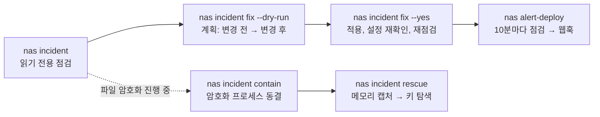

# synology-nas-cli

**명령어 하나로 C3RB3R / `.L0CK3D` 랜섬웨어 캠페인에 대해 Synology NAS를 점검하고, 두 번째 명령어로 발견된 문제를 수정한 뒤, 이후에도 터미널에서 DSM을 계속 관리할 수 있습니다.**

[English](README.md) · [繁體中文](README.zh-TW.md) · [简体中文](README.zh-CN.md) · [日本語](README.ja.md) · [한국어](README.ko.md) · [Deutsch](README.de.md) · [Español](README.es.md) · [Français](README.fr.md)

[](https://gitlab.com/aa22396584/synology-nas-cli/-/releases) [](LICENSE)

공식 저장소, 릴리스 및 이슈: https://gitlab.com/aa22396584/synology-nas-cli


`nas`는 외부 의존성이 없는 Python CLI(표준 라이브러리만 사용, Python 3.8+ 지원으로 DSM 자체에서도 실행 가능)이자 Synology DSM 7 Web API용 stdio MCP 서버입니다. 상태, 상태 점검(health), 로그, 패키지, 볼륨, Tailscale, DSM 업그레이드, 웹훅으로 푸시되는 예약 상태 알림은 물론, 2026년 10월 인터넷에 노출된 Synology NAS 장비를 겨냥한 C3RB3R / `.L0CK3D` 캠페인(Synology-SA-24:20, SA-26:13, SA-26:14) 당시 구축된 침해 점검 및 조치 도구를 제공합니다.

Synology Inc.와 제휴되어 있지 않습니다(Not affiliated with Synology Inc.). "Synology", "DSM" 및 "QuickConnect"는 Synology Inc.의 상표입니다.

## AI 에이전트에 맡기기

다음 프롬프트 중 하나를 Claude Code, Codex, Cursor, Gemini CLI, OpenCode, Grok Bot 또는 도구를 사용할 수 있는 AI 에이전트에 붙여넣으세요(Grok Bot 설정, 스킬 및 알림 루틴: [`docs/GROK-BOT.md`](docs/GROK-BOT.md)):

**한국어 프롬프트:**

```text
https://github.com/akari-sora/synology-nas-cli 를 사용하여 https://192.0.2.10:5001 에 있는 내 Synology NAS를 점검하고 수정해 줘. docs/AGENT-RUNBOOK.md 의 절차를 따라 진행해.
```

**English prompt:**

```text
Use https://github.com/akari-sora/synology-nas-cli to audit and fix my Synology NAS at https://192.0.2.10:5001. Follow docs/AGENT-RUNBOOK.md.
```


### 에이전트가 단계별로 수행하는 작업

1. **설치**: 저장소를 클론(또는 패키지를 설치)하고 `./bin/nas --version`을 확인합니다.
2. **`nas setup`**: `nas setup --json --no-input ...`을 실행하여 `~/.config/synology-nas-cli/config.json`(권한 `0600`)을 작성하고, 자격 증명을 확인하기 위해 한 번 로그인한 뒤, 첫 연결 시 DSM의 TLS 인증서 SHA-256 지문을 고정(pin)합니다.
3. **`nas doctor`**: `nas doctor --json`을 실행하여 설정, 자격 증명, 오리진(origin) 연결 가능 여부, TLS 고정 지문, 로그인, SA-26:13 기준 DSM 버전, 2단계 인증 상태, 관리자 권한, 시스템 시간 오차를 확인합니다.
4. **`nas incident`**: `nas incident --json`(및 선택적으로 `--probe --scan`)을 실행하여 DSM 버전, 취약한 패키지, 방화벽, QuickConnect, UPnP 라우터 규칙, 공인 포트, 외부 및 실패한 로그인 기록, AutoBlock, SMB1, 기본 내장 `admin` 계정, 스냅샷 스케줄, 미지원 모델의 WORM 잠금 함정, 랜섬 노트, CVE-2024-10441 익스플로잇 시도를 읽기 전용으로 점검합니다.
5. **계획 수립**: `nas incident fix --dry-run --json --ransom-scan`을 실행하여 예정된 모든 변경 사항(`before -> after`), 실제 호출될 DSM Web API, 해당 DSM 웹 UI 경로를 보여줍니다.
6. **`nas incident fix --yes`**: 승인된 계획을 순서대로(`snapshot_worm` → `snapshots` → `packages` → `smb_min_protocol` → `quickconnect` → `router_port_forwarding` → `autoblock` → `admin_account` → `firewall`, 선택 사항인 `--rotate-password` 및 `--upgrade` 포함) 적용하고, 각 설정을 다시 읽어 검증한 뒤 점검을 다시 실행합니다.
7. **선택적 `--deep` 및 `alert-deploy`**: `nas incident --deep --json`(작업 스케줄러를 통해 읽기 전용 root 수집 스크립트를 1회 실행하여 root 전용 로그, 크론탭, `/bin` 바이너리, 계정, SSH 키, `/proc` 점검) 및 `nas alert-deploy --json --test`(10분 주기로 상태 및 보안 점검 결과를 웹훅으로 푸시)를 실행합니다.

### 진행 중 사용자가 제공하는 정보

1. **NAS 주소 및 계정 (1회)**:
   - DSM URL(예: `https://192.0.2.10:5001`, VPN/Tailscale을 사용하는 경우 해당 URL 추가).
   - 관리자 사용자 이름 및 비밀번호 출처(`op://VAULT/ITEM/password`, 비밀번호 출력 명령어, 또는 OS 키체인).
   - 방화벽에서 허용할 LAN/VPN 서브넷 CIDR(예: `192.0.2.0/24`).
   - 임시 스테이징을 위한 공유 폴더 경로(선택 사항, 예: `/docker/.nas-cli-deploy`, `--deep` 및 `alert-deploy`에서 사용).
2. **6자리 2FA 코드 (2단계 인증이 켜져 있는 경우 1회)**:
   - `nas setup`이 `"field": "otp"`와 함께 종료 코드 `3`으로 종료되면 현재 6자리 코드를 제공합니다. `--trust-device`를 사용하면 DSM의 신뢰할 수 있는 장치 토큰(`0600`)을 저장하므로 이후 명령에서는 코드가 필요하지 않습니다.
3. **계획 승인**:
   - `nas incident fix --yes`를 실행하기 전에 드라이런(dry-run) 계획을 검토합니다(또한 `--rotate-password`나 `--upgrade`를 포함할지 선택합니다).

전체 에이전트 사양: [`docs/AGENT-RUNBOOK.md`](docs/AGENT-RUNBOOK.md).



## 점검 및 수정 항목

`nas incident`는 읽기 전용입니다. 각 항목은 한 줄 힌트와 함께 `PASS`, `WARN`, `FAIL` 또는 `SKIP`을 출력합니다(`--json`은 구조화된 JSON을 출력하며, 스키마는 [`schemas/incident.schema.json`](schemas/incident.schema.json)에 있습니다). 하나라도 `FAIL`인 항목이 있으면 종료 상태는 `1`입니다.

| 항목 | `nas incident` 보고 내용 | `nas incident fix` 변경 내용 |
|---|---|---|
| `dsm_version` | DSM 빌드가 해당 브랜치의 SA-26:13 패치 빌드보다 오래되었거나 SA-26:13 패치가 없는 브랜치(DSM 7.1 이하)인 경우 `FAIL`, 패치된 경우 `PASS` | `--upgrade` 사용 시: 해당 모델의 최신 공식 `.pat` 파일을 다운로드하고 PreCheck를 실행한 뒤 설치 및 재부팅 |
| `sa_26_14_packages` | 설치된 패키지를 Synology-SA-26:14(Calendar, MailStation, PHP 7.3–8.4)와 대조: 취약한 버전이 실행 중이면 `FAIL`, 설치되어 있으나 중지된 상태면 `WARN` | 실행 중인 취약한 패키지를 중지 (`--only packages`) |
| `firewall` | 방화벽이 꺼져 있고 NAS가 자체적으로 공인 IP를 보유한 경우(예: PPPoE 직접 연결) `FAIL`, NAT 뒤에서 꺼져 있으면 `WARN`, 또는 인터페이스가 일치하지 않는 트래픽을 허용하거나 규칙이 모든 소스(`source_ip: all`)를 허용하는 경우 `FAIL`/`WARN` | 방화벽을 활성화하고, LAN 인터페이스에 현재 컴퓨터의 `/32`(DSM 로그에 기록된 주소) 및 IPv4 `allowed_networks` 허용 규칙을 추가하며, `global`이 아닌 모든 인터페이스 정책을 `drop`으로 설정하고, 모든 소스 허용 규칙을 제거 (`--only firewall`) |
| `quickconnect` | QuickConnect 또는 QuickConnect 자동 라우터 포트 포워딩이 활성화된 경우 `FAIL` | QuickConnect 및 해당 UPnP 라우터 포트 포워딩을 비활성화 (`--only quickconnect`) |
| `router_port_forwarding` | DSM이 라우터에 UPnP/NAT-PMP 포트 포워딩 규칙을 활성화한 경우 `FAIL` | DSM이 관리하는 모든 라우터 포트 포워딩 규칙을 비활성화 (`--only router_port_forwarding`) |
| `public_ports` | `--probe` 사용 시에만 실행: 현재 머신에서 NAS 공인 IP의 DSM 및 파일 서비스 포트로 TCP 연결을 시도 (응답하는 포트가 있으면 `FAIL`) | `firewall`, `quickconnect`, `router_port_forwarding` 수정으로 해결됨 |
| `external_signins` | 연결 로그에 `allowed_networks` 외부의 소스 주소에서 성공한 로그인 기록이 있는 경우 `FAIL` | 없음 (비인가 접근 조사 필요; [`docs/INCIDENT-C3RB3R.md`](docs/INCIDENT-C3RB3R.md) 참조) |
| `failed_signins` | 최근 `--hours`(기본값 `24`) 동안 실패한 로그인 횟수가 `--failed-threshold`(기본값 `20`)를 초과한 경우 `WARN` | `firewall` 및 `autoblock`으로 완화됨 |
| `autoblock` | AutoBlock이 비활성화된 경우 `FAIL` | AutoBlock을 활성화(`5`분 이내 `10`회 시도 실패 시 영구 차단)하고 현재 컴퓨터의 IP와 IPv4 `allowed_networks`(및 `incident.autoblock_allow_loopback`이 true인 경우 `127.0.0.1`)를 허용 목록에 추가 (`--only autoblock`) |
| `smb_min_protocol` | SMB가 활성화되어 있고 SMB1을 허용하는 경우(`smb_min_protocol=0`) `FAIL`, SMB가 꺼져 있으나 최소 프로토콜이 SMB1인 경우 `WARN` | 최소 SMB 프로토콜을 SMB2로 상향 (`smb_min_protocol=1`, `smb_max_protocol=3`) (`--only smb_min_protocol`) |
| `admin_account` | 기본 내장 `admin` 계정이 활성화된 경우(`expired: normal`) `FAIL` | 활성화된 다른 관리자 계정이 존재하고 현재 세션이 `admin`이 아님을 확인한 뒤, 임시 root 작업을 통해 기본 내장 `admin` 계정을 비활성화 (`--only admin_account`) |
| `snapshot_schedule:<share>` | 공유 폴더별 점검: 스냅샷 스케줄이 없거나, 스케줄이 비활성화되었거나, 가장 최근 예약 스냅샷이 `snapshot_max_age_hours`(기본값 `26`시간)보다 오래된 경우 `FAIL` | 아직 스케줄이 없는 공유 폴더에 일일 스냅샷 스케줄(기본값 `03:30`)과 14일 보존 정책을 생성; 같은 실행에서 깨끗한 `--ransom-scan` 결과가 나왔거나 `--i-know-snapshots-may-rotate`가 지정된 경우에만 실행 (`--only snapshots`) |
| `snapshot_worm:<share>` | `SYNO.DisasterRecovery.Retention info`에 `worm`이 없는 모델에서 변경 불가능한 스냅샷(WORM) 잠금이 활성화된 경우 `FAIL` (DSM이 API 호출은 수락하지만 예약 스냅샷이 조용히 중단됨) | 예약 스냅샷이 재개되도록 해당 공유 폴더에서 지원되지 않는 WORM 잠금을 해제; `snapshots`와 동일한 안전 조건 적용 (`--only snapshot_worm`) |
| `ransomware_files` | `--scan` 사용 시에만 실행: File Station을 통해 공유 폴더에서 `*.L0CK3D`, `*.LOCK3D`, `read-me3.txt`를 검색 (일치하는 파일이 발견되면 `FAIL`) | 없음 (침해 사고 대응 필요; [`docs/INCIDENT-C3RB3R.md`](docs/INCIDENT-C3RB3R.md) 참조) |
| `exploit_attempts` | DSM 연결 로그에서 CVE-2024-10441 로그인 인젝션 마커(`PLUGIN_VALUE_END`, `LD_PRELOAD=`, `LD_DEBUG_OUTPUT`) 및 `incident.ioc_ips`를 검색 (시도가 발견되면 `WARN`) | 없음 (`--deep`을 실행하여 공격 성공 여부를 확인하세요) |
| `exploit_attempts_logs`, `ioc_cron`, `ioc_binaries`, `ioc_users`, `ioc_ssh_keys`, `ioc_processes` | `--deep` 사용 시에만 실행: 읽기 전용 root 수집기를 1회 실행하여 `/var/log/synoplugin.log*`, `/var/log/synoscgi.log*`, `/var/log/auth.log*`, 크론탭(`/etc/cron.d/synot*`), `/bin/libgld`, `/bin/qnetd`, `/bin/l0ck.enc`, `xdy5*`, 추가 uid-0 또는 알 수 없는 계정, `authorized_keys`, `/proc` 프로세스/연결을 검사 (알려진 C3RB3R 아티팩트 발견 시 `FAIL`, 알 수 없는 항목 발견 시 `WARN`) | 없음 (침해 사고 대응 필요; [`docs/INCIDENT-C3RB3R.md`](docs/INCIDENT-C3RB3R.md) 참조) |

`SKIP`은 항상 사유를 명시합니다. 해당 항목에 플래그(`--probe`, `--scan`)가 필요하거나, API가 오류를 반환했거나, NAS에서 해당 기능을 사용하지 않는 경우(Btrfs/Snapshot Replication 미사용, DSM에 설정된 라우터 없음)입니다.

## 설치

### Git 체크아웃에서 바로 실행 (설치 불필요)

```bash
git clone https://gitlab.com/aa22396584/synology-nas-cli.git synology-nas-cli
cd synology-nas-cli
./bin/nas --help                     # runs directly from the checkout (Python 3.8+ stdlib only)
ln -s "$PWD/bin/nas" ~/bin/nas       # optional: put `nas` on PATH
```

### GitLab 릴리스 또는 로컬 체크아웃에서 `pip`로 설치

```bash
pip install https://gitlab.com/aa22396584/synology-nas-cli/-/archive/v1.0.0/synology-nas-cli-v1.0.0.tar.gz
# or from a local checkout:
pip install -e .                     # or: pipx install .
nas --help
```

### Windows에서 실행 (`py` 사용)

```powershell
git clone https://gitlab.com/aa22396584/synology-nas-cli.git synology-nas-cli
cd synology-nas-cli
py -3 bin\nas --help
# or install the console script:
py -3 -m pip install -e .
nas --help
```

### 초기화 및 로그인 확인

대화형 또는 에이전트 기반 원스텝 설정:

```bash
nas setup --origin https://192.0.2.10:5001 --user ops --password-source op:op://VAULT/ITEM/password --allowed-network 192.0.2.0/24
nas doctor
```

또는 템플릿에서 설정 파일을 생성하여 직접 편집할 수 있습니다:

```bash
nas config init                      # writes ~/.config/synology-nas-cli/config.json (mode 600)
$EDITOR ~/.config/synology-nas-cli/config.json
nas config show                      # effective config, commands masked
nas whoami                           # one login: account, admin flag, DSM version, credential source
```

## 환경에 맞는 설정 선택

| 환경 | 백엔드 | 비밀번호 출처 | 비고 |
|---|---|---|---|
| 1Password를 사용하는 macOS | `password` | `op://VAULT/ITEM/password` 참조; 1Password 앱을 통해 `op` 로그인 | 첫 실행 시 앱에서 `op`를 승인합니다. 동일한 항목에서 2FA 코드를 가져옵니다(`op item get --otp`). |
| 1Password를 사용하지 않는 macOS | `password` | `nas login --save`(키체인), 또는 `password_command` = `security find-generic-password -s synology-nas -a USER -w` | `nas login`은 세션을 캐시하므로 이후 명령에서 다시 로그인하지 않습니다. |
| Linux 서버, cron, systemd 타이머 | `password` | 1Password 서비스 계정(`OP_SERVICE_ACCOUNT_TOKEN` 또는 토큰 파일) + `op://` 참조, 또는 `password_command`(`secret-tool lookup ...`, `pass show ...`) | 터미널이 없으므로 프롬프트가 비활성화됩니다. 비대화형 자격 증명 출처를 설정하세요. |
| Windows | `password` | PowerShell을 사용한 `password_command`([자격 증명](README.md#credentials) 참조), 또는 `NAS_USER` + `NAS_PASSWORD` | CredentialManager PowerShell 모듈(`New-StoredCredential`)로 자격 증명을 저장하고 `password_command`에서 `Get-StoredCredential`로 읽습니다. |
| NAS 자체에서 실행 | `local` | 없음: DSM 작업 스케줄러를 통해 root 권한으로 실행 | `nas alert-deploy`가 이 환경을 구성합니다. DSM에 내장된 Python 3.8을 사용합니다. |
| 서비스 계정을 사용하는 CI / 헤드리스 환경 | `password` | `OP_SERVICE_ACCOUNT_TOKEN`(CI 시크릿) + `op://` 참조 | 또는 CI 시크릿 저장소를 읽는 `NAS_PASSWORD_COMMAND`를 사용합니다. `NAS_PASSWORD`도 작동합니다. |

## 침해 점검 및 대응 빠른 시작

```bash
nas incident                       # read-only audit
nas incident --probe               # also test the public address from this machine
nas incident --scan                # also search every share for ransom notes (minutes)
nas incident --deep                # also indicators of compromise via one read-only root script (needs deploy.stage_dir)
nas --json incident                # machine-readable

nas incident fix --dry-run         # the plan: every change (current -> new), the API calls, the DSM UI path
nas incident fix                   # same plan, asks before applying
nas incident fix --yes             # apply without asking
nas incident fix --only firewall,smb_min_protocol
nas incident fix --skip admin_account
nas incident fix --ransom-scan --yes          # a clean scan also allows the snapshot fixes
nas incident fix --upgrade --rotate-password --yes   # opt-in extras

nas incident contain                       # list processes that look like an encryptor (signals nothing without --yes / NAS_YES=1)
nas incident contain --yes                 # SIGSTOP them (all threads) so their memory and keys stay intact
nas incident contain --yes --stop-sync     # also stop Cloud Sync, Synology Drive, Hyper Backup, Container Manager
nas incident contain --yes --save-exe /volumeUSB1/usbshare/evidence   # copy each executable (sha256 recorded)
nas incident contain --release             # SIGCONT the frozen PIDs and start the packages --stop-sync stopped

nas incident rescue --yes --capture-dir /usbshare1/rescue                  # freeze, capture memory, recover key candidates
nas incident rescue --yes --capture-dir /usbshare1/rescue --sample /share/a.pdf.L0CK3D   # test each candidate on a copy
nas incident rescue --yes --capture-dir /usbshare1/rescue --decrypt-from /share/docs --decrypt-to /Volumes/USB/out
```

파일이 암호화되고 있는 도중이라면 `nas incident contain --yes`가 첫 번째로 실행할 명령입니다. 이 명령은 세션 키가 메모리에 그대로 남아 있도록 암호화 프로세스를 동결(`SIGSTOP` 전송, 절대 강제 종료하지 않음)한 뒤 다음 단계를 출력합니다.

- 후보 프로세스: 알려진 이름(`libgld`, `qnetd`, `xdy5*`, `incident.ioc_process_names`), `/tmp`, `/var/tmp`, `/dev/shm`, `/volume*/@tmp`에 위치한 실행 파일, `*.L0CK3D` / `read-me3.txt` 파일을 쓰기 모드로 열고 있는 프로세스, 그리고 Synology 경로 외부에서 높은 CPU를 점유하는 프로세스(컨테이너 제외). 실행 파일이 Synology 경로(`/usr/syno`, `/var/packages`, `/bin`, ...) 아래에 있는 프로세스는 열려 있는 파일 외에 추가 근거가 있어야 후보에 포함되며, 스캔 결과의 `skipped` 항목에 해당 프로세스를 추가할 수 있는 `--pid` 옵션과 함께 나열됩니다. PID 1, 커널 스레드, 스캔 스크립트 자신 및 상위 프로세스에는 `--pid`를 지정하더라도 절대 시그널을 보내지 않습니다.
- 동결 작업은 스캔에서 나열된 프로세스와 PID, 시작 시간(`/proc/PID/stat` 필드 22), 실행 파일이 모두 일치하는 프로세스에만 시그널을 보냅니다. 그사이에 재사용된 PID는 보고된 후 건너뜁니다.
- `--stop-sync`: 동결 후 Cloud Sync, Synology Drive, Hyper Backup, Container Manager(또는 Docker) 패키지 중 실행 중인 패키지를 `SYNO.Core.Package.Control stop`으로 중지합니다. Container Manager를 중지하면 모든 컨테이너가 중지됩니다. 중지한 패키지 ID는 현재 컴퓨터의 세션 캐시 옆에 있는 `contain-packages.json`에 기록됩니다.
- `--release`: NAS에 기록된 PID(`incident.contain_state_file`) 및 지정한 `--pid`에 `SIGCONT`를 보낸 다음, 기록된 각 패키지에 대해 `SYNO.Core.Package.Control start`를 실행합니다. 모든 패키지가 시작되면 기록 파일은 삭제됩니다. 개별 컨테이너가 아닌 패키지를 시작하므로, 각 컨테이너는 Container Manager의 재시작 정책(자동 재시작)에 따라 패키지와 함께 다시 시작됩니다.

`nas incident rescue`는 실행 시점에 `incident.rescue_commit`에 지정된 커밋의 [soimy/c3rb3r-rescue](https://github.com/soimy/c3rb3r-rescue)를 가져와 메모리 캡처 및 키 복구를 수행합니다:

1. `contain`: 위에서 설명한 동결 단계를 수행합니다(`--no-contain`으로 건너뛸 수 있음).
2. `toolkit`: 툴킷을 클론하고 커밋을 확인합니다. `--rescue-dir DIR`은 `git status --porcelain`이 비어 있고 HEAD가 해당 커밋과 일치할 때 기존 체크아웃을 사용합니다(다른 커밋을 사용하려면 `--force-unpinned-toolkit` 지정).
3. `capture`: NAS에서 root 권한으로(임시 작업 스케줄러 작업 또는 `--backend local`을 통해 직접 실행) 동결된 각 PID에 대해 툴킷의 `capture_process_memory.py inspect` 및 `capture`를 실행하여 `--capture-dir` 아래의 새 케이스 폴더에 저장합니다. 이 폴더는 반드시 USB 디스크나 피해 데이터와 다른 볼륨에 있어야 하며, 볼륨은 `/proc/self/mountinfo`의 마운트 소스로 비교합니다(모든 Btrfs 공유 폴더는 고유한 디바이스 번호를 가진 개별 서브볼륨이므로 디바이스 번호만으로는 볼륨을 구분할 수 없음). 동일한 볼륨에 캡처하려면 `--force-same-volume`을 사용합니다. 경로에 심볼릭 링크가 포함된 `--capture-dir`은 거부됩니다. `--backend password` 사용 시 캡처 도구는 `deploy.stage_dir`을 거치며(인라인으로 포함된 작업 스크립트에는 DSM이 4803을 반환함), sha256이 업로드된 파일과 일치하는 경우에만 표준 입력(stdin)을 통해 실행됩니다. 이후 File Station에서 목록을 조회하고 다운로드할 수 있도록 케이스 폴더의 소유권을 로그인한 DSM 계정(`id -u`, `chown`)으로 넘깁니다.
4. `pull`: 현재 컴퓨터의 작업 디렉터리(`workdir`)에 여유 공간(캡처의 읽을 수 있는 바이트 수 + 256 MiB)이 있는지 확인한 후 캡처 파일을 다운로드합니다. `--backend local` 사용 시 NAS의 시스템 파티션에 위치한 작업 디렉터리는 거부됩니다. `--keep-on-nas`를 사용하면 캡처 후 중단합니다.
5. `venv`: 가상 환경(Python `incident.rescue_min_python`, 기본 3.11, 또는 `--python`)을 생성하고 `pip --require-hashes`로 툴킷 요구 사항을 설치합니다. 고정된 커밋에 대해 numpy 2.3.5, cryptography 50.0.2, cffi 2.1.1, pycparser 3.12의 모든 PyPI 파일 sha256이 `nas/rescue.py`에 보관되어 있으며, `--force-unpinned-toolkit`을 사용한 다른 커밋은 해시 검사 없이 설치합니다. 그런 다음 툴킷의 자체 테스트를 실행합니다.
6. `keys`: 각 캡처에 대해 `recover_process_key.py`를 실행합니다. 후보 키는 권한 400인 파일로 저장되며 화면에 절대 출력되지 않습니다. 분석된 암호화 프로그램과 일치하지 않는 프로세스는 여기서 `ValueError: Executable does not match the reviewed sample profile` 오류와 함께 중단됩니다.
7. `sample` (`--sample NAS_FILE [--expected-sha256 HEX]`): 파일을 복사하고 복사본에 각 후보 키를 시험해 봅니다.
8. `decrypt` (`--decrypt-from NAS_FOLDER --decrypt-to DIR`): 검증된 후보 키로 복사본을 복호화합니다(`--sample`로 검증된 키가 없을 때 첫 번째 후보 키를 사용하려면 `--force-unverified-key` 지정).

`--force`는 `--force-same-volume`, `--force-unverified-key`, `--force-unpinned-toolkit`을 동시에 활성화합니다.

각 단계는 `<workdir>/state.json`(`--workdir`, 기본값 `~/.local/share/synology-nas-cli/rescue/<time>`)에 기록되며, 동일한 명령을 다시 실행하면 중단된 지점부터 이어서 진행합니다. NAS에 기록되는 항목은 다음과 같습니다:

- 케이스 폴더 `--capture-dir/case-<time>-<random>/pid-N` (유지됨; 로그인한 계정 소유; 캡처본을 다른 곳에 안전하게 보관한 뒤 삭제하세요). 캡처 도구는 표준 입력(검증된 바이트)에서 실행되므로 케이스 폴더에 도구 사본이 기록되지 않습니다. chown/chmod 탐색은 `O_NOFOLLOW`로 열린 파일 디스크립터를 통해 수행되며 심볼릭 링크는 건드리지 않습니다. DSM 공유 폴더 테스트에서 권한 0700으로 생성된 폴더가 이후 0755로 표시되는 현상이 있었으므로(파일은 0400 유지), 해당 공유 폴더를 누가 읽을 수 있는지 확인하세요.
- `--backend password` 사용 시: 업로드된 도구 `deploy.stage_dir/nas-rescue-tool-<random>.py`와 결과 파일 `deploy.stage_dir/nas-incident-rescue-<token>.json`(모두 실행 후 삭제됨), 그리고 임시 root 작업 `nas-incident-rescue`(실행 후 삭제됨).
- `contain` 단계: 임시 작업 `nas-incident-contain`과 그 결과 파일(삭제됨), 그리고 동결 상태 파일 `incident.contain_state_file`(`nas incident contain --release` 실행 시 제거되는 `/root/.nas-incident-contain.json`).

JSON: [`schemas/incident-rescue.schema.json`](schemas/incident-rescue.schema.json).

점검 결과에 `ransomware_files FAIL` 또는 `external_signins FAIL`이 나타나면 단순 보안 강화 단계를 넘어선 상태입니다. [`docs/INCIDENT-C3RB3R.md`](docs/INCIDENT-C3RB3R.md)의 절차를 따르세요(우선 격리, 증거 보존, 스냅샷에서 복원).

## `nas incident fix`

점검을 실행하고, 계획을 출력한 뒤, 확인을 요청하고(`--yes`, `NAS_YES=1` 또는 `assume_yes: true`는 자동으로 승인; 터미널이 없고 해당 옵션도 없으면 `Not applied: add --yes (or NAS_YES=1).` 메시지와 함께 종료 코드 3으로 종료), 아래 순서대로 변경 사항을 적용한 다음 각 설정을 다시 읽어 확인하고, 점검을 다시 실행하여 변경 전 -> 변경 후 결과를 출력합니다. `--dry-run`은 계획과 정확한 API 호출만 출력하며 쓰기 요청을 보내지 않습니다. 변경 작업이 실패하거나 최종 점검에 여전히 FAIL이 남아 있으면 종료 상태는 1입니다.

적용 순서: `snapshot_worm` -> `snapshots` -> `packages` -> `smb_min_protocol` -> `quickconnect` -> `router_port_forwarding` -> `autoblock` -> `admin_account` -> `firewall` -> `rotate_password`(선택 사항) -> `upgrade`(선택 사항, 재부팅됨).

| 수정 항목 | 변경 내용 | DSM 웹 UI (수동 설정 경로) | 원시 호출 (`nas api ... --allow-write`) |
|---|---|---|---|
| `snapshot_worm` | 변경 불가능한 스냅샷을 지원하지 않는 모델의 공유 폴더에서 WORM 잠금을 해제 (`snapshots`와 동일한 안전 조건 적용: 해당 공유 폴더의 스케줄이 다시 스냅샷을 생성하기 시작함) | Snapshot Replication > Snapshots > Settings (지원되지 않는 모델에서는 옵션이 숨겨져 있으므로 API가 유일한 방법임) (Snapshot Replication > 스냅샷 > 설정) | `SYNO.DisasterRecovery.Retention set_worm_lock --version 1 type=Share name=SHARE worm_lock_enable=false worm_lock_day=7` |
| `snapshots` | 스케줄이 없는 공유 폴더에 일일 스케줄(`incident.snapshot_hour:minute`)을 생성하고, 보존 정책이 아직 없는 경우에만 일 단위 보존 정책(`incident.snapshot_retain_days`, 14일)을 설정. 기존 스케줄(활성화 여부 무관) 및 기존 보존 정책은 그대로 유지함. 같은 실행에서 깨끗한 `--ransom-scan` 결과가 나왔거나 `--i-know-snapshots-may-rotate` / `--force`가 지정된 경우에만 실행됨(스냅샷 생성이 시작되면 보존 정책이 적용되어 가장 오래된 스냅샷이 삭제될 수 있음) | Snapshot Replication > Snapshots > select the share > Settings > Schedule / Retention Policy (Snapshot Replication > 스냅샷 > 공유 폴더 선택 > 설정 > 예약 / 보존 정책) | `SYNO.Core.Share.Snapshot set_schedule --version 1 name=SHARE enable_snapshot_schedule=true 'schedule={...}' task_id=-1` 실행 후 `SYNO.DisasterRecovery.Retention set --version 1 name=SHARE type=Share policyType=64 retainDay=14 ...` |
| `packages` | SA-26:14에 명시된 실행 중인 패키지를 중지 (업데이트 또는 제거는 직접 수행) | Package Center > Installed > package > Update or Stop (패키지 센터 > 설치됨) | `SYNO.Core.Package.Control stop --version 1 id=PHP7.4` |
| `smb_min_protocol` | 최소 SMB 프로토콜을 SMB2로 설정 (SMB1 전용 클라이언트는 접근 불가) | Control Panel > File Services > SMB > Advanced Settings (제어판 > 파일 서비스 > SMB > 고급 설정) | `SYNO.Core.FileServ.SMB set --version 3 smb_min_protocol=1 smb_max_protocol=3` |
| `quickconnect` | QuickConnect 비활성화 및 자동 라우터 포트 포워딩 비활성화 | Control Panel > External Access > QuickConnect (제어판 > 외부 액세스 > QuickConnect) | `SYNO.Core.QuickConnect set --version 2 enabled=false`; `SYNO.Core.QuickConnect.Upnp set --version 1 enabled=false` |
| `router_port_forwarding` | DSM이 UPnP/NAT-PMP를 통해 관리하는 라우터 포트 포워딩 규칙을 비활성화(삭제하지 않음) | Control Panel > External Access > Router Configuration (제어판 > 외부 액세스 > 라우터 구성); 라우터 자체 관리 페이지도 확인 필요 | `SYNO.Core.PortForwarding.Rules save --version 1 'rules=[...enable:false...]' task_id_suffix=PF`, `save_status` 폴링 |
| `autoblock` | AutoBlock 활성화 (5분 내 10회 시도); DSM에 기록된 현재 컴퓨터의 주소, IPv4 `allowed_networks`, 그리고 `incident.autoblock_allow_loopback`이 켜진 경우에만 `127.0.0.1`을 허용 목록에 추가 | Control Panel > Security > Protection > Auto Block; Allow/Block List (제어판 > 보안 > 보호 > 자동 차단; 허용/차단 목록) | `SYNO.Core.Security.AutoBlock set --version 1 enable=true attempts=10 within_mins=5 enable_expire=false expire_day=0`; `SYNO.Core.Security.AutoBlock.Rules create --version 1 type=allow block_days=0 overwrite=true 'ip=["127.0.0.1"]'` |
| `admin_account` | 기본 내장 `admin` 계정을 비활성화. 먼저 CLI가 `admin`으로 로그인되어 있는지, 붙여넣은 `NAS_SID` 세션이 어떤 계정을 사용하는지(`SYNO.Core.Desktop.Initdata`), 활성화된 다른 `administrators` 그룹 구성원이 있는지 확인하며, `--force-admin`(또는 `--force`)을 사용하면 확인 결과와 상관없이 적용함. 비밀번호 세션에서 `SYNO.Core.User set`을 호출하면 105를 반환하므로, 실행 후 삭제되는 임시 작업 스케줄러 작업에서 root 권한으로 실행됨 | Control Panel > User & Group > admin > Edit > Disable this account (제어판 > 사용자 및 그룹) | root 작업 스크립트: `/usr/syno/bin/synowebapi --exec api=SYNO.Core.User method=set version=1 name='"admin"' expired='"now"'` (`--backend local` 사용 시: `SYNO.Core.User set --version 1 name=admin expired=now`) |
| `firewall` | 방화벽 활성화; LAN 인터페이스에 허용 규칙(DSM에 기록된 현재 컴퓨터의 `/32` + IPv4 `allowed_networks`) 추가(프로필에 LAN 인터페이스가 없는 경우에만 `global`에 추가); `global`을 제외한 모든 인터페이스(eth*, pppoe, ppp0, vpn, wlan0, ...)는 일치하지 않는 트래픽을 차단(`drop`); 모든 소스를 허용하는 규칙은 제거 | Control Panel > Security > Firewall > Edit Rules (제어판 > 보안 > 방화벽 > 규칙 편집) | `SYNO.Core.Security.Firewall.Profile set --version 1 'profile={...}' profile_applying=false` 실행 후 `SYNO.Core.Security.Firewall.Profile.Apply start --version 1 name=default profile_applying=false`, `status task_id=...` 폴링, `stop` |
| `rotate_password` (`--rotate-password`) | 로그인된 계정의 비밀번호를 무작위 24자 새 비밀번호로 변경. 먼저 자격 증명 저장소(표준 입력으로 `op item edit`를 실행하여 항목 기록에 이전 값을 남기는 1Password 항목, 또는 이전 값을 `<store_service>-previous`에 복사해 두는 키체인 항목)에 기록한 다음 DSM에서 변경함. DSM이 거부하면 이전 비밀번호를 저장소에 복원하고, DSM 호출이 중단되면 저장소는 새 비밀번호를 유지함. 설정을 다시 읽고 새 로그인을 검증함. 비밀번호는 절대 출력되지 않음. 1Password 또는 키체인 항목에만 기록하므로, 명령어, 환경 변수 또는 프롬프트에서 가져온 비밀번호는 DSM과 해당 출처에서 직접 변경해야 함 | Personal > Account > change password (개인 > 계정) | `SYNO.Core.NormalUser set --version 2 password=... old_password=...` |
| `upgrade` (`--upgrade`) | 최신 공식 `.pat` 파일을 다운로드 및 업로드하고, PreCheck를 실행한 뒤 설치; NAS가 재부팅됨 | Control Panel > Update & Restore > Manual DSM Update (제어판 > 업데이트 및 복원) | `nas upgrade --yes` |

**방화벽 잠김 방지 확인.** 방화벽을 변경하기 전에 CLI는 다음 사항을 확인하고 계획에 표시합니다: 오리진에 대해 HTTP(S) 프록시가 설정되어 있는지, 오리진이 루프백 주소(SSH 터널, 로컬 프록시)이거나 공인 주소인지, DSM 연결 로그에 기록된 이 계정의 가장 최근 성공한 로그인 소스가 루프백, IPv6 또는 공인 주소인지, 또는 로그에 기록된 소스 주소가 현재 컴퓨터가 NAS에 도달할 때 사용하는 로컬 주소와 다른지(NAT, 프록시 경유, 또는 다른 기기에서의 로그인) 여부입니다. 확인을 통과하지 못하면 변경 작업은 보류되며, `--force-firewall`(또는 `--force`)을 지정해야만 계획 노트에 확인 결과를 포함한 채로 적용됩니다. 허용 목록에는 DSM이 로그에 기록한 주소가 포함됩니다. 적용 후에는 동일한 오리진을 통해 처음부터 다시 로그인을 시도하며, 실패할 경우 복구 방법을 출력합니다(LAN의 다른 컴퓨터, Synology Assistant / find.synology.com, DSM이 방화벽에서 필터링하지 않는 `127.0.0.1`로 인식하는 Tailscale 사용자 공간 모드, 그리고 기기 후면 RESET 버튼 모드 1). IPv6 허용 목록 항목은 방화벽 규칙으로 작성되지 않으므로 IPv6 소스는 차단됩니다. `100.64.0.0/10`(Tailscale)은 CGNAT ISP가 WAN 측에서 사용하는 대역이기도 하므로, 자체적으로 PPPoE 연결을 수립하는 NAS에서 `global` 허용 규칙을 넣으면 다른 가입자의 접근을 허용하게 됩니다. 이 때문에 규칙은 LAN 인터페이스에 적용됩니다.

**자체 공인 주소를 가진 NAS**(직접 PPPoE를 연결하거나 DMZ에 위치한 경우)는 앞단에 라우터 NAT가 없으므로 DSM 방화벽이 모든 DSM 서비스와 인터넷 사이의 유일한 방어선이 됩니다. QuickConnect와 UPnP 포트 포워딩은 NAT 뒤에서도 DSM을 인터넷에 노출시킵니다.

## MCP 서버 및 에이전트 스킬

### MCP 서버 (`nas mcp`)

`nas mcp`는 stdio를 통해 Model Context Protocol 서버(JSON-RPC 2.0; 프로토콜 버전 `2025-11-25`, `2025-06-18`, `2025-03-26`, `2024-11-05`)를 실행하며 다음 15개의 도구를 노출합니다: `setup`, `doctor`, `whoami`, `status`, `health`, `net`, `services`, `logs`, `alert`, `incident_audit`, `incident_fix`, `pkg_list`, `volume_list`, `tailscale_status`, `api_read`.

```bash
claude mcp add synology-nas --scope user -- /path/to/synology-nas-cli/bin/nas mcp
claude mcp add synology-nas --scope user -- /path/to/synology-nas-cli/bin/nas mcp --auto-confirm
```

`incident_fix`는 호출에 `confirm: true`가 있거나 `--auto-confirm`으로 시작된 서버에서 `confirm` 인자가 생략된 경우 계획을 적용하며, `confirm: false`는 항상 드라이런(dry run)으로 동작합니다. `NAS_YES`와 `assume_yes`는 MCP 호출 동작을 변경하지 않습니다. `setup` 도구는 설정에 아직 없는 필드를 채우며 `op:`, `keychain`, `env` 자격 증명 출처를 받습니다. `origins`, `user`, `password_source`, `otp_source`, `tls`, `allowed_networks`, `stage_dir` 또는 `webhook_file`에 대해 이미 적용 중인 값(설정 파일, `NAS_ORIGINS` 같은 환경 변수, 또는 서버의 `--lan-origin`)을 변경하거나 `command:` 출처를 설정하려면 명령줄에서 `nas setup`을 사용해야 합니다(도구는 해당 필드 이름을 명시하며 종료 코드 2를 반환합니다). 기본 내장 값(`tls` `pin`, `otp_source` `op`)은 이미 설정된 값으로 간주되지 않으며, 공인 `allowed_networks` 항목은 명령줄에서 추가합니다. `user`, `descr`, 로그의 `text`, `cmdline` 및 파일 이름 같은 필드에는 NAS에 로그인을 시도하거나 프로세스를 실행하는 주체가 지정한 텍스트가 담깁니다.

전체 도구 목록, 스키마 및 Claude Code, Claude Desktop, Cursor, Codex 설정 방법: [`docs/MCP.md`](docs/MCP.md).

### 에이전트 스킬 설치 스크립트

[`skills/`](skills/) 폴더에는 [`skills/synology-nas/SKILL.md`](skills/synology-nas/SKILL.md)와 [`skills/synology-ransomware-response/SKILL.md`](skills/synology-ransomware-response/SKILL.md)가 포함되어 있습니다. 기존 스킬 디렉터리(`~/.claude/skills`, `~/.cursor/skills`, `~/.codex/skills`, `~/.agents/skills`, `~/.grok/skills`, `~/.gemini/skills`, `~/.config/opencode/skills`, `~/.hermes/shared-skills`)에 설치할 수 있습니다:

```bash
./skills/install.sh                  # symlink skills into detected agent folders
./skills/install.sh --copy           # copy instead of symlink (--dry-run, --uninstall also available)
```

Windows PowerShell:

```powershell
.\skills\install.ps1                 # supports --copy, --dry-run, --uninstall
```

## 알림 및 웹훅

`nas alert`는 모든 상태 및 보안 점검을 1회 실행하며, 경고(warning) 또는 심각(critical) 수준의 항목이 있으면 종료 코드 1로 종료합니다. 각 결과는 `{level, code, kind, message}` 형식입니다. `--push FILE`을 지정하면 마지막으로 성공한 푸시 이후 변경된 내용(새로운 상태, 여전히 지속 중인 경고/심각 항목에 대한 24시간 주기 알림, 모든 이벤트, 해결된 키, 하루 1회 하트비트)만 FILE의 `{"url", "header"}`로 POST합니다. 알림 코드, 본문 형식 및 수신기 예시는 [`docs/ALERTS.md`](docs/ALERTS.md)에 있습니다.

실행하는 세 가지 방법:

1. **NAS에 자동 배포:** `nas alert-deploy`는 root 전용 폴더(`deploy.root_dir`)에 코드를 복사하고, 10분마다 `nas --backend local alert --push`를 실행하는 root 작업 스케줄러 작업을 생성하며, DSM 자체 알림 웹훅(Control Panel > Notification > Webhooks (제어판 > 알림 > 웹훅))도 동일한 URL을 가리키도록 설정합니다.
2. **NAS에서 수동 설정:** 위 세 가지 구성을 DSM UI에서 직접 설정합니다. 자세한 단계는 [`docs/ALERTS.md`](docs/ALERTS.md#manual-install-on-the-nas)를 참조하세요.
3. **항상 켜져 있는 다른 머신에서 실행:** cron 또는 launchd를 사용해 `password` 백엔드로 `nas alert --push ...`를 실행합니다. [`docs/ALERTS.md`](docs/ALERTS.md#from-another-machine-cron--launchd)를 참조하세요.

수신기(Receivers): 하나의 헤더와 함께 JSON POST를 받는 모든 HTTPS 엔드포인트(일반 JSON 수신기), POST마다 에이전트 실행을 시작하는 챗봇 "루틴" 웹훅(Grok Bot 스타일), 또는 웹훅을 전혀 사용하지 않고 DSM 자체 경고/오류 이벤트를 처리하는 DSM 내장 알림(이메일, DS finder / Synology 앱을 통한 Synology 모바일 푸시)을 사용할 수 있습니다. 세 가지 방식 모두 [`docs/ALERTS.md`](docs/ALERTS.md#receivers)에 설명되어 있습니다.

## NAS 상태를 변경하는 작업

- NAS를 변경하는 명령어: `incident fix`(확인 후 실행, 또는 `--yes`), `incident contain`(`--yes` 사용 시 `SIGSTOP`; `--stop-sync`는 패키지 중지; `--release`), `incident rescue`(확인 후 실행, 또는 `--yes`: 프로세스 동결, 임시 root 작업, 캡처 폴더 생성), `upgrade`(`--yes`가 없어도 `.pat` 파일을 업로드하고 PreCheck를 실행한 뒤 업로드 파일을 삭제함; `--yes` 사용 시 설치 진행), `pkg start|stop|install|uninstall|default-volume VOL`, `volume atime`, `tailscale login-url`, `alert-deploy`, `login --save` / `logout --forget`(로컬 키체인만 변경), `trust --reset`(로컬 파일만 변경), 그리고 `--allow-write`를 사용한 `api`. `ransom-scan`, `incident --scan`, `incident fix --ransom-scan`은 NAS에 임시 File Station 검색 작업을 생성합니다(실행 후 중지 및 정리됨). `nas api`는 `--allow-write`, `--yes` 또는 `NAS_YES=1`이 있을 때만 읽기가 아닌 메서드를 전송합니다.
- `--yes`, `NAS_YES=1` 및 설정 파일의 `assume_yes: true`는 CLI의 모든 확인 프롬프트에 예를 답합니다: `incident fix`는 계획을 적용하고(`--upgrade` 포함 시 노트가 있는 PreCheck를 포함해 DSM을 설치하고 NAS를 재부팅하며, `--rotate-password` 포함 시 비밀번호를 변경함), `upgrade`는 PreCheck 후 설치 및 NAS 재부팅을 수행하며, `incident contain`은 후보 프로세스를 동결하고(`--stop-sync` 포함 시 패키지 중지), `incident rescue`는 각 단계를 실행하며, `api`는 `--allow-write`와 동일하게 쓰기 메서드를 전송합니다. `nas mcp`는 이러한 설정이 아니라 각 호출의 `confirm` 인자와 `--auto-confirm` 플래그를 따릅니다.
- `incident fix --dry-run`은 전송할 모든 쓰기 호출을 출력합니다. 계획은 항상 현재 값 -> 새 값을 보여줍니다.
- 비밀번호, SID, SynoToken은 절대 출력되지 않습니다. `nas api`는 일련번호와 계정 이름이 포함될 수 있는 원시 DSM 출력을 그대로 출력하며, 다른 명령어들은 해당 정보를 필터링합니다.
- 비밀번호 로그인이 실패할 때마다 AutoBlock 실패 횟수에 합산됩니다. CLI는 로그인 실패 시 한 번만 보고하고 즉시 중단합니다.
- `alert-deploy`는 공유 폴더 외부의 root 전용 폴더에 NAS에서 root 권한으로 실행되는 코드를 설치합니다.

## 설정, 자격 증명, TLS, 백엔드 및 전체 명령어 참조

JSON 설정 파일 키와 환경 변수([Configuration](README.md#configuration)), 자격 증명 우선순위 체인·2단계 인증·세션 캐시·TLS 인증서 고정(TOFU) 및 AutoBlock 주의 사항([Credentials](README.md#credentials) 및 [TLS](README.md#tls)), `password` / `chrome` / `local` 백엔드 비교([Backends](README.md#backends)), 그리고 전체 CLI 명령어 요약([Command reference summary](README.md#command-reference-summary))은 영문 README의 해당 섹션을 참조하세요.

### 문서 색인

- [`docs/AGENT-RUNBOOK.md`](docs/AGENT-RUNBOOK.md) — AI 에이전트를 위한 단계별 실행 절차 (`setup` → `doctor` → `incident` → `incident fix` → `--deep` → `alert-deploy`).
- [`docs/INCIDENT-C3RB3R.md`](docs/INCIDENT-C3RB3R.md) — 2026 C3RB3R / `.L0CK3D` 랜섬웨어 캠페인에 대한 공개 침해 사고 안내 페이지, 보안 권고, 타임라인, 침해 지표(IOC), 의사결정 단계, 복구 및 예방 방법.
- [`docs/HARDENING.md`](docs/HARDENING.md) — 출처가 명시된 설명, 영문 / 번체 중국어(繁體中文) DSM UI 경로, 대응하는 `nas` 명령어를 포함한 Synology DSM 보안 강화 체크리스트.
- [`docs/TROUBLESHOOTING.md`](docs/TROUBLESHOOTING.md) — 방화벽/AutoBlock/2FA 잠김 해제, 모드 1 리셋, 리버스 프록시 및 Tailscale `127.0.0.1`, 미지원 WORM 모델, Google Drive 일일 750 GB 할당량, SMB1 기기, DSM API 오류 코드, "최신 상태" 브랜치 함정, TLS 고정 지문 초기화 해결 방법.
- [`docs/MCP.md`](docs/MCP.md) — MCP 서버 도구, 인자, 스키마 및 클라이언트 설정 방법.
- [`docs/GROK-BOT.md`](docs/GROK-BOT.md) — Grok Bot: 봇의 클라우드 컴퓨터(Tailscale) 또는 Grok Bot 앱이 설치된 컴퓨터에서의 `nas` 실행, 스킬, 알림 루틴 웹훅 및 봇 설명.
- [`docs/ALERTS.md`](docs/ALERTS.md) — 알림 코드, 웹훅 페이로드, 수신기 및 배포 방법 (`alert-deploy`, 수동 DSM 작업, cron/launchd).
- [`docs/DSM-API-NOTES.md`](docs/DSM-API-NOTES.md) — `nas`가 의존하는 DSM 7 Web API 특이 사항 및 파라미터 인코딩 규칙.
- [`docs/EXIT-CODES.md`](docs/EXIT-CODES.md) — CLI 및 MCP `_meta.exit_code` 정의 (`0`–`7`, `130`).
- [`schemas/`](schemas/) — `incident`, `incident-fix`, `incident-contain`, `incident-rescue`, `alert`, `status`, `health`, `whoami`에 대한 JSON 스키마.
- [`llms.txt`](llms.txt) — LLM 에이전트용 진입점 색인.

## License

MIT, Copyright (c) 2026 Akari Sora. See [LICENSE](LICENSE).
