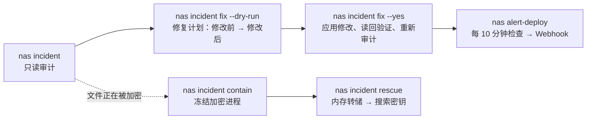

# synology-nas-cli

**用一条命令针对 C3RB3R / `.L0CK3D` 勒索软件攻击活动审计 Synology NAS，再用一条命令修复发现的问题，之后还能继续在终端中日常管理 DSM。**

[English](README.md) · [繁體中文](README.zh-TW.md) · [简体中文](README.zh-CN.md) · [日本語](README.ja.md) · [한국어](README.ko.md) · [Deutsch](README.de.md) · [Español](README.es.md) · [Français](README.fr.md)

[](https://gitlab.com/aa22396584/synology-nas-cli/-/releases) [](LICENSE)

主仓库、版本发布与问题反馈：https://gitlab.com/aa22396584/synology-nas-cli


`nas` 是一个零外部依赖的 Python 命令行工具（仅使用标准库，要求 Python 3.8+，因此也可直接在 DSM 本机运行）兼 stdio MCP 服务器，基于 Synology DSM 7 Web API 构建：支持系统状态、健康度、连接日志、套件、存储空间、Tailscale、DSM 升级、定时健康告警并推送至 Webhook，以及在 2026 年 10 月针对暴露在公网的 Synology NAS 的 C3RB3R / `.L0CK3D` 勒索软件攻击活动（Synology-SA-24:20、SA-26:13、SA-26:14）期间开发的事件审计与修复工具。

本项目与 Synology Inc. 无关。"Synology"、"DSM" 与 "QuickConnect" 是 Synology Inc. 的商标。

## 交给 AI Agent 执行

将以下提示词粘贴到 Claude Code、Codex、Cursor、Gemini CLI、OpenCode、Grok Bot 或任何支持工具调用的 AI Agent 中（Grok Bot 的配置、技能与告警例行任务见 [`docs/GROK-BOT.md`](docs/GROK-BOT.md)）：

```text
使用 https://github.com/akari-sora/synology-nas-cli 审计并修复我的 Synology NAS（地址：https://192.0.2.10:5001），按照 docs/AGENT-RUNBOOK.md 的步骤执行。
```


### Agent 会依次执行的步骤

1. **安装**：克隆仓库（或安装软件包）并验证 `./bin/nas --version`。
2. **`nas setup`**：运行 `nas setup --json --no-input ...` 写入 `~/.config/synology-nas-cli/config.json`（权限 `0600`），登录一次以验证凭据，并在首次使用时固定（pin）DSM 的 TLS 证书 SHA-256 指纹。
3. **`nas doctor`**：运行 `nas doctor --json` 验证配置文件、凭据、连接可达性、TLS 证书指纹、登录状态、DSM 版本（对比 SA-26:13）、两步验证状态、管理员权限及系统时钟偏差。
4. **`nas incident`**：运行 `nas incident --json`（可选加上 `--probe --scan`），对 DSM 版本、存在漏洞的套件、防火墙、QuickConnect、UPnP 路由器规则、公网端口、外部与失败的登录记录、AutoBlock、SMB1、内置 `admin` 账户、快照计划、不支持机型上的 WORM 锁陷阱、勒索信以及 CVE-2024-10441 漏洞利用尝试进行只读审计。
5. **生成修复计划**：运行 `nas incident fix --dry-run --json --ransom-scan`，展示每一项计划变更（`before -> after`）、具体的 DSM Web API 调用以及对应的 DSM 网页界面路径。
6. **`nas incident fix --yes`**：按顺序应用经确认的修复计划（`snapshot_worm` → `snapshots` → `packages` → `smb_min_protocol` → `quickconnect` → `router_port_forwarding` → `autoblock` → `admin_account` → `firewall`，外加可选的 `--rotate-password` 与 `--upgrade`），逐项读回设置进行验证，并重新运行一次审计。
7. **可选的 `--deep` 与 `alert-deploy`**：运行 `nas incident --deep --json`（通过任务计划程序运行一个只读 root 收集脚本，检查仅 root 可读的日志、crontab、`/bin` 二进制文件、系统账户、SSH 密钥及 `/proc`）和 `nas alert-deploy --json --test`（每 10 分钟进行一次健康与安全监控并推送至 Webhook）。

### 过程中需要你提供的信息

1. **NAS 地址与账户（仅需一次）**：
   - DSM URL（例如 `https://192.0.2.10:5001`，若使用 VPN/Tailscale 可一并提供其 URL）。
   - 管理员用户名及其密码来源（`op://VAULT/ITEM/password`、密码获取命令或操作系统钥匙串）。
   - 防火墙中需要保持放行的局域网/VPN 子网 CIDR（例如 `192.0.2.0/24`）。
   - 用于临时暂存文件的可选共享文件夹路径（例如 `/docker/.nas-cli-deploy`，供 `--deep` 和 `alert-deploy` 使用）。
2. **6 位两步验证码（若启用了两步验证，仅需一次）**：
   - 当 `nas setup` 以退出码 `3` 返回且带有 `"field": "otp"` 时，提供当前的 6 位验证码；`--trust-device` 会保存 DSM 的受信设备令牌（权限 `0600`），后续命令无需再次输入验证码。
3. **确认修复计划**：
   - 在运行 `nas incident fix --yes` 之前审阅 dry-run 计划（并决定是否包含 `--rotate-password` 或 `--upgrade`）。

完整 Agent 执行规范：[`docs/AGENT-RUNBOOK.md`](docs/AGENT-RUNBOOK.md)。



## 检查项与修复内容

`nas incident` 是只读的。每个检查项都会输出 `PASS`、`WARN`、`FAIL` 或 `SKIP` 以及一行提示（`--json` 输出结构化 JSON；Schema 见 [`schemas/incident.schema.json`](schemas/incident.schema.json)）。当任意检查项为 `FAIL` 时，退出状态码为 `1`。

| 检查项 | `nas incident` 报告内容 | `nas incident fix` 修改内容 |
|---|---|---|
| `dsm_version` | 若 DSM 版本低于其所在分支的 SA-26:13 修复版本，或处于没有 SA-26:13 修复的分支（DSM 7.1 及更早版本），则为 `FAIL`；已打补丁则为 `PASS` | 加上 `--upgrade` 时：下载该机型最新的官方 `.pat`、运行 PreCheck、安装并重启 |
| `sa_26_14_packages` | 对照 Synology-SA-26:14 检查已安装套件（Calendar、MailStation、PHP 7.3–8.4）：若存在漏洞的版本正在运行则为 `FAIL`，已安装但已停止则为 `WARN` | 停止正在运行的受漏洞影响套件（`--only packages`） |
| `firewall` | 当防火墙关闭且 NAS 自身持有公网 IP（例如自行 PPPoE 拨号）时为 `FAIL`，在 NAT 后关闭时为 `WARN`，或者当网卡对未匹配流量采取接受策略、规则允许任意来源（`source_ip: all`）时为 `FAIL`/`WARN` | 启用防火墙，在局域网网卡上添加允许本机 `/32`（按 DSM 连接日志记录的地址）及 IPv4 `allowed_networks` 的规则，将所有非 `global` 网卡的默认策略设为 `drop`，并移除允许任意来源的规则（`--only firewall`） |
| `quickconnect` | 当启用了 QuickConnect 或 QuickConnect 自动路由器端口转发时为 `FAIL` | 关闭 QuickConnect 及其 UPnP 路由器端口转发（`--only quickconnect`） |
| `router_port_forwarding` | 当 DSM 在路由器上启用了 UPnP/NAT-PMP 端口转发规则时为 `FAIL` | 禁用所有由 DSM 管理的路由器端口转发规则（`--only router_port_forwarding`） |
| `public_ports` | 仅在指定 `--probe` 时：从本机向 NAS 公网 IP 上的 DSM 与文件服务端口发起 TCP 连接（若有任意端口响应则为 `FAIL`） | 由 `firewall`、`quickconnect` 与 `router_port_forwarding` 共同覆盖 |
| `external_signins` | 当连接日志中存在来自 `allowed_networks` 之外源地址的成功登录记录时为 `FAIL` | 无（需排查未授权访问；见 [`docs/INCIDENT-C3RB3R.md`](docs/INCIDENT-C3RB3R.md)） |
| `failed_signins` | 当过去 `--hours`（默认 `24`）小时内的失败登录次数超过 `--failed-threshold`（默认 `20`）时为 `WARN` | 由 `firewall` 与 `autoblock` 缓解 |
| `autoblock` | 当未启用 AutoBlock 时为 `FAIL` | 启用 AutoBlock（`5` 分钟内尝试失败 `10` 次则永久封锁），并将本机 IP 与 IPv4 `allowed_networks`（若 `incident.autoblock_allow_loopback` 为 true 则同时包含 `127.0.0.1`）加入允许名单（`--only autoblock`） |
| `smb_min_protocol` | 当启用了 SMB 且允许 SMB1（`smb_min_protocol=0`）时为 `FAIL`，当 SMB 关闭但最低协议设为 SMB1 时为 `WARN` | 将最低 SMB 协议提升至 SMB2（`smb_min_protocol=1`，`smb_max_protocol=3`）（`--only smb_min_protocol`） |
| `admin_account` | 当内置 `admin` 账户处于启用状态（`expired: normal`）时为 `FAIL` | 在确认存在另一个已启用的管理员账户且当前会话不是 `admin` 后，通过临时 root 任务禁用内置 `admin` 账户（`--only admin_account`） |
| `snapshot_schedule:<share>` | 逐个共享文件夹检查：若未设置快照计划、计划被禁用，或最新的计划快照早于 `snapshot_max_age_hours`（默认 `26` 小时），则为 `FAIL` | 为尚无计划的共享文件夹创建每日快照计划（默认 `03:30`）与 14 天保留策略；必须在同一次运行中通过干净的 `--ransom-scan` 或指定 `--i-know-snapshots-may-rotate` 才会执行（`--only snapshots`） |
| `snapshot_worm:<share>` | 当机型本身的 `SYNO.DisasterRecovery.Retention info` 不支持 `worm`，却启用了不可变快照（WORM）锁时为 `FAIL`（DSM 会接受该 API 调用，但计划快照会从此静默停止） | 关闭受影响共享文件夹上不受支持的 WORM 锁，使计划快照恢复运行；前置条件与 `snapshots` 相同（`--only snapshot_worm`） |
| `ransomware_files` | 仅在指定 `--scan` 时：通过 File Station 在各共享文件夹中搜索 `*.L0CK3D`、`*.LOCK3D` 与 `read-me3.txt`（若找到任何匹配文件则为 `FAIL`） | 无（需要启动事件应急响应；见 [`docs/INCIDENT-C3RB3R.md`](docs/INCIDENT-C3RB3R.md)） |
| `exploit_attempts` | 扫描 DSM 连接日志中的 CVE-2024-10441 登录注入标记（`PLUGIN_VALUE_END`、`LD_PRELOAD=`、`LD_DEBUG_OUTPUT`）以及 `incident.ioc_ips`（若发现尝试记录则为 `WARN`） | 无（可配合 `--deep` 检查是否有利用尝试成功） |
| `exploit_attempts_logs`、`ioc_cron`、`ioc_binaries`、`ioc_users`、`ioc_ssh_keys`、`ioc_processes` | 仅在指定 `--deep` 时：运行一个只读 root 收集脚本，检查 `/var/log/synoplugin.log*`、`/var/log/synoscgi.log*`、`/var/log/auth.log*`、crontab（`/etc/cron.d/synot*`）、`/bin/libgld`、`/bin/qnetd`、`/bin/l0ck.enc`、`xdy5*`、额外的 uid-0 或未知账户、`authorized_keys` 以及 `/proc` 进程/网络连接（发现已知 C3RB3R 痕迹时为 `FAIL`，发现未知项时为 `WARN`） | 无（需要启动事件应急响应；见 [`docs/INCIDENT-C3RB3R.md`](docs/INCIDENT-C3RB3R.md)） |

`SKIP` 始终会注明原因：该项需要特定标志（`--probe`、`--scan`）、API 返回了错误，或者该 NAS 未使用该功能（未使用 Btrfs/Snapshot Replication，或未在 DSM 中配置路由器）。

## 安装

### 从 Git 检出直接运行（免安装）

```bash
git clone https://gitlab.com/aa22396584/synology-nas-cli.git synology-nas-cli
cd synology-nas-cli
./bin/nas --help                     # runs directly from the checkout (Python 3.8+ stdlib only)
ln -s "$PWD/bin/nas" ~/bin/nas       # optional: put `nas` on PATH
```

### 使用 `pip` 从 GitLab 发布版或本地检出安装

```bash
pip install https://gitlab.com/aa22396584/synology-nas-cli/-/archive/v1.0.0/synology-nas-cli-v1.0.0.tar.gz
# or from a local checkout:
pip install -e .                     # or: pipx install .
nas --help
```

### 在 Windows 上（使用 `py`）

```powershell
git clone https://gitlab.com/aa22396584/synology-nas-cli.git synology-nas-cli
cd synology-nas-cli
py -3 bin\nas --help
# or install the console script:
py -3 -m pip install -e .
nas --help
```

### 初始化并验证登录

交互式或由 Agent 驱动的一步式初始化：

```bash
nas setup --origin https://192.0.2.10:5001 --user ops --password-source op:op://VAULT/ITEM/password --allowed-network 192.0.2.0/24
nas doctor
```

或者从模板生成配置文件并手动编辑：

```bash
nas config init                      # writes ~/.config/synology-nas-cli/config.json (mode 600)
$EDITOR ~/.config/synology-nas-cli/config.json
nas config show                      # effective config, commands masked
nas whoami                           # one login: account, admin flag, DSM version, credential source
```

## 选择适合你的配置方式

| 环境与场景 | 后端 | 密码来源 | 说明 |
|---|---|---|---|
| 使用 1Password 的 macOS | `password` | `op://VAULT/ITEM/password` 引用；`op` 通过 1Password 应用登录 | 首次使用时在 1Password 应用中批准 `op`。两步验证码可从同一条目读取（`op item get --otp`）。 |
| 不使用 1Password 的 macOS | `password` | `nas login --save`（钥匙串），或设置 `password_command` = `security find-generic-password -s synology-nas -a USER -w` | `nas login` 还会缓存会话，后续命令无需重复登录。 |
| Linux 服务器、cron、systemd timer | `password` | 1Password 服务账户（`OP_SERVICE_ACCOUNT_TOKEN` 或令牌文件）+ `op://` 引用，或 `password_command`（`secret-tool lookup ...`、`pass show ...`） | 无终端环境下不会弹出交互提示，因此需配置非交互式凭据来源。 |
| Windows | `password` | 使用 PowerShell 的 `password_command`（见 [Credentials](README.md#credentials)），或环境变量 `NAS_USER` + `NAS_PASSWORD` | 使用 PowerShell 的 CredentialManager 模块（`New-StoredCredential`）保存凭据，并在 `password_command` 中用 `Get-StoredCredential` 读取。 |
| 在 NAS 本机运行 | `local` | 无：通过 DSM 任务计划程序以 root 身份运行 | 由 `nas alert-deploy` 自动配置，使用 DSM 自带的 Python 3.8。 |
| 使用服务账户的 CI / 无头环境 | `password` | `OP_SERVICE_ACCOUNT_TOKEN`（CI 机密变量）+ `op://` 引用 | 也可使用读取 CI 机密存储的 `NAS_PASSWORD_COMMAND`，或直接使用 `NAS_PASSWORD`。 |

## 事件应急快速上手

```bash
nas incident                       # read-only audit
nas incident --probe               # also test the public address from this machine
nas incident --scan                # also search every share for ransom notes (minutes)
nas incident --deep                # also indicators of compromise via one read-only root script (needs deploy.stage_dir)
nas --json incident                # machine-readable

nas incident fix --dry-run         # the plan: every change (current -> new), the API calls, the DSM UI path
nas incident fix                   # same plan, asks before applying
nas incident fix --yes             # apply without asking
nas incident fix --only firewall,smb_min_protocol
nas incident fix --skip admin_account
nas incident fix --ransom-scan --yes          # a clean scan also allows the snapshot fixes
nas incident fix --upgrade --rotate-password --yes   # opt-in extras

nas incident contain                       # list processes that look like an encryptor (signals nothing without --yes / NAS_YES=1)
nas incident contain --yes                 # SIGSTOP them (all threads) so their memory and keys stay intact
nas incident contain --yes --stop-sync     # also stop Cloud Sync, Synology Drive, Hyper Backup, Container Manager
nas incident contain --yes --save-exe /volumeUSB1/usbshare/evidence   # copy each executable (sha256 recorded)
nas incident contain --release             # SIGCONT the frozen PIDs and start the packages --stop-sync stopped

nas incident rescue --yes --capture-dir /usbshare1/rescue                  # freeze, capture memory, recover key candidates
nas incident rescue --yes --capture-dir /usbshare1/rescue --sample /share/a.pdf.L0CK3D   # test each candidate on a copy
nas incident rescue --yes --capture-dir /usbshare1/rescue --decrypt-from /share/docs --decrypt-to /Volumes/USB/out
```

当文件正在被加密时，第一步应立即运行 `nas incident contain --yes`：它会冻结加密进程（发送 `SIGSTOP`，绝不杀死进程），使会话密钥保留在进程内存中，随后打印下一步操作指南。

- 候选进程条件：已知可疑名称（`libgld`、`qnetd`、`xdy5*`、`incident.ioc_process_names`）、位于 `/tmp`、`/var/tmp`、`/dev/shm`、`/volume*/@tmp` 下的可执行文件、以写入模式打开了 `*.L0CK3D` / `read-me3.txt` 文件的进程，以及在 Synology 系统路径之外占用高 CPU 的进程（不含容器）。可执行文件位于 Synology 路径（`/usr/syno`、`/var/packages`、`/bin` 等）下的进程，除打开上述文件外还需满足另一项条件才会被纳入；否则扫描结果会将其列在 `skipped` 下，并给出可用以显式纳入它的 `--pid` 参数。PID 1、内核线程以及扫描脚本自身及其父进程绝不会被发送信号（即便通过 `--pid` 指定也一样）。
- 冻结操作只会向扫描列出的目标进程发送信号：同时核对 PID、启动时间（`/proc/PID/stat` 第 22 字段）与可执行文件路径；若期间某个 PID 被其他进程复用，则会报告并跳过。
- `--stop-sync`：完成冻结后，对正在运行的 Cloud Sync、Synology Drive、Hyper Backup 与 Container Manager（或 Docker）套件逐一调用 `SYNO.Core.Package.Control stop` 停止运行。停止 Container Manager 会停止所有容器。由此停止的套件 ID 会记录在本机会话缓存同目录下的 `contain-packages.json` 中。
- `--release`：向记录在 NAS 上的 PID（`incident.contain_state_file`）及任何通过 `--pid` 指定的进程发送 `SIGCONT`，随后对记录的每个套件调用 `SYNO.Core.Package.Control start`；待所有套件启动后删除该记录。它启动的是套件而非单个容器：容器会在套件启动时依照自身的重启策略（Container Manager 中的自动重启设置）恢复运行。

`nas incident rescue` 使用 [soimy/c3rb3r-rescue](https://github.com/soimy/c3rb3r-rescue)（在运行时按 `incident.rescue_commit` 指定的 commit 拉取）执行内存转储与密钥恢复：

1. `contain`：执行上述冻结步骤（指定 `--no-contain` 可跳过）。
2. `toolkit`：克隆救援工具库并校验 commit。当 `git status --porcelain` 为空且 HEAD 处于该固定 commit 时，`--rescue-dir DIR` 可直接使用已有的本地检出目录（若使用其他 commit 需指定 `--force-unpinned-toolkit`）。
3. `capture`：在 NAS 上以 root 身份（通过临时任务计划程序任务，或在 `--backend local` 下直接运行），对每个已冻结的 PID 运行工具库的 `capture_process_memory.py inspect` 与 `capture`，写入 `--capture-dir` 下新建的案件目录。该目录必须位于 USB 外置磁盘或与受影响数据不同的存储空间上；存储空间通过 `/proc/self/mountinfo` 中的挂载源（mount source）进行比对（因为每个 Btrfs 共享文件夹都是独立的子卷并带有各自的设备号，仅靠设备号无法区分不同存储空间）；指定 `--force-same-volume` 可允许转储到同一存储空间。若 `--capture-dir` 路径中含有符号链接则会拒绝执行。在 `--backend password` 下，转储工具会先上传至 `deploy.stage_dir`（若将脚本直接内联在任务中，DSM 会返回错误码 4803），并在校验其 sha256 与上传文件一致后通过标准输入（stdin）运行。随后会将案件目录的所有权移交给当前登录的 DSM 账户（`id -u`、`chown`），以便通过 File Station 列出并下载。
4. `pull`：在检查本机工作目录剩余空间充足（转储文件的可读字节数外加 256 MiB）后，将内存转储下载到本机工作目录；在 `--backend local` 下，拒绝使用位于 NAS 系统分区上的工作目录。指定 `--keep-on-nas` 会在完成内存转储后停止，不下载到本机。
5. `venv`：创建虚拟环境（Python 版本不低于 `incident.rescue_min_python` 即 3.11，或通过 `--python` 指定），并通过 `pip --require-hashes` 安装工具库依赖：针对固定的 commit，`nas/rescue.py` 中保存了 numpy 2.3.5、cryptography 50.0.2、cffi 2.1.1 与 pycparser 3.12 所有 PyPI 文件的 sha256；若使用 `--force-unpinned-toolkit` 搭配其他 commit，则安装时不校验哈希。随后运行工具库自带的自检测试。
6. `keys`：对每份内存转储运行 `recover_process_key.py`；提取出的候选密钥文件权限设为 400，且绝不会打印到终端。若目标进程不是已分析过的加密器样本，则会在此处停止并报错 `ValueError: Executable does not match the reviewed sample profile`。
7. `sample`（`--sample NAS_FILE [--expected-sha256 HEX]`）：复制指定的加密样本文件，并在副本上逐一测试每个候选密钥。
8. `decrypt`（`--decrypt-from NAS_FOLDER --decrypt-to DIR`）：使用通过验证的候选密钥解密文件副本（若未通过 `--sample` 验证过密钥，指定 `--force-unverified-key` 会使用第一个候选密钥）。

`--force` 会同时启用 `--force-same-volume`、`--force-unverified-key` 与 `--force-unpinned-toolkit`。

每个步骤都会记录在 `<workdir>/state.json` 中（`--workdir`，默认为 `~/.local/share/synology-nas-cli/rescue/<time>`）；再次运行相同命令会从上次中断的步骤继续。该流程在 NAS 上写入的内容包括：

- 案件目录 `--capture-dir/case-<time>-<random>/pid-N`（保留；归当前登录的 DSM 账户所有；待转储文件安全备份到别处后即可删除）。转储工具直接从 stdin（经校验的字节流）运行，不会在案件目录中写入工具副本。chown/chmod 遍历使用带有 `O_NOFOLLOW` 打开的文件描述符，不会跟随符号链接。在 DSM 共享文件夹上的实测中，以 0700 权限创建的文件夹之后会显示为 0755（文件则保持 0400）；请留意哪些账户对该共享文件夹有读取权限。
- 在 `--backend password` 下：上传的工具 `deploy.stage_dir/nas-rescue-tool-<random>.py` 与结果文件 `deploy.stage_dir/nas-incident-rescue-<token>.json`（两者均在运行结束后删除），以及临时 root 任务 `nas-incident-rescue`（同样在运行结束后删除）。
- `contain` 步骤：临时任务 `nas-incident-contain` 及其结果文件（运行后删除），以及冻结状态文件 `incident.contain_state_file`（`/root/.nas-incident-contain.json`，由 `nas incident contain --release` 删除）。

JSON Schema：[`schemas/incident-rescue.schema.json`](schemas/incident-rescue.schema.json)。

如果审计结果显示 `ransomware_files FAIL` 或 `external_signins FAIL`，说明事态已超出常规安全加固范畴：请按照 [`docs/INCIDENT-C3RB3R.md`](docs/INCIDENT-C3RB3R.md) 处理（先隔离网络、保留证据，再从快照恢复）。

## `nas incident fix`

运行安全审计、打印修复计划并询问确认（`--yes`、`NAS_YES=1` 或 `assume_yes: true` 会自动确认；若在无终端环境下且未指定这些选项，则会以退出码 3 退出并提示 `Not applied: add --yes (or NAS_YES=1).`），随后按以下顺序应用修改、逐一读回核实，最后重新运行一次审计并打印修改前 -> 修改后的对比。`--dry-run` 只打印计划与具体的 API 调用，不发送任何写入请求。当任一修改失败或最终审计仍存在 `FAIL` 项时，退出状态码为 1。

执行顺序：`snapshot_worm` -> `snapshots` -> `packages` -> `smb_min_protocol` -> `quickconnect` -> `router_port_forwarding` -> `autoblock` -> `admin_account` -> `firewall` -> `rotate_password`（可选开启） -> `upgrade`（可选开启，会重启）。

| 修复项 | 修改内容 | DSM 网页界面路径（手动方式） | 底层调用（`nas api ... --allow-write`） |
|---|---|---|---|
| `snapshot_worm` | 在机型本身不支持不可变快照的共享文件夹上关闭不可变快照锁（前置条件与 `snapshots` 相同：关闭后该共享文件夹的计划快照将恢复运行） | Snapshot Replication > Snapshots > Settings（在不支持的机型上该选项被隐藏，因此只能通过 API 关闭）/ Snapshot Replication > 快照 > 设置 | `SYNO.DisasterRecovery.Retention set_worm_lock --version 1 type=Share name=SHARE worm_lock_enable=false worm_lock_day=7` |
| `snapshots` | 为尚无快照计划的共享文件夹创建每日计划（`incident.snapshot_hour:minute`），并仅在尚未配置保留策略的共享文件夹上设置按天保留策略（`incident.snapshot_retain_days`，默认 14 天）。已有的计划（无论是否启用）与已有的保留策略均保持不变。需在同一次运行中通过干净的 `--ransom-scan`，或指定 `--i-know-snapshots-may-rotate` / `--force` 后方可执行：因为快照恢复拍摄后会应用保留策略，从而滚动删除最旧的快照 | Snapshot Replication > Snapshots > select the share > Settings > Schedule / Retention Policy (Snapshot Replication > 快照 > 选择共享文件夹 > 设置 > 计划 / 保留策略) | `SYNO.Core.Share.Snapshot set_schedule --version 1 name=SHARE enable_snapshot_schedule=true 'schedule={...}' task_id=-1` 然后执行 `SYNO.DisasterRecovery.Retention set --version 1 name=SHARE type=Share policyType=64 retainDay=14 ...` |
| `packages` | 停止 SA-26:14 中点名的正在运行的套件（请自行更新或卸载这些套件） | Package Center > Installed > package > Update or Stop (套件中心 > 已安装) | `SYNO.Core.Package.Control stop --version 1 id=PHP7.4` |
| `smb_min_protocol` | 将最低 SMB 协议设为 SMB2（仅支持 SMB1 的客户端将无法访问） | Control Panel > File Services > SMB > Advanced Settings (控制面板 > 文件服务 > SMB > 高级设置) | `SYNO.Core.FileServ.SMB set --version 3 smb_min_protocol=1 smb_max_protocol=3` |
| `quickconnect` | 关闭 QuickConnect 及其自动路由器端口转发 | Control Panel > External Access > QuickConnect (控制面板 > 外部访问 > QuickConnect) | `SYNO.Core.QuickConnect set --version 2 enabled=false`; `SYNO.Core.QuickConnect.Upnp set --version 1 enabled=false` |
| `router_port_forwarding` | 禁用（而非删除）DSM 通过 UPnP/NAT-PMP 管理的路由器端口转发规则 | Control Panel > External Access > Router Configuration (控制面板 > 外部访问 > 路由器配置)；同时请检查路由器自身的管理后台 | `SYNO.Core.PortForwarding.Rules save --version 1 'rules=[...enable:false...]' task_id_suffix=PF`，并轮询 `save_status` |
| `autoblock` | 启用 AutoBlock（5 分钟内失败 10 次）；将 DSM 连接日志记录的本机地址、IPv4 `allowed_networks` 加入允许名单，且仅在设置了 `incident.autoblock_allow_loopback` 时一并加入 `127.0.0.1` | Control Panel > Security > Protection > Auto Block; Allow/Block List (控制面板 > 安全性 > 保护) | `SYNO.Core.Security.AutoBlock set --version 1 enable=true attempts=10 within_mins=5 enable_expire=false expire_day=0`; `SYNO.Core.Security.AutoBlock.Rules create --version 1 type=allow block_days=0 overwrite=true 'ip=["127.0.0.1"]'` |
| `admin_account` | 禁用内置 `admin` 账户。执行前会先检查 CLI 当前是否以 `admin` 登录、粘贴的 `NAS_SID` 会话属于哪个账户（`SYNO.Core.Desktop.Initdata`），以及 `administrators` 群组中是否存在另一个已启用的成员；指定 `--force-admin`（或 `--force`）可忽略上述检查强制应用。由于密码会话直接调用 `SYNO.Core.User set` 会返回 105，因此该操作会在临时创建的任务计划程序 root 任务中执行，完成后立即删除该任务 | Control Panel > User & Group > admin > Edit > Disable this account (控制面板 > 用户与群组) | root 任务脚本：`/usr/syno/bin/synowebapi --exec api=SYNO.Core.User method=set version=1 name='"admin"' expired='"now"'`（在 `--backend local` 下：`SYNO.Core.User set --version 1 name=admin expired=now`） |
| `firewall` | 启用防火墙；在局域网网卡上（仅当配置文件中没有任何局域网网卡时才作用于 `global`）添加允许规则（DSM 记录的本机 `/32` 地址 + IPv4 `allowed_networks`）；除 `global` 外的每一块网卡（eth*、pppoe、ppp0、vpn、wlan0 等）均丢弃未匹配流量；移除所有允许任意来源的规则 | Control Panel > Security > Firewall > Edit Rules (控制面板 > 安全性 > 防火墙 > 编辑规则) | `SYNO.Core.Security.Firewall.Profile set --version 1 'profile={...}' profile_applying=false`，然后执行 `SYNO.Core.Security.Firewall.Profile.Apply start --version 1 name=default profile_applying=false`，轮询 `status task_id=...`，最后 `stop` |
| `rotate_password` (`--rotate-password`) | 为当前登录账户生成全新的 24 位随机密码。先写入凭据存储（通过标准输入调用 `op item edit` 写入 1Password 条目并在条目历史中保留旧密码；或写入系统钥匙串并将旧密码备份到 `<store_service>-previous`），再修改 DSM 中的密码；若 DSM 拒绝修改，则将旧密码写回凭据存储；若 DSM 调用中途中断，凭据存储会保留新密码。随后读回并用新密码重新登录验证，密码全程不会打印到终端。仅支持写回 1Password 或系统钥匙串；若密码来自外部命令、环境变量或交互提示，请自行在 DSM 和对应来源中修改 | Personal > Account > change password (个人设置 > 账户) | `SYNO.Core.NormalUser set --version 2 password=... old_password=...` |
| `upgrade` (`--upgrade`) | 下载最新的官方 `.pat`、上传、运行 PreCheck 并安装；随后 NAS 会自动重启 | Control Panel > Update & Restore > Manual DSM Update (控制面板 > 更新和还原) | `nas upgrade --yes` |

**防火墙防自锁检查。** 在修改防火墙之前，CLI 会检查并在计划中列出以下情况：当前连接的目标地址配置了 HTTP(S) 代理；目标地址是回环地址（SSH 隧道、本地代理）或公网地址；该账户在 DSM 连接日志中最新一条成功登录记录显示的源地址为回环地址、IPv6 或公网地址；或者日志记录的源地址与本机连接 NAS 所使用的本地地址不一致（经过了 NAT、代理，或该次登录来自另一台设备）。只要任一检查未通过，防火墙修改就会暂缓，等待用户显式加上 `--force-firewall`（或 `--force`）后才会在附带检查说明的情况下应用。放行集合中始终包含 DSM 连接日志所记录的本机源地址。应用规则后，CLI 会立即通过同一目标地址从头重新登录一次；若登录失败，则会打印自救步骤：使用局域网内的另一台电脑、Synology Assistant / find.synology.com、Tailscale 用户态（userspace）模式（DSM 看到的源地址为 `127.0.0.1`，实测中防火墙不会过滤该地址），以及机身背面的 RESET 按钮（模式 1）。IPv6 允许名单条目不会写入防火墙规则，因此 IPv6 来源流量会被丢弃。`100.64.0.0/10`（Tailscale 网段）同时也是运营商级 NAT（CGNAT）在 WAN 侧使用的地址段：如果 NAS 自身拨 PPPoE 上网，在 `global` 上放行该网段会让同一运营商下的其他宽带用户也能访问 NAS，因此放行规则只会写在局域网网卡上。

**直接持有公网地址的 NAS**（自行 PPPoE 拨号，或位于路由器 DMZ 区）前面没有路由器 NAT 隔离：此时 DSM 防火墙是所有 DSM 服务与公网之间的唯一防线。即便在 NAT 后面，启用 QuickConnect 和 UPnP 端口转发同样会将 DSM 暴露到公网。

## MCP 服务器与 Agent 技能

### MCP 服务器（`nas mcp`）

`nas mcp` 通过标准输入输出（stdio）运行 Model Context Protocol 服务器（JSON-RPC 2.0；支持协议版本 `2025-11-25`、`2025-06-18`、`2025-03-26`、`2024-11-05`），提供 15 个工具：`setup`、`doctor`、`whoami`、`status`、`health`、`net`、`services`、`logs`、`alert`、`incident_audit`、`incident_fix`、`pkg_list`、`volume_list`、`tailscale_status` 与 `api_read`。

```bash
claude mcp add synology-nas --scope user -- /path/to/synology-nas-cli/bin/nas mcp
claude mcp add synology-nas --scope user -- /path/to/synology-nas-cli/bin/nas mcp --auto-confirm
```

当调用参数带有 `confirm: true`，或者服务器以 `--auto-confirm` 启动且调用未传 `confirm` 时，`incident_fix` 会实际应用修复计划；传入 `confirm: false` 则始终只执行 dry run。环境变量 `NAS_YES` 与配置项 `assume_yes` 不会影响 MCP 调用。`setup` 工具仅用于填写当前尚未配置的字段，支持 `op:`、`keychain` 与 `env` 三种凭据来源；若要修改已经生效的配置值（来自配置文件、`NAS_ORIGINS` 等环境变量或服务器的 `--lan-origin` 参数），包括 `origins`、`user`、`password_source`、`otp_source`、`tls`、`allowed_networks`、`stage_dir` 或 `webhook_file`，或者要使用 `command:` 凭据来源，则必须在命令行上运行 `nas setup`（MCP 工具会返回退出码 2 并指明对应字段）。内置默认值（`tls` 的 `pin`、`otp_source` 的 `op`）不视为已设置；公网 `allowed_networks` 条目也需通过命令行添加。返回结果中的 `user`、`descr`、日志 `text`、`cmdline` 以及文件名等字段包含尝试登录 NAS 或在 NAS 上运行进程的一方所可控的文本。

适用于 Claude Code、Claude Desktop、Cursor 与 Codex 的完整工具列表、Schema 及配置示例见：[`docs/MCP.md`](docs/MCP.md)。

### Agent 技能安装器

[`skills/`](skills/) 目录包含 [`skills/synology-nas/SKILL.md`](skills/synology-nas/SKILL.md) 与 [`skills/synology-ransomware-response/SKILL.md`](skills/synology-ransomware-response/SKILL.md)。可将它们安装到现有的 Agent 技能目录中（`~/.claude/skills`、`~/.cursor/skills`、`~/.codex/skills`、`~/.agents/skills`、`~/.grok/skills`、`~/.gemini/skills`、`~/.config/opencode/skills`、`~/.hermes/shared-skills`）：

```bash
./skills/install.sh                  # symlink skills into detected agent folders
./skills/install.sh --copy           # copy instead of symlink (--dry-run, --uninstall also available)
```

在 Windows PowerShell 下：

```powershell
.\skills\install.ps1                 # supports --copy, --dry-run, --uninstall
```

## 告警与 Webhook

`nas alert` 会完整运行一次所有健康与安全检查，当存在 warning/critical 级别的问题时以退出码 1 退出。每条检查结果的结构均为 `{level, code, kind, message}`。指定 `--push FILE` 时，它只会将自上次成功推送以来发生变化的内容通过 POST 发送至 FILE 中配置的 `{"url", "header"}`：新出现的异常、持续存在满 24 小时的 warning/critical 异常提醒、每次新事件、已恢复正常的项目，以及每天一次的心跳。告警代码、请求体格式与接收端示例见 [`docs/ALERTS.md`](docs/ALERTS.md)。

共有三种运行方式：

1. **在 NAS 本机运行（自动部署）：** `nas alert-deploy` 会将代码复制到仅 root 可访问的目录（`deploy.root_dir`），创建每 10 分钟运行一次 `nas --backend local alert --push` 的 root 任务计划程序任务，并将 DSM 自带的通知 Webhook（Control Panel > Notification > Webhooks / 控制面板 > 通知设置 > Webhook）指向同一个 URL。
2. **在 NAS 本机运行（手动配置）：** 在 DSM 网页界面中手动完成上述三步。具体步骤见 [`docs/ALERTS.md`](docs/ALERTS.md#manual-install-on-the-nas)。
3. **在另一台常开设备上运行：** 使用 cron 或 launchd 配合 `password` 后端定时运行 `nas alert --push ...`。见 [`docs/ALERTS.md`](docs/ALERTS.md#from-another-machine-cron--launchd)。

接收端支持：任何接受带单个请求头的 JSON POST 的 HTTPS 端点（通用 JSON 接收端）、每次收到 POST 即触发一次 Agent 运行的聊天机器人“例行任务（routine）”Webhook（如 Grok Bot），或者完全不使用 Webhook——仅靠 DSM 内置通知（电子邮件、通过 DS finder / Synology 手机应用发送的推送通知）也可覆盖 DSM 自身的警告与错误事件。三种方案详见 [`docs/ALERTS.md`](docs/ALERTS.md#receivers)。

## 哪些命令会修改 NAS

- 会修改 NAS 或本地状态的命令包括：`incident fix`（会询问确认，或加 `--yes`）、`incident contain`（加 `--yes` 时发送 `SIGSTOP`；`--stop-sync` 会停止套件；`--release` 恢复运行）、`incident rescue`（会询问确认，或加 `--yes`：冻结进程、创建临时 root 任务、写入内存转储目录）、`upgrade`（不加 `--yes` 时仍会上传 `.pat` 并运行 PreCheck，随后删除上传文件；加 `--yes` 则执行安装）、`pkg start|stop|install|uninstall|default-volume VOL`、`volume atime`、`tailscale login-url`、`alert-deploy`、`login --save` / `logout --forget`（仅修改本地钥匙串）、`trust --reset`（仅修改本地文件），以及带 `--allow-write` 的 `api`。`ransom-scan`、`incident --scan` 与 `incident fix --ransom-scan` 会在 NAS 上创建临时 File Station 搜索任务（结束后停止并清理）。`nas api` 只有在指定 `--allow-write`、`--yes` 或 `NAS_YES=1` 时才会发送非只读方法。
- `--yes`、`NAS_YES=1` 与配置项 `assume_yes: true` 会自动确认 CLI 的所有提示：`incident fix` 会直接应用计划（若加了 `--upgrade` 会安装 DSM 并重启 NAS，即使 PreCheck 带有提示信息；若加了 `--rotate-password` 会修改密码）；`upgrade` 会在 PreCheck 后安装并重启 NAS；`incident contain` 会冻结候选进程（若加了 `--stop-sync` 还会停止套件）；`incident rescue` 会执行各救援步骤；`api` 会像指定了 `--allow-write` 一样发送写入方法。`nas mcp` 仅根据每次调用的 `confirm` 参数与启动时的 `--auto-confirm` 决定是否执行写入，不受上述设置影响。
- `incident fix --dry-run` 会打印它将发送的每一个写入调用，且计划始终展示“当前值 -> 新值”。
- 密码、SID 与 SynoToken 绝不会打印到终端。`nas api` 会原样输出 DSM 的原始响应（可能包含序列号与账户名）；其他命令则会对这些敏感信息进行过滤。
- 每次密码登录失败都会计入 AutoBlock 失败次数；CLI 遇到登录失败只会报告一次并立即停止，绝不重试。
- `alert-deploy` 会在共享文件夹之外的仅 root 可访问目录中安装以 root 身份在 NAS 上运行的代码。

## 配置文件、凭据、TLS、后端与完整命令参考

关于配置文件（`$NAS_CONFIG` 或 `~/.config/synology-nas-cli/config.json`）的全部配置项与环境变量、凭据读取优先级链（1Password `op` → 外部命令 `command` → 操作系统钥匙串 `keychain` → 环境变量 `env` → 终端交互输入 `prompt`）、两步验证与会话缓存、首次连接信任（TOFU）的 TLS 证书 SHA-256 指纹固定与 AutoBlock 机制、`password` / `chrome` / `local` 三种后端的对比，以及完整的命令行参考摘要，请参阅英文主文档对应章节：[Configuration](README.md#configuration)、[Credentials 与 TLS](README.md#credentials)、[Backends](README.md#backends) 以及 [Command reference summary](README.md#command-reference-summary)。

### 文档索引

- [`docs/AGENT-RUNBOOK.md`](docs/AGENT-RUNBOOK.md) — 面向 AI Agent 的分步执行手册（`setup` → `doctor` → `incident` → `incident fix` → `--deep` → `alert-deploy`）。
- [`docs/INCIDENT-C3RB3R.md`](docs/INCIDENT-C3RB3R.md) — 2026 年 C3RB3R / `.L0CK3D` 勒索软件攻击活动的公开事件专页，涵盖安全公告、时间线、失陷指标（IOC）、处置决策步骤、恢复方法与防范措施。
- [`docs/HARDENING.md`](docs/HARDENING.md) — Synology DSM 安全加固核对清单，附带出处说明、英文 / 繁體中文 DSM 界面路径以及对应的 `nas` 命令。
- [`docs/TROUBLESHOOTING.md`](docs/TROUBLESHOOTING.md) — 防火墙/AutoBlock/2FA 自锁救援、Mode 1 重置、反向代理与 Tailscale `127.0.0.1`、不支持 WORM 的机型、Google Drive 每日 750 GB 配额、SMB1 老旧设备、DSM API 错误码、“已是最新版本”分支陷阱及重置 TLS 证书指纹的排障指南。
- [`docs/MCP.md`](docs/MCP.md) — MCP 服务器工具列表、参数、Schema 与客户端配置方法。
- [`docs/GROK-BOT.md`](docs/GROK-BOT.md) — Grok Bot 指南：在 Bot 的云端电脑（通过 Tailscale）或装有 Grok Bot 应用的电脑上运行 `nas`、配置技能、接入告警例行任务 Webhook 及 Bot 描述模板。
- [`docs/ALERTS.md`](docs/ALERTS.md) — 告警代码、Webhook 请求体格式、接收端示例与部署方式（`alert-deploy`、手动配置 DSM 任务、cron/launchd）。
- [`docs/DSM-API-NOTES.md`](docs/DSM-API-NOTES.md) — `nas` 所依赖的 DSM 7 Web API 细节特性与参数编码规则。
- [`docs/EXIT-CODES.md`](docs/EXIT-CODES.md) — CLI 退出码与 MCP `_meta.exit_code` 定义（`0`–`7`、`130`）。
- [`schemas/`](schemas/) — `incident`、`incident-fix`、`incident-contain`、`incident-rescue`、`alert`、`status`、`health` 与 `whoami` 的 JSON Schema。
- [`llms.txt`](llms.txt) — 面向 LLM Agent 的入口索引文件。

## License

MIT, Copyright (c) 2026 Akari Sora. See [LICENSE](LICENSE).
