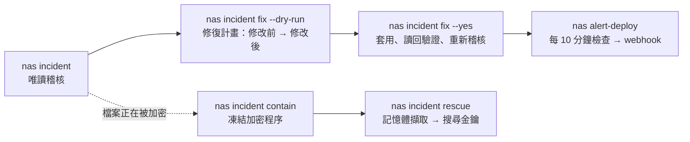

# synology-nas-cli

**一個指令檢查 Synology NAS 是否有 C3RB3R / `.L0CK3D` 勒索軟體攻擊活動相關的弱點，第二個指令把發現的問題修好，之後也能繼續從終端機管理 DSM。**

[English](README.md) · [繁體中文](README.zh-TW.md) · [简体中文](README.zh-CN.md) · [日本語](README.ja.md) · [한국어](README.ko.md) · [Deutsch](README.de.md) · [Español](README.es.md) · [Français](README.fr.md)

[](https://gitlab.com/aa22396584/synology-nas-cli/-/releases) [](LICENSE)

主儲存庫、版本發布與 Issue 回報：https://gitlab.com/aa22396584/synology-nas-cli


`nas` 是零外部相依性的 Python 命令列工具（僅使用標準函式庫，支援 Python 3.8+，因此也能直接在 DSM 本機上執行）與 stdio MCP 伺服器，支援 Synology DSM 7 Web API：系統狀態、健康度、日誌、套件、儲存空間、Tailscale、DSM 升級、定期健康檢查並推播警報至 Webhook，以及在 2026 年 10 月針對暴露於網際網路的 Synology NAS 之 C3RB3R / `.L0CK3D` 勒索軟體攻擊活動（Synology-SA-24:20、SA-26:13、SA-26:14）期間開發的資安事件稽核與修復工具。

本專案與 Synology Inc. 無關（Not affiliated with Synology Inc.）。"Synology"、"DSM" 與 "QuickConnect" 為 Synology Inc. 的商標。

## 交給 AI Agent 自動執行

把以下提示詞貼給 Claude Code、Codex、Cursor、Gemini CLI、OpenCode、Grok Bot 或任何支援工具呼叫的 AI Agent（Grok Bot 設定、技能與警報例行任務：[`docs/GROK-BOT.md`](docs/GROK-BOT.md)）：

```text
使用 https://github.com/akari-sora/synology-nas-cli 檢查並修復我的 Synology NAS（位址：https://192.0.2.10:5001），照著 docs/AGENT-RUNBOOK.md 的步驟執行。
```


### Agent 會依序執行的步驟

1. **安裝**：複製此儲存庫（或安裝套件）並驗證 `./bin/nas --version`。
2. **`nas setup`**：執行 `nas setup --json --no-input ...` 寫入 `~/.config/synology-nas-cli/config.json`（權限 `0600`），登入一次以驗證憑證，並在首次使用時釘選（pin）DSM 的 TLS 憑證 SHA-256 指紋。
3. **`nas doctor`**：執行 `nas doctor --json` 驗證設定檔、憑證、連線目標可達性、TLS 指紋釘選、登入、DSM 版本（比對 SA-26:13）、兩步驟驗證狀態、管理員權限與系統時鐘偏差。
4. **`nas incident`**：執行 `nas incident --json`（可選加 `--probe --scan`）對 DSM 版本、有弱點的套件、防火牆、QuickConnect、UPnP 路由器規則、公網連接埠、外部與失敗登入紀錄、AutoBlock、SMB1、內建 `admin` 帳號、快照排程、不支援機型的 WORM 鎖定陷阱、勒索訊息檔，以及 CVE-2024-10441 攻擊嘗試進行唯讀稽核。
5. **產生修復計畫**：執行 `nas incident fix --dry-run --json --ransom-scan`，顯示每一項預計變更（`before -> after`）、實際會發送的 DSM Web API 呼叫，以及對應的 DSM 網頁介面路徑。
6. **`nas incident fix --yes`**：依序套用核准的計畫（`snapshot_worm` → `snapshots` → `packages` → `smb_min_protocol` → `quickconnect` → `router_port_forwarding` → `autoblock` → `admin_account` → `firewall`，以及選用的 `--rotate-password` 與 `--upgrade`），逐項讀回設定以驗證結果，並重新執行一次稽核。
7. **選用的 `--deep` 與 `alert-deploy`**：執行 `nas incident --deep --json`（透過任務排程表執行一次性唯讀 root 收集腳本，檢查限 root 讀取的日誌、crontab、`/bin` 執行檔、帳號、SSH 金鑰與 `/proc`）以及 `nas alert-deploy --json --test`（每 10 分鐘執行健康度與安全性監控並推播至 Webhook）。

### 你沿途需要提供的資訊

1. **NAS 位址與帳號（一次）**：
   - DSM 網址（例如 `https://192.0.2.10:5001`，若有使用 VPN/Tailscale 可一併提供該網址）。
   - 管理員帳號名稱，以及其密碼來源（`op://VAULT/ITEM/password`、密碼指令，或作業系統鑰匙圈）。
   - 防火牆中要維持放行的區網／VPN 子網路 CIDR（例如 `192.0.2.0/24`）。
   - 選用的共用資料夾暫存路徑（例如 `/docker/.nas-cli-deploy`，供 `--deep` 與 `alert-deploy` 使用）。
2. **6 位數兩步驟驗證碼（若已啟用兩步驟驗證，僅需一次）**：
   - 當 `nas setup` 以結束碼 `3` 退出且回報 `"field": "otp"` 時，提供當下的 6 位數驗證碼；`--trust-device` 會儲存 DSM 的信任裝置權杖（權限 `0600`），後續指令即不需再輸入驗證碼。
3. **確認修復計畫**：
   - 在執行 `nas incident fix --yes` 之前檢視 `--dry-run` 計畫（並決定是否納入 `--rotate-password` 或 `--upgrade`）。

完整 Agent 執行規範：[`docs/AGENT-RUNBOOK.md`](docs/AGENT-RUNBOOK.md)。



## 檢查項目與修復內容

`nas incident` 為唯讀操作。每個項目會印出 `PASS`、`WARN`、`FAIL` 或 `SKIP` 以及一行提示（`--json` 會輸出結構化 JSON；結構定義見 [`schemas/incident.schema.json`](schemas/incident.schema.json)）。只要有任何項目為 `FAIL`，結束碼即為 `1`。

| 項目 | `nas incident` 回報內容 | `nas incident fix` 變更內容 |
|---|---|---|
| `dsm_version` | 若 DSM 版本組建低於該分支的 SA-26:13 修補版本，或位於沒有 SA-26:13 修補程式的分支（DSM 7.1 及更舊版本）則為 `FAIL`；已修補則為 `PASS` | 搭配 `--upgrade`：下載該機型最新的官方 `.pat`、執行 PreCheck、安裝並重新開機 |
| `sa_26_14_packages` | 比對已安裝套件與 Synology-SA-26:14（Calendar、MailStation、PHP 7.3–8.4）：若有弱點的版本正在執行則為 `FAIL`，已安裝但已停止則為 `WARN` | 停止正在執行的有弱點套件（`--only packages`） |
| `firewall` | 當防火牆關閉且 NAS 本身持有公網 IP（例如自行撥接 PPPoE）時為 `FAIL`；在 NAT 後方關閉時為 `WARN`；或當網路介面預設允許未比對流量、或規則允許任意來源（`source_ip: all`）時為 `FAIL`／`WARN` | 啟用防火牆，在區網介面上新增本機 `/32`（依 DSM 連線紀錄所示）以及 IPv4 `allowed_networks` 的允許規則，將所有非 `global` 介面的預設政策設為 `drop`，並移除允許任意來源的規則（`--only firewall`） |
| `quickconnect` | 當 QuickConnect 或 QuickConnect 自動路由器連接埠轉送啟用時為 `FAIL` | 關閉 QuickConnect 及其 UPnP 路由器連接埠轉送（`--only quickconnect`） |
| `router_port_forwarding` | 當 DSM 在路由器上啟用了 UPnP/NAT-PMP 連接埠轉送規則時為 `FAIL` | 停用所有由 DSM 管理的路由器連接埠轉送規則（`--only router_port_forwarding`） |
| `public_ports` | 僅在搭配 `--probe` 時執行：從本機對 NAS 公網 IP 上的 DSM 與檔案服務連接埠發起 TCP 連線測試（若有任何連接埠回應則為 `FAIL`） | 由 `firewall`、`quickconnect` 與 `router_port_forwarding` 處理 |
| `external_signins` | 當連線日誌包含來自 `allowed_networks` 以外來源位址的成功登入紀錄時為 `FAIL` | 無（請調查未授權存取；見 [`docs/INCIDENT-C3RB3R.md`](docs/INCIDENT-C3RB3R.md)） |
| `failed_signins` | 當過去 `--hours`（預設 `24`）小時內的失敗登入次數超過 `--failed-threshold`（預設 `20`）時為 `WARN` | 由 `firewall` 與 `autoblock` 緩解 |
| `autoblock` | 當 AutoBlock 停用時為 `FAIL` | 啟用 AutoBlock（`5` 分鐘內嘗試失敗 `10` 次即永久封鎖），並將本機 IP 與 IPv4 `allowed_networks` 加入允許清單（若 `incident.autoblock_allow_loopback` 為 true，亦會加入 `127.0.0.1`）（`--only autoblock`） |
| `smb_min_protocol` | 當 SMB 啟用且允許 SMB1（`smb_min_protocol=0`）時為 `FAIL`；當 SMB 關閉但最低通訊協定設為 SMB1 時為 `WARN` | 將最低 SMB 通訊協定調升為 SMB2（`smb_min_protocol=1`、`smb_max_protocol=3`）（`--only smb_min_protocol`） |
| `admin_account` | 當內建 `admin` 帳號處於啟用狀態（`expired: normal`）時為 `FAIL` | 確認另有其他啟用中的管理員帳號且目前工作階段並非 `admin` 後，透過暫時性 root 排程任務停用內建 `admin` 帳號（`--only admin_account`） |
| `snapshot_schedule:<share>` | 逐一檢查共用資料夾：若無快照排程、排程已停用，或最新的排程快照早於 `snapshot_max_age_hours`（預設 `26` 小時）則為 `FAIL` | 為尚無排程的共用資料夾建立每日快照排程（預設 `03:30`）與 14 天保留原則；需在同一次執行中通過乾淨的 `--ransom-scan`，或加上 `--i-know-snapshots-may-rotate`（`--only snapshots`） |
| `snapshot_worm:<share>` | 當機型的 `SYNO.DisasterRecovery.Retention info` 不支援 `worm`，卻啟用了不可變快照（WORM）鎖定時為 `FAIL`（DSM 會接受該 API 呼叫，但排程快照會從此靜默停擺） | 關閉受影響共用資料夾上不支援的 WORM 鎖定，讓排程快照恢復運作；保護條件與 `snapshots` 相同（`--only snapshot_worm`） |
| `ransomware_files` | 僅在搭配 `--scan` 時執行：透過 File Station 在共用資料夾中搜尋 `*.L0CK3D`、`*.LOCK3D` 與 `read-me3.txt`（若找到任何相符檔案則為 `FAIL`） | 無（需進行資安事件應變；見 [`docs/INCIDENT-C3RB3R.md`](docs/INCIDENT-C3RB3R.md)） |
| `exploit_attempts` | 掃描 DSM 連線日誌是否有 CVE-2024-10441 登入注入標記（`PLUGIN_VALUE_END`、`LD_PRELOAD=`、`LD_DEBUG_OUTPUT`）與 `incident.ioc_ips`（若發現嘗試紀錄則為 `WARN`） | 無（請搭配 `--deep` 檢查攻擊嘗試是否成功） |
| `exploit_attempts_logs`, `ioc_cron`, `ioc_binaries`, `ioc_users`, `ioc_ssh_keys`, `ioc_processes` | 僅在搭配 `--deep` 時執行：執行一次性唯讀 root 收集腳本，檢查 `/var/log/synoplugin.log*`、`/var/log/synoscgi.log*`、`/var/log/auth.log*`、crontab（`/etc/cron.d/synot*`）、`/bin/libgld`、`/bin/qnetd`、`/bin/l0ck.enc`、`xdy5*`、額外的 uid-0 或未知帳號、`authorized_keys`，以及 `/proc` 程序／連線（發現已知 C3RB3R 入侵跡象時為 `FAIL`，發現未知項目時為 `WARN`） | 無（需進行資安事件應變；見 [`docs/INCIDENT-C3RB3R.md`](docs/INCIDENT-C3RB3R.md)） |

`SKIP` 一定會附上原因：該項目需要特定旗標（`--probe`、`--scan`）、API 回傳錯誤，或該 NAS 未使用該功能（無 Btrfs／Snapshot Replication、DSM 中未設定路由器）。

## 安裝

### 從 Git 工作目錄直接執行（免安裝）

```bash
git clone https://gitlab.com/aa22396584/synology-nas-cli.git synology-nas-cli
cd synology-nas-cli
./bin/nas --help                     # runs directly from the checkout (Python 3.8+ stdlib only)
ln -s "$PWD/bin/nas" ~/bin/nas       # optional: put `nas` on PATH
```

### 使用 `pip` 從 GitLab Release 或本機工作目錄安裝

```bash
pip install https://gitlab.com/aa22396584/synology-nas-cli/-/archive/v1.0.0/synology-nas-cli-v1.0.0.tar.gz
# or from a local checkout:
pip install -e .                     # or: pipx install .
nas --help
```

### 在 Windows 上執行（使用 `py`）

```powershell
git clone https://gitlab.com/aa22396584/synology-nas-cli.git synology-nas-cli
cd synology-nas-cli
py -3 bin\nas --help
# or install the console script:
py -3 -m pip install -e .
nas --help
```

### 初始化並驗證登入

互動式或由 Agent 驅動的單步設定：

```bash
nas setup --origin https://192.0.2.10:5001 --user ops --password-source op:op://VAULT/ITEM/password --allowed-network 192.0.2.0/24
nas doctor
```

或者從範本建立設定檔並手動編輯：

```bash
nas config init                      # writes ~/.config/synology-nas-cli/config.json (mode 600)
$EDITOR ~/.config/synology-nas-cli/config.json
nas config show                      # effective config, commands masked
nas whoami                           # one login: account, admin flag, DSM version, credential source
```

## 選擇適合的環境設定

| 環境 | 後端（Backend） | 密碼來源 | 說明 |
|---|---|---|---|
| macOS 搭配 1Password | `password` | `op://VAULT/ITEM/password` 參照；透過 1Password App 登入 `op` | 首次使用時在 App 中核准 `op`。2FA 驗證碼從同一項目讀取（`op item get --otp`）。 |
| macOS 不使用 1Password | `password` | `nas login --save`（鑰匙圈），或 `password_command` = `security find-generic-password -s synology-nas -a USER -w` | `nas login` 同時會快取工作階段，後續指令不需再次登入。 |
| Linux 伺服器、cron、systemd timer | `password` | 1Password Service Account（`OP_SERVICE_ACCOUNT_TOKEN` 或 token 檔案）+ `op://` 參照，或 `password_command`（`secret-tool lookup ...`、`pass show ...`） | 無終端機環境：互動輸入提示會關閉，請設定非互動式密碼來源。 |
| Windows | `password` | 搭配 PowerShell 的 `password_command`（見 [Credentials](README.md#credentials)），或 `NAS_USER` + `NAS_PASSWORD` | 使用 CredentialManager PowerShell 模組（`New-StoredCredential`）儲存憑證，並在 `password_command` 中以 `Get-StoredCredential` 讀取。 |
| 在 NAS 本機上執行 | `local` | 無：透過 DSM 任務排程表以 root 身分執行 | 由 `nas alert-deploy` 自動設定，使用 DSM 內建的 Python 3.8。 |
| CI／無頭環境搭配 Service Account | `password` | `OP_SERVICE_ACCOUNT_TOKEN`（CI secret）+ `op://` 參照 | 或使用 `NAS_PASSWORD_COMMAND` 讀取 CI 機密儲存區；亦可使用 `NAS_PASSWORD`。 |

## 資安事件快速開始

```bash
nas incident                       # read-only audit
nas incident --probe               # also test the public address from this machine
nas incident --scan                # also search every share for ransom notes (minutes)
nas incident --deep                # also indicators of compromise via one read-only root script (needs deploy.stage_dir)
nas --json incident                # machine-readable

nas incident fix --dry-run         # the plan: every change (current -> new), the API calls, the DSM UI path
nas incident fix                   # same plan, asks before applying
nas incident fix --yes             # apply without asking
nas incident fix --only firewall,smb_min_protocol
nas incident fix --skip admin_account
nas incident fix --ransom-scan --yes          # a clean scan also allows the snapshot fixes
nas incident fix --upgrade --rotate-password --yes   # opt-in extras

nas incident contain                       # list processes that look like an encryptor (signals nothing without --yes / NAS_YES=1)
nas incident contain --yes                 # SIGSTOP them (all threads) so their memory and keys stay intact
nas incident contain --yes --stop-sync     # also stop Cloud Sync, Synology Drive, Hyper Backup, Container Manager
nas incident contain --yes --save-exe /volumeUSB1/usbshare/evidence   # copy each executable (sha256 recorded)
nas incident contain --release             # SIGCONT the frozen PIDs and start the packages --stop-sync stopped

nas incident rescue --yes --capture-dir /usbshare1/rescue                  # freeze, capture memory, recover key candidates
nas incident rescue --yes --capture-dir /usbshare1/rescue --sample /share/a.pdf.L0CK3D   # test each candidate on a copy
nas incident rescue --yes --capture-dir /usbshare1/rescue --decrypt-from /share/docs --decrypt-to /Volumes/USB/out
```

當檔案正在被加密時，第一個要跑的指令是 `nas incident contain --yes`：它會凍結加密程序（發送 `SIGSTOP`，絕不強制終止），讓工作階段金鑰保留在記憶體中，接著印出後續步驟。

- 候選程序：已知程序名稱（`libgld`、`qnetd`、`xdy5*`、`incident.ioc_process_names`）、位於 `/tmp`、`/var/tmp`、`/dev/shm`、`/volume*/@tmp` 的執行檔、以寫入模式開啟 `*.L0CK3D`／`read-me3.txt` 檔案的程序，以及位於 Synology 路徑之外的高 CPU 使用率程序（排除容器）。若程序的執行檔位於 Synology 路徑下（`/usr/syno`、`/var/packages`、`/bin` 等），除了開啟上述檔案外還需要另一項理由才會納入；掃描結果會將其列在 `skipped` 下，並附上可用來納入該程序的 `--pid` 參數。PID 1、核心執行緒，以及掃描腳本本身與其上層程序一律不會收到訊號（即使加上 `--pid` 亦同）。
- 凍結操作只會對掃描列出的同一個程序發送訊號：比對相同的 PID、啟動時間（`/proc/PID/stat` 第 22 欄）與執行檔路徑；若期間 PID 被其他程序重用，會回報並略過。
- `--stop-sync`：凍結程序後，會對正在執行的 Cloud Sync、Synology Drive、Hyper Backup 與 Container Manager（或 Docker）套件呼叫 `SYNO.Core.Package.Control stop`。停止 Container Manager 會一併停止所有容器。因此停止的套件 ID 會記錄在本機工作階段快取旁的 `contain-packages.json` 中。
- `--release`：對記錄在 NAS 上的 PID（`incident.contain_state_file`）以及任何指定的 `--pid` 發送 `SIGCONT`，接著對每個記錄的套件執行 `SYNO.Core.Package.Control start`；當所有套件皆啟動後即刪除紀錄檔。此步驟啟動的是套件而非單一容器：容器會在套件啟動時，依各自的重新啟動原則（Container Manager 中的自動重新啟動設定）恢復執行。

`nas incident rescue` 會使用 [soimy/c3rb3r-rescue](https://github.com/soimy/c3rb3r-rescue)（於執行時依 `incident.rescue_commit` 指定的 commit 下載）執行記憶體擷取與金鑰還原：

1. `contain`：執行上述凍結步驟（`--no-contain` 可略過）。
2. `toolkit`：複製救援工具組並核對 commit。若指定 `--rescue-dir DIR`，當 `git status --porcelain` 為空且 HEAD 位於該 commit 時會直接使用現有目錄（其他情況需加 `--force-unpinned-toolkit`）。
3. `capture`：在 NAS 上以 root 身分（透過暫時性任務排程表任務，或搭配 `--backend local` 直接執行），對每個凍結的 PID 執行工具組的 `capture_process_memory.py inspect` 與 `capture`，寫入 `--capture-dir` 下新建的案件資料夾。該資料夾必須位於 USB 外接硬碟或與受影響資料不同的磁碟區；磁碟區是以 `/proc/self/mountinfo` 中的掛載來源（mount source）比對（每個 Btrfs 共用資料夾都是獨立的 subvolume 且有各自的裝置編號，因此裝置編號無法區分不同磁碟區）；加 `--force-same-volume` 可寫入同一磁碟區。若 `--capture-dir` 路徑中含有符號連結則會拒絕執行。使用 `--backend password` 時，擷取工具會透過 `deploy.stage_dir` 上傳（若將工具直接內嵌於任務腳本中，DSM 會回傳 4803），且僅在檔案的 sha256 與上傳檔案相符時才會從 stdin 執行。隨後案件資料夾會移交給目前登入的 DSM 帳號（`id -u`、`chown`），以便透過 File Station 列出與下載。
4. `pull`：先檢查本機工作目錄的可用空間（需大於擷取資料的可讀取位元組數加上 256 MiB），再將擷取資料下載至本機工作目錄；使用 `--backend local` 時，會拒絕位於 NAS 系統分割區上的工作目錄。加上 `--keep-on-nas` 則會在完成擷取後停止。
5. `venv`：建立虛擬環境（Python 版本為 `incident.rescue_min_python`，即 3.11，或由 `--python` 指定），並以 `pip --require-hashes` 安裝工具組的相依套件：`nas/rescue.py` 中記錄了固定 commit 所需的 numpy 2.3.5、cryptography 50.0.2、cffi 2.1.1 與 pycparser 3.12 各 PyPI 檔案的 sha256；其他 commit 在加上 `--force-unpinned-toolkit` 時會略過雜湊檢查進行安裝。接著執行工具組的自我測試。
6. `keys`：對每份擷取資料執行 `recover_process_key.py`；找出的候選金鑰會以權限 `400` 存成檔案，絕不印出。若目標程序並非已分析過的加密程式，會在此處停止並回報 `ValueError: Executable does not match the reviewed sample profile`。
7. `sample`（`--sample NAS_FILE [--expected-sha256 HEX]`）：複製樣本檔案，並在副本上逐一測試每個候選金鑰。
8. `decrypt`（`--decrypt-from NAS_FOLDER --decrypt-to DIR`）：使用驗證通過的候選金鑰解密檔案副本（若未透過 `--sample` 驗證金鑰，加 `--force-unverified-key` 會使用第一個候選金鑰）。

`--force` 會同時啟用 `--force-same-volume`、`--force-unverified-key` 與 `--force-unpinned-toolkit`。

每個步驟都會記錄在 `<workdir>/state.json`（`--workdir`，預設為 `~/.local/share/synology-nas-cli/rescue/<time>`）；再次執行相同指令時會從上次中斷處繼續。此流程在 NAS 上寫入的項目如下：

- 案件資料夾 `--capture-dir/case-<time>-<random>/pid-N`（會保留；擁有者為登入的 DSM 帳號；確認擷取資料已安全備份至他處後即可刪除）。擷取工具是從 stdin（經雜湊驗證的位元組）直接執行，不會將工具副本寫入案件資料夾。chown/chmod 走訪目錄時會透過以 `O_NOFOLLOW` 開啟的檔案描述符操作，不會變動符號連結。在 DSM 共用資料夾的實測中，以權限 0700 建立的資料夾事後列出為 0755（檔案則維持 0400）；請檢查誰有權限讀取該共用資料夾。
- 使用 `--backend password` 時：上傳的工具檔 `deploy.stage_dir/nas-rescue-tool-<random>.py` 與結果檔 `deploy.stage_dir/nas-incident-rescue-<token>.json`（兩者皆會在執行後刪除），以及暫時性 root 任務 `nas-incident-rescue`（執行後刪除）。
- `contain` 步驟：暫時性任務 `nas-incident-contain` 及其結果檔（執行後刪除），以及凍結狀態檔 `incident.contain_state_file`（`/root/.nas-incident-contain.json`，由 `nas incident contain --release` 移除）。

JSON 結構定義：[`schemas/incident-rescue.schema.json`](schemas/incident-rescue.schema.json)。

若稽核結果顯示 `ransomware_files FAIL` 或 `external_signins FAIL`，代表情況已超出強化設定的範疇：請依照 [`docs/INCIDENT-C3RB3R.md`](docs/INCIDENT-C3RB3R.md) 處理（先隔離網路、保留證據、從快照還原）。

## `nas incident fix`

執行稽核、印出修復計畫並詢問確認（`--yes`、`NAS_YES=1` 或 `assume_yes: true` 會自動回答 yes；若無終端機且未指定上述選項，會以結束碼 3 退出並顯示 `Not applied: add --yes (or NAS_YES=1).`），接著依下列順序套用變更、逐項讀回確認，最後再執行一次稽核並印出 before -> after 對照。`--dry-run` 只會印出修復計畫與實際 API 呼叫，不會發送任何寫入請求。若任何變更失敗或最終稽核仍有 FAIL 項目，結束碼為 1。

執行順序：`snapshot_worm` -> `snapshots` -> `packages` -> `smb_min_protocol` -> `quickconnect` -> `router_port_forwarding` -> `autoblock` -> `admin_account` -> `firewall` -> `rotate_password`（選用）-> `upgrade`（選用，會重新開機）。

| 修復項目 | 變更內容 | DSM 網頁介面（手動路徑） | 原始 API 呼叫（`nas api ... --allow-write`） |
|---|---|---|---|
| `snapshot_worm` | 在不支援不可變快照的機型上關閉共用資料夾的不可變快照鎖定（保護條件與 `snapshots` 相同：關閉後該共用資料夾的排程會恢復建立快照） | Snapshot Replication > Snapshots > Settings（不支援的機型在介面上會隱藏此選項，因此只能透過 API 關閉）/ Snapshot Replication > 快照 > 設定 | `SYNO.DisasterRecovery.Retention set_worm_lock --version 1 type=Share name=SHARE worm_lock_enable=false worm_lock_day=7` |
| `snapshots` | 為尚無排程的共用資料夾建立每日快照排程（`incident.snapshot_hour:minute`），並僅在該共用資料夾尚無保留原則時設定依天數保留（`incident.snapshot_retain_days`，預設 14 天）。既有的排程（無論啟用與否）與既有的保留原則皆不會變動。需在同一次執行中通過乾淨的 `--ransom-scan`，或加上 `--i-know-snapshots-may-rotate`／`--force`：因為開始建立新快照後會套用保留原則，進而刪除最舊的快照 | Snapshot Replication > Snapshots > select the share > Settings > Schedule / Retention Policy (Snapshot Replication > 快照 > 設定 > 排程 / 保留原則) | `SYNO.Core.Share.Snapshot set_schedule --version 1 name=SHARE enable_snapshot_schedule=true 'schedule={...}' task_id=-1` 接著執行 `SYNO.DisasterRecovery.Retention set --version 1 name=SHARE type=Share policyType=64 retainDay=14 ...` |
| `packages` | 停止 SA-26:14 點名且正在執行的套件（請自行更新或解除安裝） | Package Center > Installed > package > Update or Stop (套件中心 > 已安裝) | `SYNO.Core.Package.Control stop --version 1 id=PHP7.4` |
| `smb_min_protocol` | 將最低 SMB 通訊協定設為 SMB2（僅支援 SMB1 的裝置將無法連線） | Control Panel > File Services > SMB > Advanced Settings (控制台 > 檔案服務 > SMB > 進階設定) | `SYNO.Core.FileServ.SMB set --version 3 smb_min_protocol=1 smb_max_protocol=3` |
| `quickconnect` | 關閉 QuickConnect 及其自動路由器連接埠轉送 | Control Panel > External Access > QuickConnect (控制台 > 外部存取 > QuickConnect) | `SYNO.Core.QuickConnect set --version 2 enabled=false`；`SYNO.Core.QuickConnect.Upnp set --version 1 enabled=false` |
| `router_port_forwarding` | 停用（而非刪除）DSM 透過 UPnP/NAT-PMP 管理的路由器連接埠轉送規則 | Control Panel > External Access > Router Configuration (控制台 > 外部存取 > 路由器設定)；請同時檢查路由器本身的管理頁面 | `SYNO.Core.PortForwarding.Rules save --version 1 'rules=[...enable:false...]' task_id_suffix=PF`，並輪詢 `save_status` |
| `autoblock` | 啟用 AutoBlock（5 分鐘內失敗 10 次）；將 DSM 日誌記錄的本機位址、IPv4 `allowed_networks` 加入允許清單，且僅在設定 `incident.autoblock_allow_loopback` 時一併加入 `127.0.0.1` | Control Panel > Security > Protection > Auto Block; Allow/Block List (控制台 > 安全性 > 保護) | `SYNO.Core.Security.AutoBlock set --version 1 enable=true attempts=10 within_mins=5 enable_expire=false expire_day=0`；`SYNO.Core.Security.AutoBlock.Rules create --version 1 type=allow block_days=0 overwrite=true 'ip=["127.0.0.1"]'` |
| `admin_account` | 停用內建 `admin` 帳號。會先檢查 CLI 目前是否以 `admin` 登入、貼上的 `NAS_SID` 工作階段使用的是哪個帳號（`SYNO.Core.Desktop.Initdata`），以及 `administrators` 群組中是否另有其他啟用中的成員；加 `--force-admin`（或 `--force`）可忽略上述檢查強制套用。由於從密碼登入的工作階段呼叫 `SYNO.Core.User set` 會回傳 105，此項目會透過暫時性任務排程表任務以 root 執行，完成後隨即刪除該任務 | Control Panel > User & Group > admin > Edit > Disable this account (控制台 > 使用者與群組) | root 任務腳本：`/usr/syno/bin/synowebapi --exec api=SYNO.Core.User method=set version=1 name='"admin"' expired='"now"'`（搭配 `--backend local` 時為：`SYNO.Core.User set --version 1 name=admin expired=now`） |
| `firewall` | 啟用防火牆；在區網（LAN）介面上新增允許規則（DSM 日誌記錄的本機 `/32` + IPv4 `allowed_networks`；僅在設定檔中無任何 LAN 介面時才會設於 `global`）；除 `global` 以外的所有介面（eth*、pppoe、ppp0、vpn、wlan0 等）預設丟棄未比對流量；移除允許任意來源的規則 | Control Panel > Security > Firewall > Edit Rules (控制台 > 安全性 > 防火牆 > 編輯規則) | `SYNO.Core.Security.Firewall.Profile set --version 1 'profile={...}' profile_applying=false`，接著執行 `SYNO.Core.Security.Firewall.Profile.Apply start --version 1 name=default profile_applying=false`，輪詢 `status task_id=...`，最後執行 `stop` |
| `rotate_password`（`--rotate-password`） | 為目前登入的帳號產生新的 24 字元隨機密碼。會先寫入憑證儲存區（透過 stdin 呼叫 `op item edit` 寫入 1Password 項目並在歷史紀錄保留舊密碼；或寫入系統鑰匙圈並將舊密碼備份至 `<store_service>-previous`），再變更 DSM 中的密碼；若 DSM 拒絕變更，會將舊密碼寫回儲存區；若 DSM 呼叫中途斷線，儲存區會保留新密碼。完成後會讀回並重新登入驗證，密碼絕不印出。僅支援寫入 1Password 或系統鑰匙圈；若密碼來自外部指令、環境變數或互動輸入，請手動在 DSM 與該來源中變更 | Personal > Account > change password (個人 > 帳號) | `SYNO.Core.NormalUser set --version 2 password=... old_password=...` |
| `upgrade`（`--upgrade`） | 下載最新官方 `.pat`、上傳、執行 PreCheck 並安裝；NAS 會重新開機 | Control Panel > Update & Restore > Manual DSM Update (控制台 > 更新與還原) | `nas upgrade --yes` |

**防火牆防自鎖檢查。** 在變更防火牆設定前，CLI 會檢查並在計畫中列出以下情況：是否為該連線目標設定了 HTTP(S) Proxy；連線目標是否為 loopback 位址（SSH 隧道、本機 Proxy）或公網位址；該帳號在 DSM 連線日誌中最新一筆成功登入的來源是否為 loopback、IPv6 或公網位址；或者日誌記錄的登入來源位址與本機連往 NAS 所使用的本機位址不同（經過 NAT、Proxy，或該筆登入來自其他裝置）。只要任一檢查未通過，防火牆變更就會暫緩並等待 `--force-firewall`（或 `--force`），加上後會在計畫備註中保留檢查結果並套用。允許清單會包含 DSM 日誌所記錄的位址。套用後，CLI 會立即透過同一連線目標從頭重新登入一次；若登入失敗，會印出救援步驟：使用區網內的另一台電腦、Synology Assistant／find.synology.com、Tailscale userspace 模式（DSM 看到的來源為 `127.0.0.1`，實測中不受防火牆過濾），以及機身 RESET 鍵（Mode 1）。IPv6 的允許清單項目不會寫入規則，因此 IPv6 來源會被丟棄。`100.64.0.0/10`（Tailscale）同時也是電信商 CGNAT 在 WAN 端使用的網段：在自行撥接 PPPoE 的 NAS 上，若於 `global` 設此允許規則會讓同電信商的其他用戶也能連入，因此規則只會放在區網（LAN）介面上。

**持有公網位址的 NAS**（自行撥接 PPPoE，或位於 DMZ 區）前方沒有路由器 NAT：此時 DSM 防火牆是所有 DSM 服務與網際網路之間的唯一防線。此外，即使位於 NAT 後方，QuickConnect 與 UPnP 連接埠轉送仍會將 DSM 對網際網路開放。

## MCP 伺服器與 Agent 技能

### MCP 伺服器（`nas mcp`）

`nas mcp` 會在 stdio 上執行 Model Context Protocol 伺服器（JSON-RPC 2.0；協定版本 `2025-11-25`、`2025-06-18`、`2025-03-26`、`2024-11-05`），提供 15 項工具：`setup`、`doctor`、`whoami`、`status`、`health`、`net`、`services`、`logs`、`alert`、`incident_audit`、`incident_fix`、`pkg_list`、`volume_list`、`tailscale_status` 與 `api_read`。

```bash
claude mcp add synology-nas --scope user -- /path/to/synology-nas-cli/bin/nas mcp
claude mcp add synology-nas --scope user -- /path/to/synology-nas-cli/bin/nas mcp --auto-confirm
```

當呼叫帶入 `confirm: true`，或在以 `--auto-confirm` 啟動的伺服器上未指定 `confirm` 時，`incident_fix` 會實際套用修復計畫；`confirm: false` 則一律為預覽模式（dry run）。`NAS_YES` 與 `assume_yes` 不會影響 MCP 呼叫。`setup` 工具會填入設定檔尚未設定的欄位，並接受 `op:`、`keychain` 與 `env` 憑證來源；若要修改已生效的設定值（來自設定檔、`NAS_ORIGINS` 等環境變數，或伺服器的 `--lan-origin`），包含 `origins`、`user`、`password_source`、`otp_source`、`tls`、`allowed_networks`、`stage_dir` 或 `webhook_file`，以及 `command:` 憑證來源，則須在命令列執行 `nas setup`（MCP 工具會回傳結束碼 2 並指出該欄位名稱）。內建預設值（`tls` 的 `pin`、`otp_source` 的 `op`）不視為已設定；公網 `allowed_networks` 項目須從命令列新增。諸如 `user`、`descr`、日誌 `text`、`cmdline` 與檔案名稱等欄位，其文字內容是由發送登入請求或在 NAS 上執行程序的一方所決定。

完整工具清單、Schema，以及 Claude Code、Claude Desktop、Cursor 與 Codex 的設定方式：[`docs/MCP.md`](docs/MCP.md)。

### Agent 技能安裝器

[`skills/`](skills/) 資料夾包含 [`skills/synology-nas/SKILL.md`](skills/synology-nas/SKILL.md) 與 [`skills/synology-ransomware-response/SKILL.md`](skills/synology-ransomware-response/SKILL.md)。可將它們安裝至現有的技能目錄（`~/.claude/skills`、`~/.cursor/skills`、`~/.codex/skills`、`~/.agents/skills`、`~/.grok/skills`、`~/.gemini/skills`、`~/.config/opencode/skills`、`~/.hermes/shared-skills`）：

```bash
./skills/install.sh                  # symlink skills into detected agent folders
./skills/install.sh --copy           # copy instead of symlink (--dry-run, --uninstall also available)
```

在 Windows PowerShell 上：

```powershell
.\skills\install.ps1                 # supports --copy, --dry-run, --uninstall
```

## 警報與 Webhook

`nas alert` 會執行一次所有健康度與安全性檢查，當有項目達到 warning/critical 等級時以結束碼 1 退出。每筆檢查結果的格式為 `{level, code, kind, message}`。搭配 `--push FILE` 時，只會將自上次成功推播後發生變化的內容 POST 到 FILE 中的 `{"url", "header"}`：新發生的異常狀態、持續存在的 warning/critical 項目每 24 小時一次提醒、每一筆事件、已解除的項目，以及每天一次的心跳（heartbeat）。各警報代碼、POST 內容格式與接收端範例見 [`docs/ALERTS.md`](docs/ALERTS.md)。

三種執行方式：

1. **在 NAS 本機上自動設定**：`nas alert-deploy` 會將程式碼複製到限 root 存取的資料夾（`deploy.root_dir`），在任務排程表建立每 10 分鐘執行一次 `nas --backend local alert --push` 的 root 任務，並將 DSM 內建的通知 Webhook（Control Panel > Notification > Webhooks（控制台 > 通知設定 > Webhook））指向同一個網址。
2. **在 NAS 本機上手動設定**：在 DSM 網頁介面手動完成上述三個部分。詳細步驟見 [`docs/ALERTS.md`](docs/ALERTS.md#manual-install-on-the-nas)。
3. **從另一台常駐開機的機器執行**：使用 cron 或 launchd 搭配 `password` 後端執行 `nas alert --push ...`。見 [`docs/ALERTS.md`](docs/ALERTS.md#from-another-machine-cron--launchd)。

接收端：任何接受帶單一標頭之 JSON POST 的 HTTPS 端點（通用 JSON 接收端）、每次收到 POST 就啟動一次 Agent 執行的聊天機器人「例行任務（routine）」Webhook（如 Grok Bot），或完全不使用 Webhook：DSM 內建通知（電子郵件、透過 DS finder／Synology App 發送的行動推播）已涵蓋 DSM 本身的警告／錯誤事件。三種方式皆說明於 [`docs/ALERTS.md`](docs/ALERTS.md#receivers)。

## 會修改 NAS 狀態的操作

- 會修改 NAS 的指令：`incident fix`（會先詢問，或加 `--yes`）、`incident contain`（加 `--yes` 時發送 `SIGSTOP`；`--stop-sync` 會停止套件；`--release`）、`incident rescue`（會先詢問，或加 `--yes`：凍結程序、暫時性 root 任務、擷取資料夾）、`upgrade`（未加 `--yes` 時仍會上傳 `.pat` 並執行 PreCheck，隨後刪除上傳檔案；加 `--yes` 才會安裝）、`pkg start|stop|install|uninstall|default-volume VOL`、`volume atime`、`tailscale login-url`、`alert-deploy`、`login --save`／`logout --forget`（僅修改本機鑰匙圈）、`trust --reset`（僅修改本機檔案），以及搭配 `--allow-write` 的 `api`。`ransom-scan`、`incident --scan` 與 `incident fix --ransom-scan` 會在 NAS 上建立暫時性的 File Station 搜尋任務（完成後會停止並清除）。`nas api` 需搭配 `--allow-write`、`--yes` 或 `NAS_YES=1` 才會發送非唯讀的方法。
- `--yes`、`NAS_YES=1` 與設定檔中的 `assume_yes: true` 會自動同意 CLI 的所有確認提示：`incident fix` 會套用修復計畫（搭配 `--upgrade` 時會安裝 DSM 並將 NAS 重新開機，即使 PreCheck 帶有提示訊息亦同；搭配 `--rotate-password` 時會變更密碼）；`upgrade` 會在 PreCheck 後安裝並將 NAS 重新開機；`incident contain` 會凍結候選程序（搭配 `--stop-sync` 時會停止套件）；`incident rescue` 會執行各救援步驟；`api` 會發送寫入方法（如同加上 `--allow-write`）。`nas mcp` 則是依每次呼叫的 `confirm` 參數與啟動時的 `--auto-confirm` 決定，不受上述設定影響。
- `incident fix --dry-run` 會印出將會發送的每一個寫入呼叫。修復計畫一定會顯示 current -> new（修改前 -> 修改後）的數值。
- 密碼、SID 與 SynoToken 絕不會印出。`nas api` 會印出原始 DSM 輸出內容（可能包含序號與帳號名稱）；其他指令則會過濾這些資訊。
- 每次密碼登入失敗都會計入 AutoBlock 次數；CLI 一旦遇到登入失敗只會回報一次並立即停止。
- `alert-deploy` 會在共用資料夾之外的限 root 資料夾中安裝以 root 身分於 NAS 上執行的程式碼。

## 設定檔、憑證、TLS、連線後端與完整指令參考

關於 `~/.config/synology-nas-cli/config.json` 的所有設定鍵值與環境變數、密碼與 2FA 驗證碼來源鏈（1Password `op`、外部指令、作業系統鑰匙圈、環境變數、終端機互動輸入）與首次連線 TLS 憑證指紋釘選（TOFU）、三種連線後端（`password`、`chrome`、`local`），以及完整的 CLI 指令與參數速查表，請參閱英文版 README 的對應章節：[Configuration](README.md#configuration)、[Credentials](README.md#credentials)、[Backends](README.md#backends) 與 [Command reference summary](README.md#command-reference-summary)。

### 文件索引

- [`docs/AGENT-RUNBOOK.md`](docs/AGENT-RUNBOOK.md) — 供 AI Agent 依序執行的步驟規範（`setup` → `doctor` → `incident` → `incident fix` → `--deep` → `alert-deploy`）。
- [`docs/INCIDENT-C3RB3R.md`](docs/INCIDENT-C3RB3R.md) — 2026 年 C3RB3R / `.L0CK3D` 勒索軟體攻擊活動公開事件說明、資安通報、時間軸、入侵指標（IOC）、判斷步驟、復原與防範措施。
- [`docs/HARDENING.md`](docs/HARDENING.md) — Synology DSM 資安強化檢查表，附出處說明、英文／繁體中文 DSM 網頁介面路徑，以及對應的 `nas` 指令。
- [`docs/TROUBLESHOOTING.md`](docs/TROUBLESHOOTING.md) — 防火牆／AutoBlock／2FA 封鎖救援、Mode 1 重置、反向代理與 Tailscale `127.0.0.1`、不支援 WORM 的機型、Google Drive 每日 750 GB 配額限制、SMB1 裝置、DSM API 錯誤碼、「已是最新版本」分支陷阱，以及重設 TLS 憑證釘選的解決方法。
- [`docs/MCP.md`](docs/MCP.md) — MCP 伺服器工具清單、參數、JSON Schema 與用戶端設定方式。
- [`docs/GROK-BOT.md`](docs/GROK-BOT.md) — Grok Bot：在 Bot 的雲端電腦（透過 Tailscale）或安裝了 Grok Bot App 的電腦上執行 `nas`、技能設定、警報例行任務 Webhook 與 Bot 角色設定說明。
- [`docs/ALERTS.md`](docs/ALERTS.md) — 警報代碼、Webhook 內容格式、接收端與部署方式（`alert-deploy`、手動設定 DSM 任務、cron/launchd）。
- [`docs/DSM-API-NOTES.md`](docs/DSM-API-NOTES.md) — `nas` 所依賴的 DSM 7 Web API 細節行為與參數編碼規則。
- [`docs/EXIT-CODES.md`](docs/EXIT-CODES.md) — CLI 與 MCP `_meta.exit_code` 結束碼定義（`0`–`7`、`130`）。
- [`schemas/`](schemas/) — `incident`、`incident-fix`、`incident-contain`、`incident-rescue`、`alert`、`status`、`health` 與 `whoami` 的 JSON Schema。
- [`llms.txt`](llms.txt) — 供 LLM Agent 讀取的入口索引檔。

## License

MIT, Copyright (c) 2026 Akari Sora. See [LICENSE](LICENSE).
